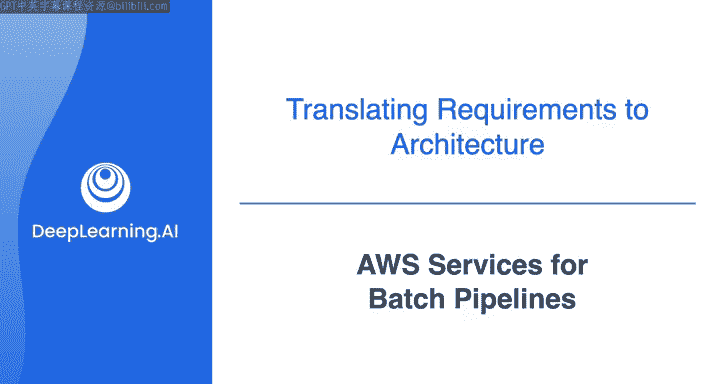
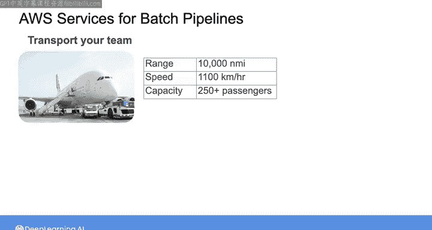
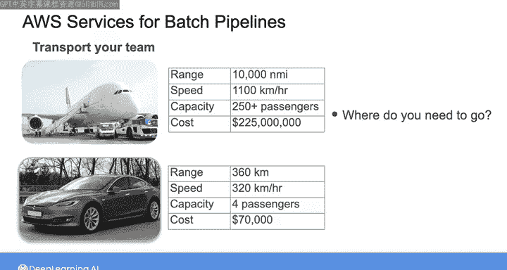
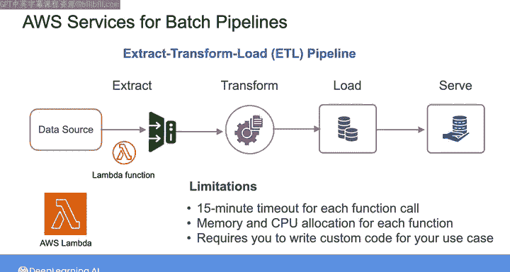
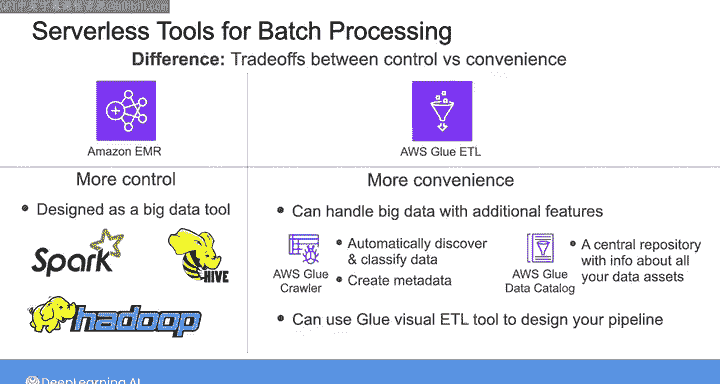
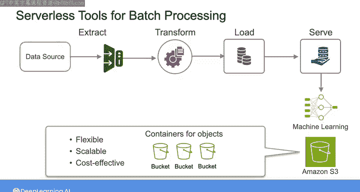

# 吴恩达《数据工程（导论，源系统、数据摄取和管道，数据存储和查询｜1-2-3课）｜DeepLearning.AI Data Engineering》 - P72：74_AWS批处理管道服务.zh_en - GPT中英字幕课程资源 - BV1wTtWeeEH5

All right， so you've talked with stakeholders and gathered your system requirements now it's time to translate those requirements into tool and technology choices for your system。

There are many ways to combine different cloud tools and services together to form solutions so in the process of converting system requirements to actual data systems。

 you need to be familiar with what different services can be used for I think Joe actually illustrates this point well in his book with the example of choosing a vehicle for the purpose of traveling from one place to another so imagine for a moment if instead of a data system you were tasked with solving the problem of transporting all of the members of your data team from one place to another which of these two options would be the best choice so first you have a jumbo jet which provides a range of 10。

000 nautical miles top speed of 1100 kilometers per hour capacity for 250 plus passengers and a cost of 225 million and next you have a Tesla Model S with a range of 360 kilometers top speed of 320 kilometers per hour room。

For four passengers and a cost of around $70000。 So which of these vehicles would you choose to transport your team？

 Well， that's pretty clearly a ridiculous question。 Of course。

 you would need to have a clear sense of your requirements In this case。

 like where do you need to go if it's New York to Paris， maybe you do need the plane。 Also。

 how big is your team。 if instead， you're only going from New York to Boston with four people。

 maybe the Tesla would work。 But what if you're in a hurry， do you need a helicopter。

 or if you're on a tight budget。 maybe four bicycles。 Okay， well。

 I think you get the point In addition to requirements for your system。

 you need to be familiar with the technologies you have to choose from What they can be used for and how you can combine them to do what you need to do。

So for the data system you'll be working with this week。

 it looks like there's going to be a batch component and a streaming component。In this video。

 I'll walk you through the basics for some of the AWS services that can support batch workloads on AWS and then in the next video we'll look at AWS services that can support streaming workloads。

 As you saw last week a common approach to batch data processing is what's known as an extract transform load or ETL pipeline In this week's exercise you'll need to ingest data from a source system。

 apply some transformations to get it into the format that your data scientist needs then load it into storage and provide them access to it So in this case。

 the ETL paradigm seems like a fit The data you'll be ingesting is tabular data So let's assume that the source system you'll be working with is Amazon relational database service or RDS for short As Joe mentioned earlier in the course Datas are a very common source system you'll be working with as a data engineer and in general。

 you aren't in control of the source system So we won't spend time here on comparing different source systems。

Vtabular data Instead， we'll assume the choices you need to make are in the downstream components for the next steps of ingestion and transformation。

 there are a number of different approaches you could take。 For example。

 you could simply spin up an E C2 instance and write a bunch of scripts to connect to the database。

 ingest and transform the data。 Then send it on storage somewhere。 This could certainly work。

 but keep in mind what Joe said about avoiding undifferentiated heavy lifting with an E2 based approach。

 you'd be responsible for installing software， managing security and all the complexity that comes with deploying a server on the cloud。

 So in this case， creating your own custom solution for a relatively straightforward ETL pipeline might not be the best use of your time。

In the comparison of serverless， traditional server and container options for services。

 Joe's recommendation was to look at serverless tools first， and then if you can't get what you need。

 consider container and server options。I would agree with that advice and so let's take a look at the serverless options you have in this case AWS Lambda was one of the first and remains one of the most popular serverless tools on AWS Well Lambda functions you can have code run in response to a trigger or event and for your ETL pipeline this week you could certainly consider using a Lambda function to extract data from the source system apply transformations and send it on storage However。

 Lambda functions come with limitations。 things like a 15 minute timeout for each function call and limitations around memory and CPU allocation for each function among others which might mean you need to break up your task into smaller chunks to stay within these limitationsBeyond that writing Lambda functions requires you to write custom code for your use case which in this case again might not be the best use of your time in terms of serverless tools that are specifically for batch processing of data there are two services。

I'd like to talk about these are Amazon Glue ETL and Amazon EMR serverless in some sense。

 you could say that there is a fair amount of overlap between the kinds of things these two services can be used for and really it may come down to the nuances of your specific project that determine which tool can best serve your needs but at a high level the difference between the two comes down to the tradeoffs between control versus convenience simply put EMR serverless gives you more control over what you can do while glue ETL provides a more convenient experience but let's dig into the details of it so you can see what I mean by that EMR was designed as a big data tool that supports a wide range of frameworks like Apache Spark and Apache hive so if you're part of a team doing a petabyte scale analytics maybe using Hadoop or requiring the flexibility to incorporate your own custom components then EMR or EMR serverless might be the right choice Glu ETL can also handle。

Big data workloads， but the real advantages are the additional features you have access to。

 For example， when you connect to a source system， gluelu uses something called crawlers。

 which automatically discover and classify data creating metadata in the process including things like table definitions and schemas this metadata is then used to populate the glue data catalog which is a central repository containing information about all of your data assets with this information about your data now in your data catalog。

 you can use the glue visualual ETl tool to design your pipeline using a graphical interface in the AWS management console that will automatically generate the spark code you need to run in your pipeline When you run your pipeline。

 the service will maintain the glue data catalog to track the transformations you apply and that catalog can be used downstream to more easily integrate with other AWS services There are other options you could consider for building the ingestion and transformation portion of your ETL pipeline on AWS。

But those are the main options I wanted to share with you in the reading item after this video。

 you'll find more details about the services we've touched on here as well as others。

 when it comes to the storage and serving aspects of the batch pipeline you're working with this week your choice would depend mainly on what downstream use case you're serving。

 For example， if you're ingesting normalized tabular data。

 then applying transformations to model it in a star schema for analytics。

 then one option you could choose would be to store and serve it in another Rds instance。

 or if you wanted to run complex analytical queries on massive data sets。

 and take advantage of other features that data warehouses offer。

 you could choose to store and serve the data in Amazon Redshift。

 which is a powerful data warehouse solution。 albeit at a significantly higher cost than RDs this week。

 you'll be serving a machine learning use case where the data will be used for training a recommender model when you're downstream data consumer is another technical data professional who's planning to manipulate the。

Data and incorporate it into their own systems oftentimes the best and cheapest storage and serving option is object storage on Amazon S3。

Out in the real world for data systems built on AWS。

 it's relatively common for S3 to serve as a sort of staging area like this， because S 3 is flexible。

 scalable and relatively cost effective。 It allows you to store virtually any kind of data that easily integrates with other AWS services。

 in S 3， you store data in buckets， which are containers for objects。 when building data pipelines。

 you may have multiple S3 buckets that are used throughout different stages of your pipeline depending on the task at hand。

 All right， Well， I could say a lot more about all the services we've looked at here。

 But at this point， I think you've got what you need in terms of information for this week's exercise。

 in the next video， we'll take a look at streaming tools。 I'll see you there。😊。

