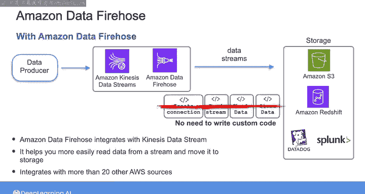

# 吴恩达《数据工程（导论，源系统、数据摄取和管道，数据存储和查询｜1-2-3课）｜DeepLearning.AI Data Engineering》 - P73：75_AWS流处理管道服务.zh_en - GPT中英字幕课程资源 - BV1wTtWeeEH5

In the last video， you learned about some of the AWS services you have to choose from when it comes to building batch pipelines。

In the lab this week， in addition to a batch component。

 your system will also have a streaming component So in this video we' look at streaming services on AWS as you've learned from Joe。

 streaming data could be coming to you from a number of different sources these could be IoT devices or clickstream data from a website or mobile app your streaming source could even be a database in the sense that you could be continuously streaming any changes or updates to the data in the database through a process called change data capture or CDC and just like for batch data processing one way you could potentially ingest streaming data would be to spin up an EC2 instance and write some custom scripts to perform CDC or connect to whatever other streaming source then transform the data and send it downstream to wherever it needs to go just like with batch processing this EC2based approach means you'd be responsible for installing software managing security and all the complexity that comes with deploying a server on the cloud。

So following the same ideas we discussed with batch processing。

 you could also consider Lambda functions as a serverless option to create your own streaming system but again this comes with writing custom code for whatever you need to do and the potential limitations of Lambda for your particular use case on top of that interacting with streaming sources can be more complex than running batch workloads and so I can say that you probably shouldn't build your own custom streaming solutions with EC2 or Lambda unless you are 100% certain that your use case cannot be solved with existing open source or managed tools so let's take a look at some of the AWS services that can support streaming workloads First up is Amazon kinisesis data streams this is a popular AWS service that enables realtime data ingestion the way it works is that you have data producers that are sending data to Kisesis data streams and this could be log data from web servers data from IoT devices or。

Exreme data as a few examples。 kinesis itself is not picky about the type of data that you send。

 Its data agnostic。 So you can send Json XMl structured or unstructured data to a data stream。

 The data gets posted to the stream by the producers and then data is stored in kinesis for a configurable amount of time。

 The default and minimum retention time is 24 hours， but it could also be extended。

 The stored data can then be pulleded by consumers of the data stream。

 Multi consumers can pull the same data and process it in different ways。

 It's common for kinesis consumers to either take the data and place it somewhere else。

 such as a storage service or data warehouse or consumers might be performing some realtime analysis of the data that is passing through the stream。

 These consumers could be software applications that are pulling data from the stream and processing it。

 and that application could be running on compute services like E C2 or Lada。 Apart from kinesis。

 Another option you have is Amazon。age streaming for Apache Kafka otherwise known as MSK MSK is a service that provides much of the same functionality as kinisesis data streams。

 Apache Kafka itself is an open source streaming platform that is a popular choice for many different streaming use cases。

 MSK is a fully managed service that makes it easier to build and run applications that use Apache Kafka to process streaming data。

 MSk runs open source versions of Kafka， which is useful because any existing applications。

 tooling or plugins from the Apache Kafka community are supported。

 The way MSk works is that you first create an Apache Kafka cluster and the MSk service manages the heavy lifting of provisioning and operating the nodes that run Kafka for you。

 This allows you to avoid that undifferentiated heavy lifting and focus more time on your customized application logic。

 then you as the user interact with what's called the Kafka data plane that MSk manages for you to create topics。

 produce and consumed data。Data producers and data consumers then connect to the cluster to send and receive messages both Kinisesis's data streams and MSK can scale up to handle petabytele data volumes coming from multiple data sources with millisecond latency which enables realtime processing and analytics when it comes to choosing one versus the other。

 just like when it comes to choosing between similar tools for other aspects of your data systems it will depend on your use case but at a high level you could think of this again as a tradeoff between control and convenience if you brand new to data streaming architectures。

 Kinisesis is often recommended for its relative user friendliness and reduced operational overhead On the other hand。

 if you're already running a Kafka cluster or maybe you have existing Kafka technical experience in house or if you're looking for a higher degree of flexibility and control then MSK might be the better choice with regard to the use case of reading the data from a stream and storing it somewhere else the next。

Ser I want to tell you about is Amazon data Firehose for a little context on why the data Firehose service exists in the first place。

 it turns out that Kisesis came first as a service for streaming data systems and AWs realize that a lot of users of Kisesis's data streams were simply taking the stream data and storing it in S3 or somewhere else but to work with Kisesis in this way。

 you need to write custom code that creates the connection with the data stream reads the stream chunks the data and then stores it to make that whole process easier AWs created the Amazon data Firehose service which can integrate with Kisesis's data streams and is designed to allow you to get data from a stream and store it in a destination like S3 or redshift or send it to HttP endpoints or thirdparty service providers such as datadog or Splunk the main takeaway with data Firehose is that it helps you more easily read data from a stream and move it to storage without needing to write custom code or create any。

Difficult integrations yourself Beyond Kisesis's data streamams。

 Data Firehose also integrates with more than 20 other AWS sources to ingest streaming data。

 including MSK and others， as with all the other AWS cloud topics we've discussed in this course so far there is a lot more to know when it comes to streaming resources and services but I think you have what you need now。

 so it's time to get hands on with these services yourself。

In the upcoming quiz， you will determine which services to use for the batch and streaming components of the data pipeline for the product recommendation system you've been looking at throughout this course。

Then after that， Joe will walk you through the lab exercise for this week where you'll implement this batch and streaming pipeline。

 have fun and I'll see you in the next course。

