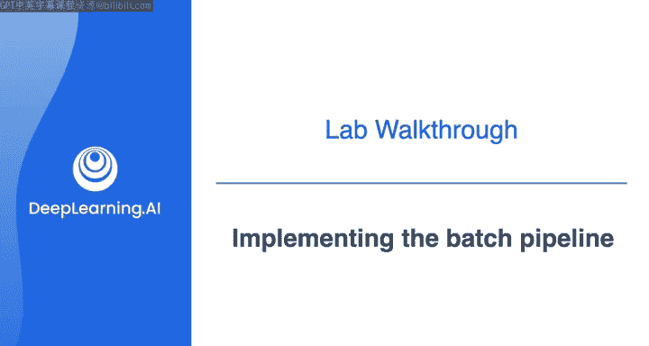
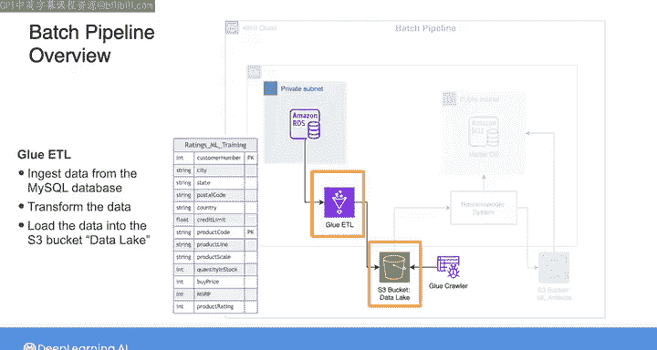
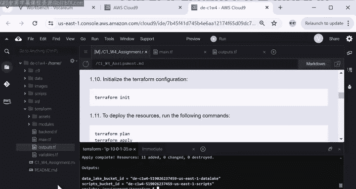
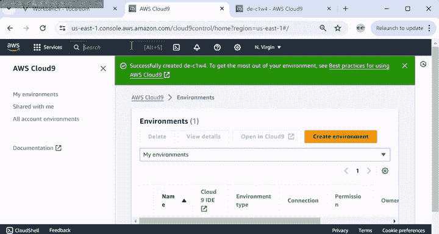
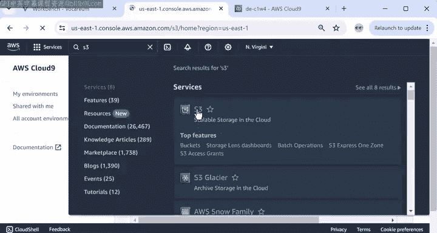
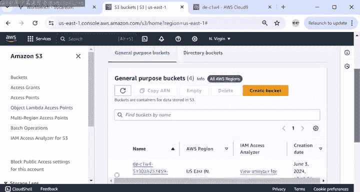
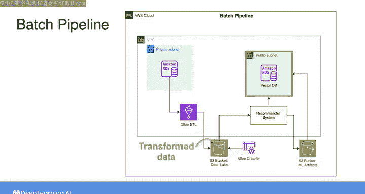

# 吴恩达《数据工程（导论，源系统、数据摄取和管道，数据存储和查询｜1-2-3课）｜DeepLearning.AI Data Engineering》 - P74：76_实验演练：实现批处理管道.zh_en - GPT中英字幕课程资源 - BV1wTtWeeEH5

Now that you've watched the conversation with the data scientist and explored your architecture choices and the quizzes。

 it's time to implement the batch and streaming architectures for the recommender system。

 you will first implement the batch pipeline to serve training data to the data scientist for training a recommender system。

 Then you'll set up a vector database to store the output embeddings of the recommender system。

 and finally， you'll implement the streaming pipeline that uses the trained recommender system and the vector database to output product recommendations for a user given their online browsing activities。

 The lab contains detailed instructions showing you how to create the resources using terraform and how to interact with them in the command line terminal。

 Don't worry if you don't completely understand the details。

 The main goal of this lab is to help you get familiar with the batch and streaming components of a data pipeline on AWS。

 Here's the architectural diagram of the batch pipeline。

 The first section of the lab focuses on this part of the architecture which transforms the data and makes it ready to be used for training。

 similar to the lab you saw in week2。 here。Provided with an RDs Mysql database that contains the classic models data and an additional table that consists of the ratings assigned by the users to the products they bought These ratings will represent the labels for the training data and the recommender system will be trained using a supervised machine learning model behind the scenes to prepare the data for the training phase youll use AWS glue ETL to ingest the data from the MysqL database and then transform the data into this form Finally。

 you'll store the transform data into this S3 bucket labeled as data lake you will create the glue ETL and the S3 bucket using Terraform Following the lab setup instructions I created this cloud9 environment and download the detailed instructions of the lab Let's start by exploring the ratings table provided in the source database to connect to the source database we need to know its end point。

I'll copy this command from the lab instructions and paste it in the terminal here。

 replacing MySQL DB name with D E， C1 W4 RDS， and then running the command。

This will return the database endpoint Next， I'll connect to the database using the Mysql command。

 The host is the endpoint I just got from the previous command。

 The database username is admin and the password is admin PWRD。

 Now that the connection is established， I'll choose the classic Model database to view the tables inside。

You can see that there's an additional ratings table。

 Let's check the contents inside this table by running this query。

 which returns the first 20 rows of the tables。 Each row consists of the customer number。

 the product code， and the product rating。Once you're done exploring the database。

 you can type Ex to quit the connection to the database。

You'll learn more about connecting and working with databases in Co2。In the next part of the lab。

 I'll use terraform to create the resources for the batch pipeline。

 including glue ETL and the S3 bucket， first I need to insult terraform in this environment。

The Scripps folder contains a script labeled set do SH that includes these shell commands for installing terraform and defining some environmental variables for terraform。

The script also contains commands for installing Postgres SQL。

 which you'll use to set up the vector database later in the lab。To run these commands。

 I'll copy the statement。And paste it in the terminal。After the packages are installed。

 I'll change my working directory to theterraform folder。Before running  Terraform。

 let's quickly check out the structure of this folder on the left。

 I'll click on Terraform and then on modules。In this lab。

 the resources needed for each part of the lab or are grouped in the folders or modules。

 so if I click on ETL， you can see the terropro files for glue and the S3 buckets。

When you organize your terraform files into modules。

 you will need to declare these modules in the main terraform file to find outside the modules so you can pass in values to any input variables and use any output values from the module within the main file。

 there's a section that declares the ETL module， which contains a link to the module and some values that are passed to its input variables along comment the section by removing the number sign in each row。

 or you can also use the shortcut。Control slash or a command slash to uncomment the entire section all at once。

Make sure to save the updates to the file。 Next， I'll edit the outputs Sarah from file and uncomment the section that declares the output variables of the ETL module。

 namely the ID of the S3 bucket data lake If you uncomment the first line here。

 make sure there's no space before the ETL comment。

You'll get a deeper understanding of these various tower from files in course2。

After saving the updates， I'll go back to the detailed instructions。In the terminal。

 I'll typeterraform in it。Then terraform plan。And finally， terraform apply。

Terrraform will always prompt for confirmation before creating the resources。

Once the resources have been created， you can see the output files。

Now， let's learn the glue job that will transform the data into the desired form。

 If you're curious to see what the script for this glue job looks like。

 you can open the terraform folder。Click on assets。

And then glue underscore job to check out the Python strip that contains the transformation logic。

 I'll go back to the instructions and copy this command and paste it in the terminal to start the glue job。

You can check the status of the glue job by writing this command。

 I'll replace the job run I D with the I returned by the previous command。

So the current status is still running， but if you wait a few minutes。

 the status will change to succeeded。We'll get further into the details of AWBS gluelu in Cose4。

Now let's check that the S3 bucket Data lake contains the training data。

In the console， I'll type S3。Click on that service。

And then choose the bucket that has data lake in its name。

Here you can see a folder labeled as ratings underscore ML underscore training。

 which contains additional folders each associated with a customer number。In object storage。

 this way of organizing the data is called partitioning。

 and it helps you quickly locate information that's related to any customer。So up to this point。

 we've transformed the ratings data into a format that can be used to train the recommender system in the next video walk through。

 we'll take a look at the next part of the lab where you'll set up a vector database to sort the outputs of the recommender model。

