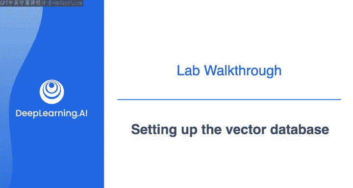
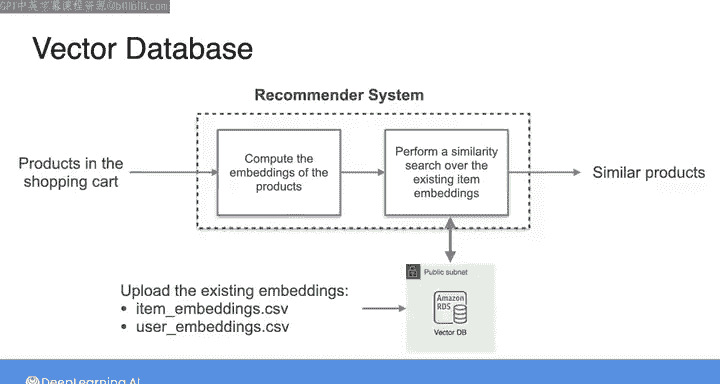
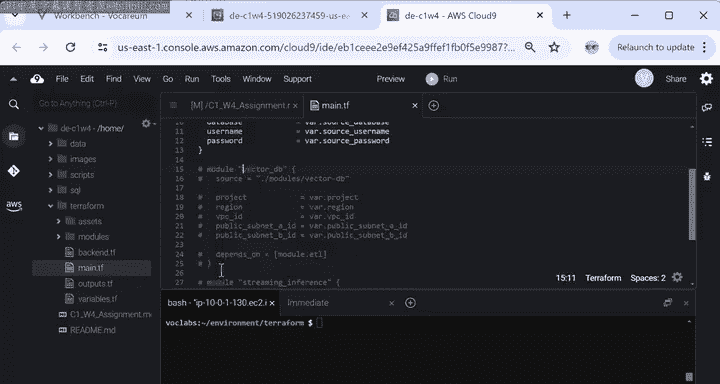
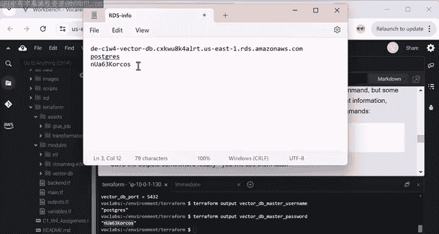
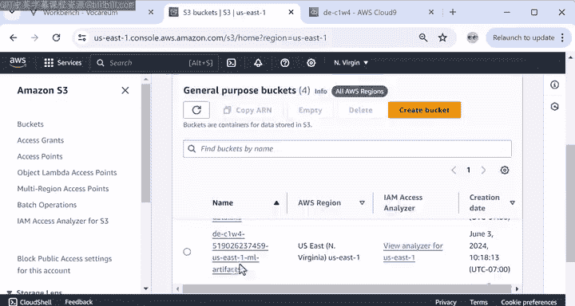
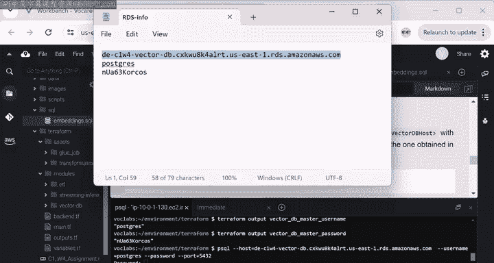
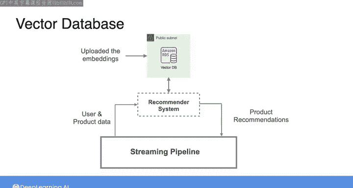

# 吴恩达《数据工程（导论，源系统、数据摄取和管道，数据存储和查询｜1-2-3课）｜DeepLearning.AI Data Engineering》 - P75：77_实验演练：设置向量数据库.zh_en - GPT中英字幕课程资源 - BV1wTtWeeEH5

In this video， walk through， we'll go through section 2 of the lab where you'll set up a vector database that will sort the outputs from the recommender model。

 Let's go back to the architectural diagram of the batch pipeline。 Now。

 we have the transform data stored in the S 3 bucket data lake。

 which is shared with the data scientist so that they can use the data to train the recommender system。

 In this lab， you won't train the recommender system yourself。

 as that would be the job of the data scientist。 But instead。

 you'll be provided with a model that is already trained。

The output of the model is shared in the S3 bucket labeled as ML artifacts。

So let's start section 2 of this lab by checking out the contents of the Ctry bucket。In the console。

 I'll go back to the list of the available buckets and then choose the bucket that has ML artifacts in its name。

You can see that the bucket has three folders， embeddings， models and scalrs。

 The embedding folder contains the embeddings of the users and items。

 meaning products that were generated by the model。

 The model folder contains the train model that will be used for inference。

And the Scalars folder contains the objects that were used in the preprocessing part of the training。

For now， let's just focus on the embeddings。 If you click on that folder， you will see two CSV files。

 one for the items or products and another one for the users。

Those embeddings will be used by the model to find what products recommend for a given user so。

 for example， the item embeddings will be used to retrieve similar products to the ones that a user has placed in the shopping cart。

The recommender model will first compute the embedding vectors of the products in the shopping cart。

 then itll perform a similarity search over the item embeddings to find similar products。

The data scientist ask you to upload the item embeddings CSV and user embeddings CSV files into a vector database to make retrieving similar products more efficient。

 so let's go through the steps for creating the vector database and uploading the embeddings。

Following the instructions in section 2， I'll open up the main do TF file and uncomment the section that declares the vector Db module。

 then in the outputs TF file'll alone comment the output variables of the Spec DB module when you create this database。

 these output files like the database username， password。

 host or endpoint will be returned to you so that you can use them to establish a connection to the database。

Make sure to save your updates to the main and outputs files Now we can create the resources associated with the Spector database in the terminal I'll runterraform and it。

Thenterraform plan。And finally， terraform apply。After you confirm that you want to create these resources。

 it might take around seven minutes to create the Postgres SQL database， by the way。

 Terraform will not overwride any resources that were earlier created。

 it will keep them and focus on creating the new resources。Once the database is created。

 you will be able to find the host name or endpoint。

 Since I need this information to connect to the vector database。

 I'll copy this link and paste it in a separate note for later。

I also need the password and the username， but they are Marcus as sensitive。

So I'll have to run these commands from the lab instructions and copy the password and the username to a separate note。

Now let's add the embeddings to the vector database。

 I'll click on the SQL folder on the left and then open up the SQL file here you can find some SQL instructions that transfer the item and user embeddings from the ML artifact as3 bucket to the vector database。

In this file， you need to specify the name of the bucket。Let's go to the console。

Go to the list of buckets。

And then copy the entire name of the ML artifacts bucket， then in the SQL file。

 let's paste the name of the bucket in these two select statements。Make sure to save the file。

Now you'll need to connect to the vector database and then execute the SQL statements。

To connect to the database instance， I'll copy this command from section 2 of the lab instructions。

 then replace the host with the host name of the database that I kept aside from earlier。

You'll be prompted to enter the password， so again， just use the one that you set aside。

 It will look like you did not type anything， but when you hit enter， the password will be read。

Now， to work at a particular database name Postgres， I'll run this command in the terminal。 Again。

 you'll be prompted to enter the password。 so just use the same one from the previous instructions。

Now to run the SQL statements from the embedding SQL script， I'll run this command in the terminal。

Then I'll run this command to see all the available tables。

 I'll scroll down using the arrow key to find the tables containing the embeddings。

 Then type Q to exit。When you're done， you can quit the connection by typing/lash Q。

Now that we've set up the vector database and uploaded the model embeddings to it in the next video。

 I'll walk you through the streaming pipeline portion of this lab that will be used to pass user and product data to the recommender system。

 then pass the product recommendations into an S3 bucket。 I'll see you there。

