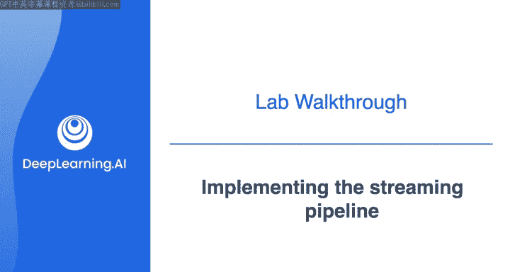
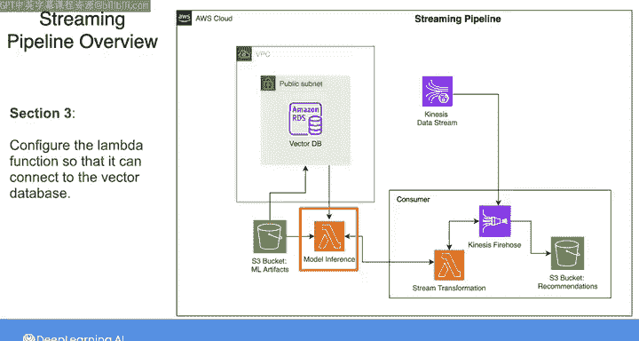
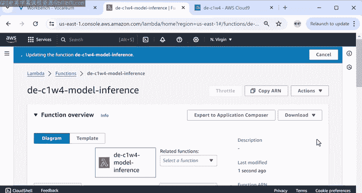
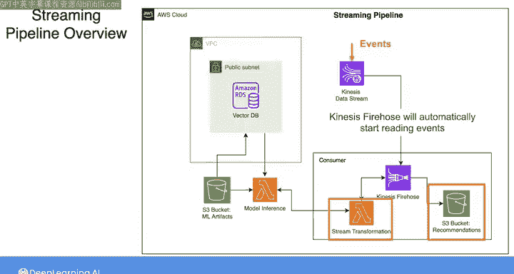
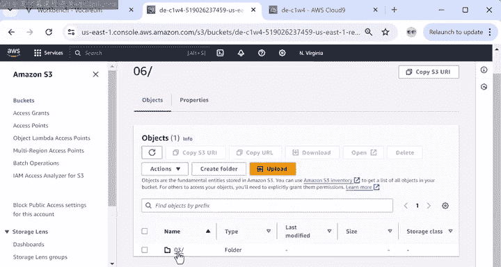
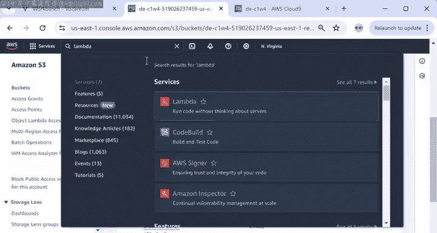
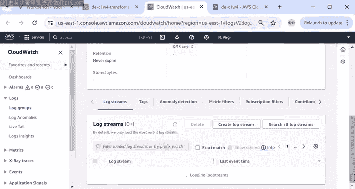
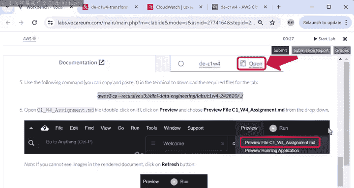
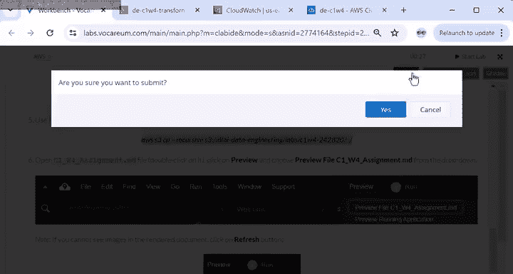
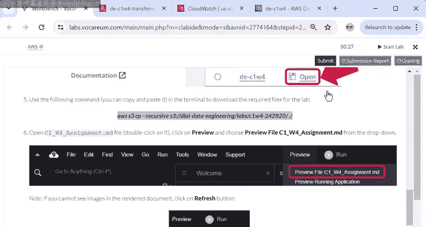

# 吴恩达《数据工程（导论，源系统、数据摄取和管道，数据存储和查询｜1-2-3课）｜DeepLearning.AI Data Engineering》 - P76：78_实验演练：实现流处理管道.zh_en - GPT中英字幕课程资源 - BV1wTtWeeEH5

As a reminder， by the end of the last video， we had trained a recommender system and a vector database ready to be used in the streaming pipeline for generating and storing product recommendations。

 Here's the architectural diagram of the streaming workflow。On the left side。

 you can see a Lambda function labeled as model inference。

 This Lambda function will use the trained model stored in S3 and the embeddings from the vector database to provide the recommendations based on the online user activity。

 Here's how it works。 AWS kesis data streams will receive the online user activity from the sales platform logs。

 Kesis data Fire hose will then read the events from the kinesis data streams and accesss of livery service to load the data into the S3 bucket labeled as the recommendation bucket before it loads the data into S 3。

 Kesis data Firehose will invoke the Lambda function labeled as stream transformation to extract the user and product features from the data streams and then pass these features to the Lambda function model inference to get the recommendations。

 Kinesis data Fire hose will finally load the recommendations to the S3 bucket recommendations。😊。

The model inferences Lambda function is already implemented and provided to you。

 but its configuration is not complete。 So before implementing the streaming workflow。

 you'll need to follow the instructions in section 3 of the lab to configure the environmental variables in the Lambda function so that it can connect to the vector database for that。

 we will again need the database host username and password。

 which I have already set aside in a separate note from the previous video in the console。

 I'll open up the Lambda service。 then choose the Lambda function that has model inference in its name。

 I'll scroll down and click on the configuration tab。 Then at the left。

 I'll choose environmental variables and click on edit here， I'll paste the database host。

 password and username that I previously set aside and don't forget to save these updates。😊。

Finally， we can follow the instructions in Section 4 to implement the streaming pipeline in the main dot T F file。

 I'll un this final section that declares a streaming module。

 I'll do the same thing in the outputs file。

Then I'll run the threeterraform commands，terraform in it。Terrform plan。And terraform apply。

This should create the kinesis fire hose， the recommendations S 3 bucket and the stream transformation Lambda functions。

Note that  Terraform will not create Kinesis data streams because it's already provided to you as one of the lab resources。

When you start the lab， a process will run into the background and will automatically stream some events to the Kinisesis data streams。

 After you create the streaming pipeline， Kisesis data fire hose will automatically start reading the events from Kinisesis data streams Invoke the Lambda function to transform the data into recommendations and finally transfer these recommendations through the S3 bucket。

 You will learn more about the underlying design of Kisesis data streams in course 2。

 for the final task in this lab。 Let's take a look at the contents of the S 3 bucket In the console。

 search for S 3。😊。

Then choose a bucket that has recommendations in the same。Inside this bucket。

 youll find that the data is partitioned by year， month， day， and hour。

Again， partitioning helps S3 locate specific data more quickly。

You can also check the logs of the transformation Lambda functions。In the console， search for Lambda。

And then click on the transformation Lambda。I'll click on the Monit tab then on View CloudW Los。

These are the logs of the function generated while it was performing transformation。

So now it's your turn to try this lab， make sure to follow the lab instructions carefully and revisit these videos if needed。

 Once you've completed all the tasks in the lab， don't forget to submit the lab on the lab Se up instructions page。

Keep in mind that the lab environment will expire after two hours。Again。

 don't worry if any of the lab steps are not completely clear for you。

 you'll develop a deeper understanding of the tools in future courses。

After that， I'll see you back here to wrap up this course。

