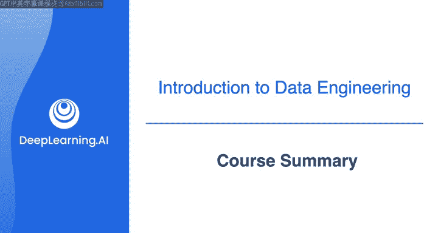
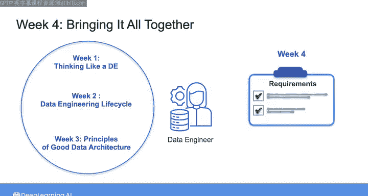
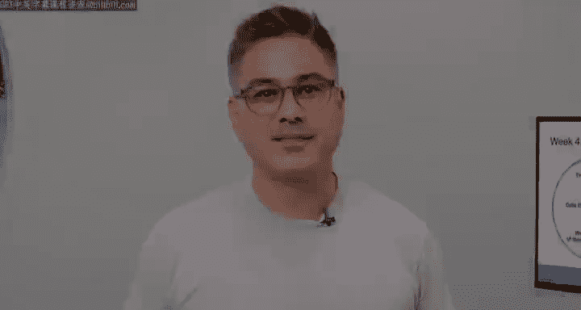

# 吴恩达《数据工程（导论，源系统、数据摄取和管道，数据存储和查询｜1-2-3课）｜DeepLearning.AI Data Engineering》 - P77：79_第1课程总结.zh_en - GPT中英字幕课程资源 - BV1wTtWeeEH5

Congratulations on finishing this first course in the data engineering specialization with this course you have completed some really important steps on your way to becoming a successful data engineer in the first week of this course we looked at the big picture I talked a little bit about the history of data engineering and how we got to where we are today。

We looked at a definition of data engineering and the data engineering lifecycle and we concluded that first week with a framework for thinking like a data engineer。

 which you can use as a reference as you go from gathering requirements to the implementation of your data systems In the second week we took a deep dive into these stages of the data engineering lifecycle from data generation and So systems to ingestion。

 storage， transformation and finally serving data for end use cases like analytics。

 machine learning and reverse ETO we also looked at the undercurrents of the data engineering lifecycle。

 including security data management， data ops， data architecture。

 orchestration and software engineering I know that this was a lot of theory。

 but I've seen many data engineers tried to design data architectures without understanding this highlel mental framework and in many of these cases it's led to broken data systems security breaches。

Worse。And now that you understand this framework you'll see how the stages of the data engineering lifecycle and its undercurrents help guide your work as a data engineer in these upcomingcu courses in the third week we focus on data architecture and the principles of building good data architecture。

 you'll revisit these principles as you make architecture decisions in the future courses。

 we wrapped up in this fourth week by bringing it all together where you went from gathering requirements from various stakeholders to implementing a product recommendation system if you're feeling a little overwhelmed at this point that's completely okay we covered a lot in this course and in some sense it was more theory than practice so it's understandable if you feel like you suddenly have a whole lot of new knowledge but aren't completely sure how to apply it yet。

But not to worry the next three courses in the specialization are all about applying the fundamentals youve learning in this course。

 so join me in the next course of this specialization to get hands on experience with So systems。

 data ingestion and data pipelines I'll see you there。

