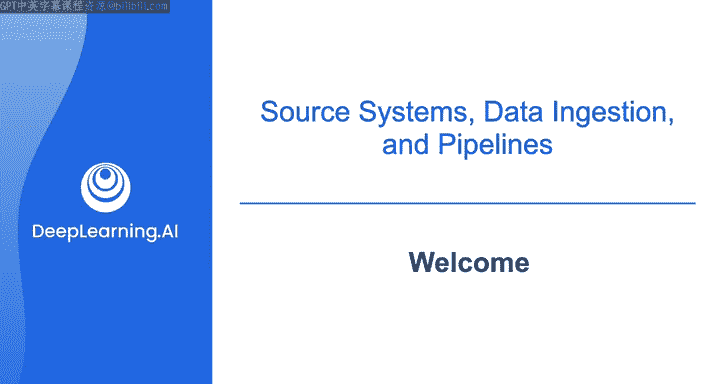

# 吴恩达《数据工程（导论，源系统、数据摄取和管道，数据存储和查询｜1-2-3课）｜DeepLearning.AI Data Engineering》 - P78：0_欢迎来到第2课程.zh_en - GPT中英字幕课程资源 - BV1wTtWeeEH5

Welcome to the second course of the data Engine specialization in the first course you got a high level overview of the field of data engineering。

The principles of good data architecture and how to translate stakeholder needs into requirements and tooling for your data systems。

 In this course， you learn more about ingesting data from source systems as well as data ops and the orchestration of end to end data pipeline。

I'm here again with your instructor Joe Vis who is also co-author of the bestsel fundamentals of data engineering Joe we can say a little bit about what learners will see in this course Sure thing Andrew。

 so this course， as you said， includes a focus on the first two stages the data engineering lifecycle。

 which are data generation and S systems and data ingestion from thoseOAR systems。

So we'll start by taking a look at different types of source systems。

 maybe things like databases or object storage and streaming systems and we'll get into the details of how you'll interact with these source systems in your work as a data engineer After that we'll look at ingesting data from So systems as well as the data ops and orchestration aspects and building data pipelines That sounds great and you know for so AI systems the data engineering or the data ingestion is like 80% of the work and in the machine learning modeling is maybe 20% of the work but people's attention on these two topics is often flipped where 80% of the attention is on AI modeling and not enough attention and best practices and tools frankly is on the data ingestion In fact for some of my early work when I was at a very large tech company I was responsible for the company's user data warehouses and so every piece of data to touch an individual user was supposed to come into my。

Data warehouses and that created a lot of value for the company。

 but that intellectual work to design the database， the database schema， the ingestion system。

 the data also maintain it that turned out to be you know pretty massive undertaking It is a massive undertaking I've always found that when we're talking about ingesting data from source systems。

This is everything。 if you can't get the data， there's not much else you can do with it so that should seem simple enough。

 but as you point out， it feels like a lot of times ingestion is ignored or focus on other things and so this is a fundamental thing you need to do get correct and you can't get the data。

You can't really do anything else so in this part of the course we'll definitely be talking about understanding the source systems from which you're going to get your data。

 different ways of ingesting it as well as different ways of orchestrating these data pipeline workflows and monitoring them to make sure that you're preserving data quality as well as ingestion performance and other characteristics etc cea。

 very important to your work as a data engineer and in fact I find this to hold true for many different data workflows from the structure tablet data to as the web processes more unstructured data like text and images this seems to have stayed the same and in fact even when I chat to my friends training the large language models and it comes to telling leading AI teams。

A lot of the time， not all but a lot of the time is actually spent you thinking about the data and then some also on the model training。

 but the data ingestion occupies so much time for all of these AI workloads it's really interesting I guess what are they seeing in terms of the complexities with ingesting data I imagine it working at a very massive scale Yeah I think things like there is actually a lot of internet data So things like common C has a lot of data but given the data。

 how do you ingest it， process it screen it to be high quality and then also if you have gaps in the data。

 if you notice your model it does want these topics。

 how do you figure out where it doesn't do quite as well on and then where on earth you go to get data if it even exist to fund those gaps So these are a lot of the intellectually challenging things I find people on the ground training even some of the largest O's large multimodal models and other large foundation models spend time worrying about that's fascinating。

And one of the things we're talking about in this course and that you'll be learning about is ingesting data from multiple types of source systems so obviously we're going talk about ingesting tabular data。

 but that's such a small subset of the total data universe these days when we're talking about unstructured data sets from text all the way to images and video this is increasingly becoming a much bigger universe and I would say be traditionally use thought about in the data world so one of the things we'll be covering in this course again is not just structured data sets from datas but we're also getting into working with text image data and so forth so that help you prepare as a data engineer。

 not for the workloads up today maybe if you're working in data warehouse but for the workloads of the future most of the value of data has probably been structured data up to this point but as our ability the process unstructured data grows well see of that shifts maybe is already shifting and the volume of unstructured data in the world is much data than volume ofstructured。

In the world so I think this would be even more challenges and even more jobs for data engineers exactlyact so hopefully it's gonna to be a very exciting introduction to the data engineering lifecycle again ingestion from source systems orchestrating these workloads and monitoring these workloads is so critical to your orchestra data engineer and again as Andrew pointed out it's only going to get more interesting more exciting and much bigger so lots of exciting things let's go on to the next video to dive into all of these topics。

😊。