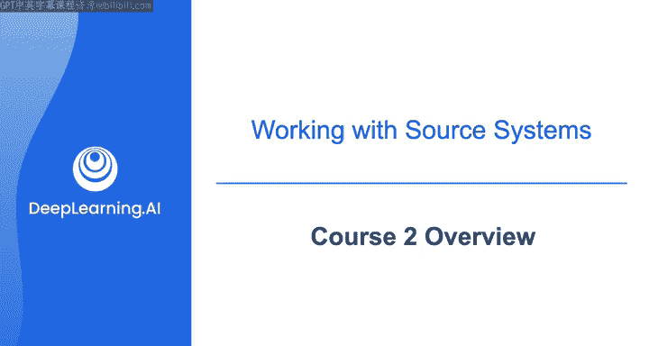
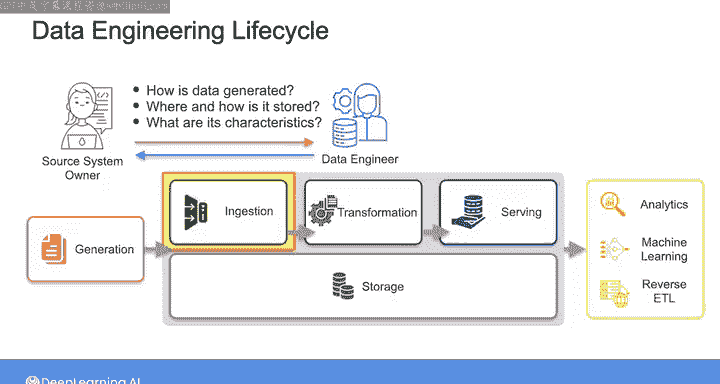
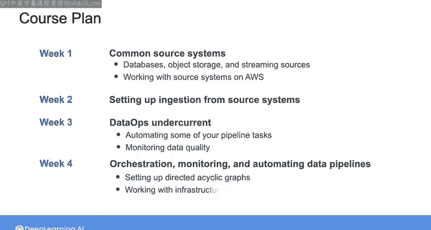

# 吴恩达《数据工程（导论，源系统、数据摄取和管道，数据存储和查询｜1-2-3课）｜DeepLearning.AI Data Engineering》 - P79：1_第2课程概览.zh_en - GPT中英字幕课程资源 - BV1wTtWeeEH5

Welcome to week one of this course on So systems ingestion and data pipelines this week we're going to get started by looking at different types of source systems and how you can interact with these systems as you saw in the first course of the specialization。

 data generation and So systems is the first stage of the data engineering lifecycl and as a data engineer you are typically not responsible or generating this data yourself or maintaining the source systems but ingestion from So systems is where all your data pipelines will begin so it's important that you understand how this data is generated。

 where and how it's stored and some of its characteristics so that you can build robust data pipelines or these upstream systems as your data source and so in this first week of this course will dive into some of the details of some common source systems including the different types of databases。

 object storage and streaming sources in the labs you'll get to work with these So systems on AWS then in the second week。

focus on setting up different types of ingestion from S systems after that and week three of this course we'll take a look at the data ops undercurren you'll use infrastructure as code to automate some of your pipeline tasks and you'll use various tools to monitor data quality and then finally in the fourth and final week of this course we'll get to orchestration to coordinate the tasks in your data pipelines you'll be setting up directed acyclic graphs or daAgs using airflow working with infrastructure as code frameworks and implementing monitoring solutions for your data pipelines so we're going to cover a lot of ground in this course。

Join me in the next video to get started with a closer look at the different types of So systems。

