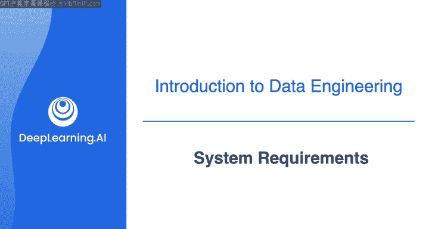
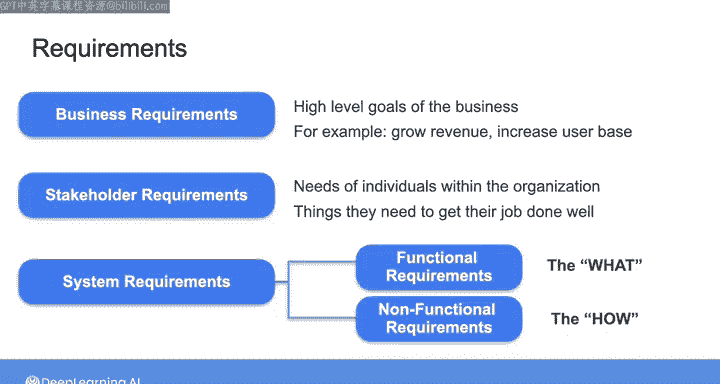
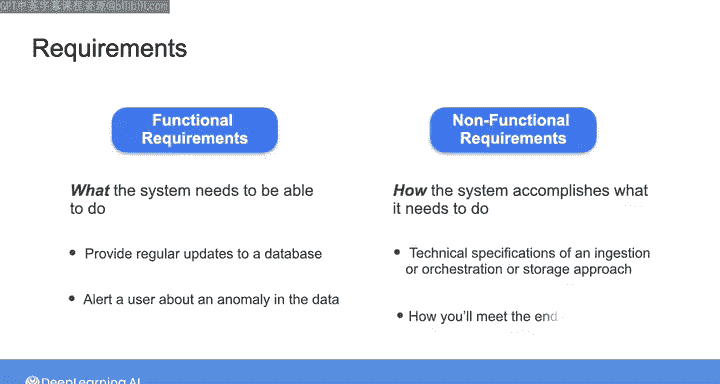
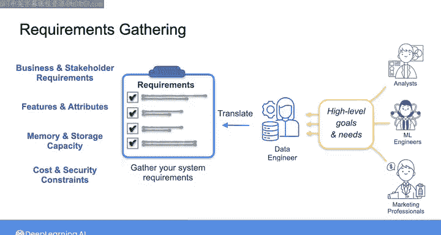
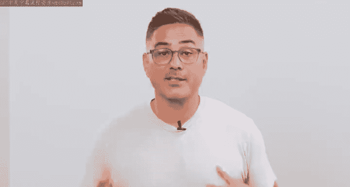

# 吴恩达《数据工程（导论，源系统、数据摄取和管道，数据存储和查询｜1-2-3课）｜DeepLearning.AI Data Engineering》 - P7：6_系统需求.zh_en - GPT中英字幕课程资源 - BV1wTtWeeEH5

The way to be sure you're delivering value for stakeholders is first understand their needs and then translate those needs into requirements for the systems you build。

And so before we start writing any code or spinning up resources on the cloud。

 I'd like to spend some time talking about what it means to gather requirements for your system。

 First off， the word requirements can mean a number of different things in the context of business and engineering。

 you can have business requirements for example， that define the highlevel goals of the business。

 business requirements might broadly include things like growing revenue or increasing the user base stakeholder requirements on the other hand。

 or the needs of individuals within the organization。

 namely those things they need to get their job done well。

 when it comes to data engineering or software development in general。

 engineers need to define system requirements that describe what a system needs to be able to do in order to meet the business and stakeholder requirements。

 system requirements are often split into two categories， functional and non-functional requirements。

 which you can think of loosely as the what and the how requirements for your system respectively。

So functional requirements or the what， meaning those things that the system needs to be able to do and the context of data engineering these might be things like providing regular updates to a database that serves analytics dashboards or alerting a user when there's an anomaly in the data by contrast you can think of nonfunctional requirements is how your system will accomplish what it needs to do this could include things like technical specifications for instion orchestration or storage that you plan to use within your data pipelines to meet the end user' needs and so to build any data system you need to start with a set of requirements for that system these could include everything from highle business and stakeholder requirements to features and attributes of the data products to provide right down to the memory and storage capacity you need for your computation and database resources you'll also have cost constraints as well as security and regulatory requirements to consider so the first and most important step in any data engineering project is to gather the requirements。

For your system。In general， those requirements will come from your downstream stakeholders。

 those that hope to achieve the goals as a result of your work the problem is your stakeholders will most often not be speaking to you in the form of concrete system requirements instead what they have on their minds or business goals and is your job to figure out how to translate their needs as you really to the business schools into the requirements for your system requirements gathering is going to look a little different for every system you build but this process always starts with having conversations with your stakeholders the way you go about having these conversations will vary depending on the stakeholders' technical level when it comes to data and data systems and the role within the organization。

In the next video， I'll introduce you to my friend So Shiti。

 who has held the role of a data executive at many large companies。

She'll share some advice for new data engineers and how to communicate with different stakeholders who have different technical backgrounds Then you'll hear from Jordan Morrow。

 who is known as the godfather of data literacy， having built one of the world's first data literacy programs。

He'll share some suggestions for how to go about requirements gathering when talking to different stakeholders both of these videos are optional and you won't be assessed on the contents of these conversations so if you'd like feel free to skip ahead to the video after that where we'll look at what requirements gathering might look like in the scenario we drop you into at the beginning of this week you're a new data engineer at Ecommerce Company and the data scientist need your help。

