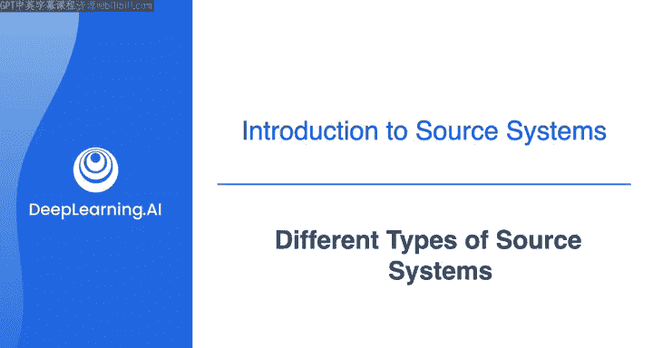
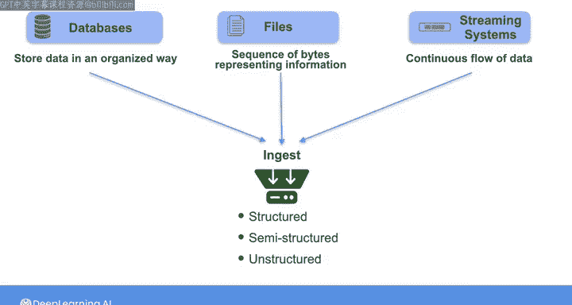

# 吴恩达《数据工程（导论，源系统、数据摄取和管道，数据存储和查询｜1-2-3课）｜DeepLearning.AI Data Engineering》 - P80：2_不同类型的源系统.zh_en - GPT中英字幕课程资源 - BV1wTtWeeEH5

The specific source systems you'll work with as a data engineer will often vary depending on what kind of data you're ingesting from those systems the most common type of data you'll work with is structured data。

 which is to say data organize as tables of rows and columns chances are you've worked the structured data in the past whether that was in a spreadsheet or relational database or maybe even using Python to read a CSV file the other types of data you'll encounter as a data engineer or a semistructured and unstructured data semistructured data is data that is not in tabular form so it's not made up of rows and columns but it' still has some structure a common semistructured data format you'll run into what' known as JavaScriptscript object notation or JSON a JSON file contains a series of key value pairs and this example the first key is first name with the corresponding value Joe the next key is last name with the corresponding value reese and with JSON format。

These key value pairs are listed inside of curly braces like this and I can have more key value pairs。

 including whatever information I want to record in this format each value can take on a different data type so for example。

 a number string or an array In fact the value in a key value pair can even be another series of key value pairs and as you can see in this example。

 the value for address has a key city wholesale code and country with a corresponding values this creates what is called a nested JON format so as you can see even though the data isn't presented as a table。

 there's still some structure to this data unstructured data on the other hand has no predefined structure for example。

 text video audio and images or all examples of unstructured data but you'll note that things like video audio and images do have an inherent structure behind the scenes。

In the sense that there are dimensions of pixels as well as colors such as red， blue and green。

 we'll dive more into unstructured data throughout this course。

 when it comes to ingesting these different types of data。

 I'd like to classify the relevant source systems you could encounter into three general types databases。

 files and streaming systems Well these three types of source systems don't necessarily correspond one to one with the three types of data I dimension that you could say that from databases you'll most often be ingesting structure and semistructured data from streaming systems you will often be ingesting semistructured messages as a data format and files files could be anything from text to image。

 audio video or even regular old rows and columns of tabular data。

 let's start by taking a closer look at databases databases store information in an organized way that allows you to find retrieve update and delete data The way this works is through a transactional。

Known as Crod。Which stands for create？Read。Update and delete the C comes first because， of course。

 data has to be created before it can be read， updated or deleted makes sense。

 right there're typically a software interface called the database management system or DBMS that sits between the physical database storage and the person or application interacting with the database。

 The DBMS is what allows you to access and manipulate the data stored in the database。

 There are two types of databases that will look at this week relational databases that store information and tables with rows and columns and nonrelational also known as NosQL or not only SQL databases that S nontular database We'll look more closely at both of these types of databases later this week。

Apart from databases， the next most common type of source system you'll interact with is files you no doubt already have lots of experience working with files of various types。

 these might be documents you stored in a computer or images or videos you recorded with your phone or maybe even a CSV file you receive in an email from a co it might seem strange to think of regular old files as a source system for data engineering。

 but at its core a file is just a sequence of bytes that represent information applications of all types write data to files and so files are a universal medium of data exchange。

And believe it or not， they're one of the most common source systems you'll work with as a data engineer files just like data can be structured like a spreadsheet。

 semistructured like a JSson or XML file or unstructured like a text image。

 video or audio file you might be receiving or accessing these files from a file system like Google Drive or an object storage system like Amazon S3 where simply as an attachment to an email。

 the third type of source system you're likely to be ingesting data from is streaming systems and you can think of streaming systems as providing a continuous flow of data recorded as messages that contain information about events。

And those events include something that happened in the world or a change to the state of a system in practice you might be interacting with the stream of events via message queuees or other streaming platforms For example。

 an IoT device like a smart thermostat might record an event that contains the latest temperature reading and publish that event as a message to a streaming platform like Kinisesis or Kafka then as a data engineer。

 you could set up another service to ingest this message and send an update to an embedded analytics dashboard in this case。

 you can think of the streaming platform as a source system from which you are extracting raw data in later weeks of this course。

 you will see how these streaming systems can also cut across the data engineering lifecycle and be used in the ingestion and transformation stages to process data for various downstream use cases In fact。

 you can see the same of all types of source systems whether you're talking about datas files or streaming。

ysThese could be systems from which you're ingesting raw data or they could be systems you build into your data pipelines at another stage of the lifecycl so to recap as a data engineer you will extract raw data from different source systems this raw data may be structured semistructured or unstructured and the source systems may be databases files or streaming systems in the next series of videos I will go into a bit more detail on the characteristics of each of these different types of source systems we'll start with databases then we'll look at how objects words works as a data source for files and after that we'll dive into message queuees logs and streaming platforms in more detail join me in the next video to get started with a look at relational databases。

