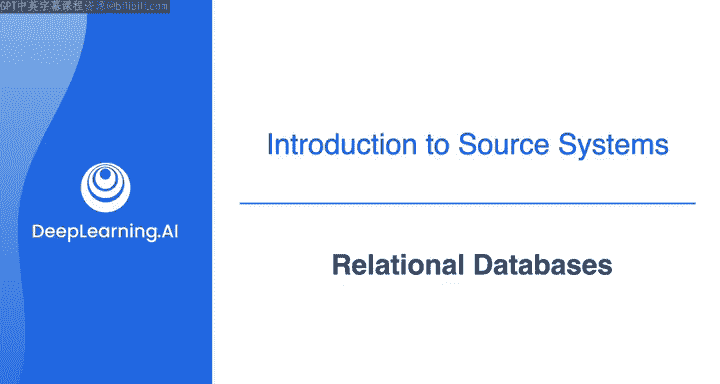
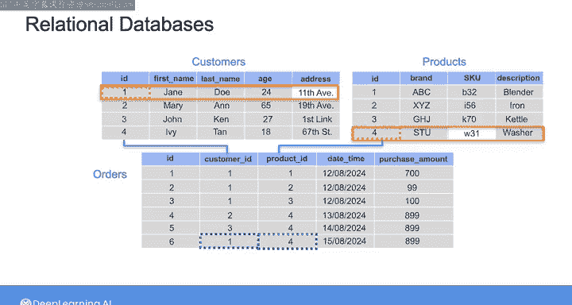
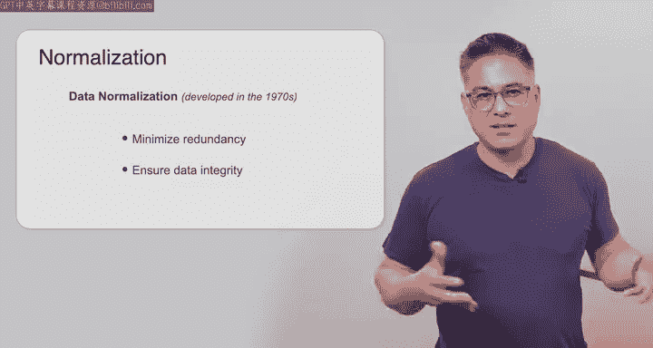
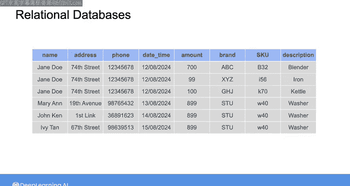
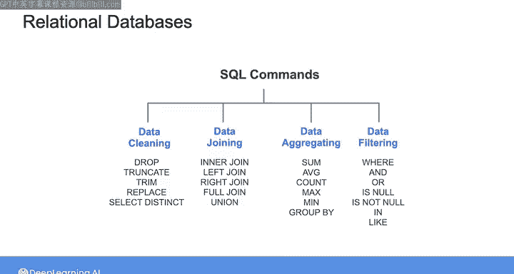

# 吴恩达《数据工程（导论，源系统、数据摄取和管道，数据存储和查询｜1-2-3课）｜DeepLearning.AI Data Engineering》 - P81：3_关系型数据库.zh_en - GPT中英字幕课程资源 - BV1wTtWeeEH5

As a data engineer， the most common type of source system you'll interact with is a relational database。

 and this is because relational databases are everywhere。

Many web and mobile applications use relational databases on the backend and you will find them as well in many corporate systems like customer relationship management。

 human resource and enterprise resource planning systems they are also commonly used for what are called online transaction processing or OLTP systems where you need to execute a high volume of transaction concurrently like for banking or online bookings。

 the relational database comes from the fact that this type of database is most often used to store data across different tables that are related to one another through a set of keys or common attributes these tables are typically organized based on how information is structured in the business So as a data engineer working at an ecommerce-commerce company for example。

 you might be working with a relational database where one table captures customer information。

 another table captures product information and a third table captures order information。

Structuring a database in this way reduces redundancy and makes the data easier to manage by not having the same piece of information duplicated across multiple rows or tables in the database to get a sense of what I mean by that imagine for a moment that instead of multiple tables you created one big table to store your data from each individual customer order In this case。

 your table might contain a large number of columns， including everything about the customer。

 like their name， address， phone number and so on and then you would have all the information about the product they purchase like the brand。

 Skew number， product description， and other details， as well as the details of the order。

 things like the date and the time and purchase them amount and how much they paid So in this scenario if one customer placed an order for three different products this would be recorded as three separate rows and your database and you would then have three rows in the table containing all the same customer data or if three different。

Custom purchased the same product。 Then you would have three rows in the database containing identical information for that product。

 So in short， information would be duplicated across multiple rows in your table and beyond that。

 there may be inconsistencies with the data across rows。 For example。

 if a customer changes their address you would then have an inconsistency across rows。

 unless you go back and update all the rows containing their previous address or if the details of a particular product changed you would need to go back and update all the rows containing the old information when you instead separate the information for customer products and orders across multiple tables。

 then a row in the customer table represents a single customer and a row in the products table contains information about a single product if a customer changes their address or the details of a product changes then you just need to update the single row containing information about that customer or product the way in which a database is organized into related tables like。

It called the database schema， relational databases represent these relationships across tables through the use of keys。

 a primary key as a special column or a collection of columns that uniquely identify each row in a table for the customer's table the primary key could be this column called ID the relationship between the customer and the order could be established by having the customer ID column in the order table reference the ID column in the customer table In this case the customer ID column in the order table is called the foreign key and references the primary key or the ID column of the customers table beyond the row structure in a relational database Each column has a unique name and a specified data type for example。

 in the customers table you might have columns like ID first name and last name that contains strings and another column called age that contains an integer Each new row in a table then has to follow the same column structure meaning the same sequence。

columns and data types This is part of the database schema as well Now in a database with schema like this one to record information about a new order from an existing customer。

 you could create a new record in the order table and indicate the customer's ID from the customer' table and the product ID from the product table and the details of the order like date and time and payment and so on and again。

 if that customer changes their address or the skew number of the product they ordered changes those changes that only affect a single row in the customers or product table and the information with say consistent as you can imagine。

 there are many different ways you could potentially establish relationships between tables and this is where the concept of data normalization comes into play and data normalization is an approach that was developed in the 1970s to minimize redundancy and ensure data integrity by storing data across tables in a logical way。

But now I think it's worth pausing for a minute to ask why you worry so much about redundancy or duplicated information in the first place like it might seem logical and orderly to structure your data like I've been describing。

 but is there any downside Well it turns out while a normalized relational database structure provides a high degree of integrity and minimize redundancy it can actually be slow when it comes to querying the data nowadays storage is relatively cheap and speed is often of the essence data integrity is so critical of course。

 but the answer to exactly how you to store your tabular data could depend on what you're trying to optimize score。

As a data engineer， you might be ingesting normalized data from a relational database system。

 but depending on the end use case you're serving， you might decide to organize the data according to a different model in your own storage systems。

 Today there even some use cases where data engineers are electing to take a socalled one big table or OBT approach where all the data is recorded in a SQL table for faster processing and will be possible if joining multiple tables in a traditional relational database we'll get more into the details of data modeling in course4 specialization。

 when it comes to interacting with the database you'll use a relational database management system or RDBMS。

 That's a software layer that sits on top of a relational database。

 There are many popular RDBMSs out there， including MysQL PostgressqL Oracle and SQL server。

 Most RDBMSs support the structured query language Also in SQL or SQL for sure。

 Some people say SQL some。

SQL you can go with whatever you prefer I I'm going say both myself the important thing to know is that SQL provides a set of commands for performing various operations on the relational databases and as a data engineer SQL will be part of your everyday work in the next video I'll walk you through some of these SQL commands that you'll need for the lab then in the lab you'll get a chance to practice querying data in a relational database using SQL queries。

After that， join me in the next video， take a look at NoSQL databases。

