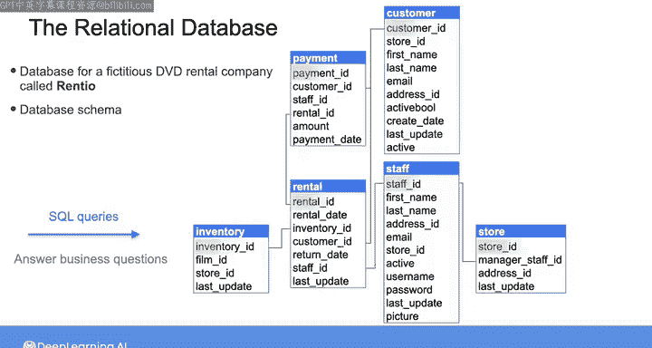
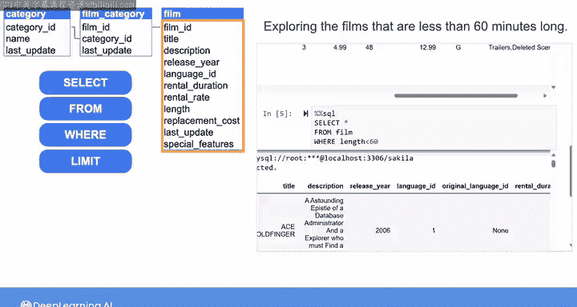
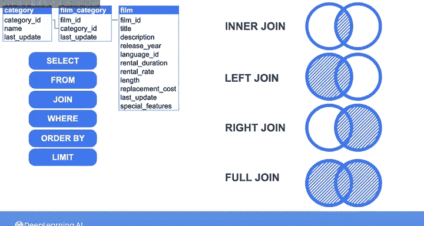
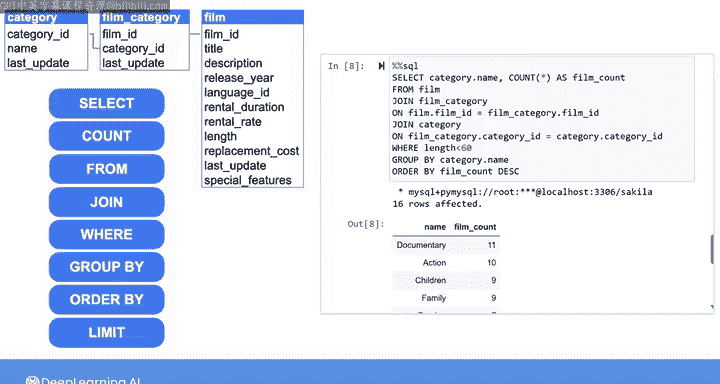
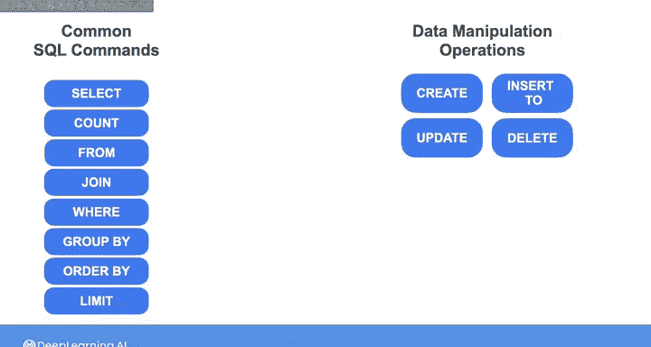

# 吴恩达《数据工程（导论，源系统、数据摄取和管道，数据存储和查询｜1-2-3课）｜DeepLearning.AI Data Engineering》 - P82：4_SQL查询.zh_en - GPT中英字幕课程资源 - BV1wTtWeeEH5

In the lab， you'll work with a transactional database for a fictitious DVD rental company called Bnio。

 This database includes tables that contain information about Ross stores， staff， customers。

 DVD inventory and rental transactions。 you'll write SQL statements or queries in a Jupyter notebook to retrieve information from the database In order to answer business questions to query the data you'll have to understand the database schema。

 In other words， you'll have to know the names of the tables。

 the columns they contain and how the tables relate to one another through primary and foreign keys。

 This database is normalized， meaning that data like addresses for the stores。

 staff and customers are stored in separate tables to reduce redundancy and make it easier to update the data when it changes。

 Similarlyly， data about the films and rental transactions themselves are also stored in separate tables you can refer to this entity relationship model that shows the relationship and attributes of the tables in Rio's database to walk you through the。

Basis of SQL I'll only be focusing on three tables。

 the film table that contains information such as the title and length for a list of films。

 the category table that contains a list of film categories and the film category table that shows the film Is along with a corresponding film category Is the most basic SQL statement starts with a select clause where you specify what data you want followed by a from clause where you specify which table you want to retrieve this data from For example。

 let's say I want to explore the titles and release yours from the film table I can write select title comma release year。

From film， once I run this query， I'll get a list of all the titles and release years。

 So it turns out that there are 1000 films in this film table。 If I don't want to see the whole list。

 I can limit the number of returned results using a limit clause。 For example。

 if I add limit 10 to the end of this query， I'll only get the first 10 titles and release years from the film table。

But what if you want to retrieve data from all the columns in a table， Well。

 you can list all the column names in the select clauses like this。

 or you can use a shortcut and type select star from film。

 This will retrieve data from all the rows and columns from the film table。

 you'll learn howqueries are executed behind the scenes in the next course。 But for now。

 just know that it can take a lot of processing resources to retrieve all data from all the columns especially if your data set is very large。

 So I recommend only using select star to retrieve all the data in a table where you can filter the results with some boolean condition。

 For example， let's say you're only interested in exploring films that are less than 60 minutes long。

 You can add a where clause after the from clause to filter the results based on the length column。

 So all right， select star。From film。Where length is less than 60。

 This will return a list of the 96 films that are less than one hour long。

 You can also order the results by any column you want。 For example。

 I can add order by length after the wear clause to get the results stored in ascending order by the film length。

If I wanted the results in descendsing order by F length， I can add the DESE or desk。

Keyword to the end of the order bike clause， and if I wanted to limit the results to say 10 records。

 I can add a limit 10 to the end of this query。So you just saw how you can retrieve data from a single table using the select from where whereby and limit clauses。

 What if you want to explore data from more than one table。

 you can use the join clause to combine records from two or more tables based on the shared columns between those tables。

 For example， let's say I want to get a list of film titles and their corresponding film category for all films that are under 60 minutes long。

 let's quantify the query from earlier where I selected star from film where length is less than 60。

 I want to combine the rows from the film table with the rows from the film category table based on matching film Is。

 So at the end of the from clause， I' write join film category on film dot film ID equals film category dot film I This way。

 the returned results will include all the columns from the film table along with the columns from the film category table for each matching pair of film Is in both tables。

 notice the。m category table only includes the category I， but not the category name。

 So we need to do another join to combine these records with rows in the category table based on the category Is。

 I'll add join category on film category dot category I equals category dot category I。

 Now the results will include all the columns from the film table。

 all the columns from the film category table and all columns from the category table。

 Since I only want the film title in the corresponding film category。

 I can modify the select statement specified that I only want the film do title column and the category name column Note that by default。

 the join clause combines only the records from both tables that have a matching column values specified in the on statement。

 It will not include any records from either table that don't have matching values。 For example。

 if the film table has a row with film I that doesn't appear in the film category table。

 then that row will not be included in the results。 This type of join is。

knownown as the inner join and you can think of the join results as the middle overlapping part of a Venn diagram the other types of joins include the left join which returns all records from the first table along with any matching records from the second table the right join which returns all the records from the second table along with any matching records from the first table and the full join which returns all the records from both tables and combines the ones with matching values。

 going back to the results from the last query I can see that quite a few of the shorter films belong to the children or documentary category let's say I want to know for sure which is the most popular category for short films I can use the group by command to group the rows based on the film category then use the count command to count the number of records for each of the film category。

 the group by command is written after the where clauses so here I'll add group by category name then I'll modify the select statement to select category name and count star which counts all the rows each category。

' also use the as command to give the output of this count the film underscore count alias name finally I'll order the results by the film count in descending order as you can see the most popular category for short films under an hour is documentary followed by action then children and so those are some of the most common SQL commands and now you're ready to get started with the lab the lab also covers some data manipulation operations including create。

 insert into update and delete so make sure you read the instructions carefully when trying each of the exercises after you finish the lab join me to take a look at No SQL databases。

