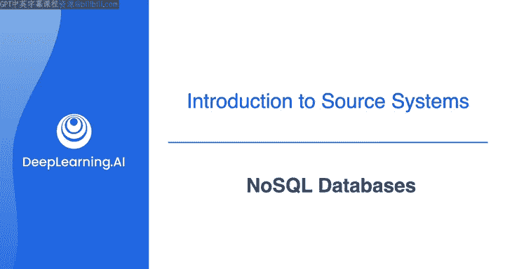
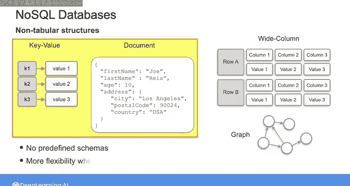
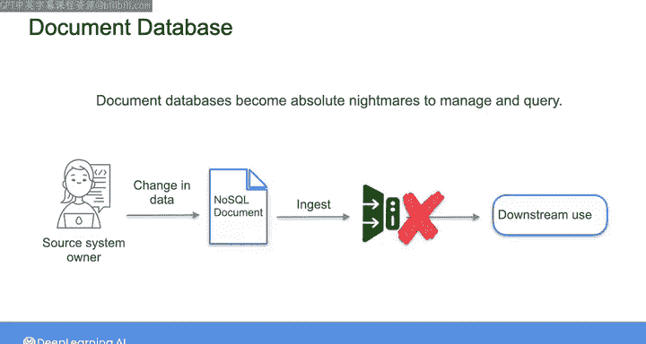

# 吴恩达《数据工程（导论，源系统、数据摄取和管道，数据存储和查询｜1-2-3课）｜DeepLearning.AI Data Engineering》 - P83：5_NoSQL数据库.zh_en - GPT中英字幕课程资源 - BV1wTtWeeEH5

In the early 2000s， tech giants like Google and Amazon began outgrowing the relational databases。

 They needed to process large volumes of data from disparate sources that didn't fit neatly into the relational database model。

Enforcing tabular structures would lead to data redundancy and performance issues at scale。

 and so these companies led the way in developing new distributed non-relational databases to scale the web platforms。

And so in this way， no SQL databases were developed to overcome the limitations of relational databases。

 trading certain RDBMS characteristics like strong consistency joins。

 and a fixed schema for more schema flexibility， scalability and improved performance。

Before we go any further， let's get one thing straight。 No SQL doesn't stand for no SQL。

It means not only SQL。 it's a category of databases that break away from the relational framework we saw in the previous video。

 but some non-relational databases still support SQL or SQL like query languages。

 let's go over the basics of nosQL databases NosQL databases have non-tular structures。

 they can support various data formats including key value document wide column graph and others。

 I'll talk about key value and document source later in this video and you'll see some of these other types throughout the next few courses Unlike relational databases。

 No SQL databases don't require predefined schemas。

 So this means you have more flexibility when deciding how you want to store your data。

 No SQL databases excel in horizontal scaling， which means automatically distributing data and workloads across multiple servers can be increased traffic demands when a user writes data to a NosQL database that is distributed across multiple servers or nodes that right operation is first performed on a single node。

In this distributed system， which is a location where one version of the database is running then there might be a slight delay before those changes are propagated to all their nodes in the system unlike relational databases。

 No SQL databases operate under the principle of eventual rather than strong consistency meaning that the database will allow you to read from a node that has not received the latest right update and you may not get the most up-todate data but given enough time。

 the database will be consistent and reading data from any node will give you the same data with a relational database that provide strong consistency。

 you would not be able to read data until all the nodes in the system have been updated in this way。

 eventual consistency allows no SL databases to prioritize speed which is perfect for applications where system availability and scalability is more important than realtime consistency such as social media platforms or content distribution networks in terms of data integrity not all NosQL databases guarantee the principles of atomity consistent。

See isolation and durability， also known as acid compliance， which we'll look at in the next video。

 but some do， for example， Mongo Db This means that if you're sourcing data from a NosqL database。

 then you may need to take extra steps to ensure data integrity。 Finally。

 NosqL databases use specialized query languages tailored to their data model。

 which are often but not always different from SQL。

 let's take a closer look at two common types of NosqL databases。

 key value databases and document databases。 a key value database source data as a collection of key value pairs similar to what you might find in a GSM file or a python dictionary structure。

 the key serves as unique identifier to retrieve the corresponding value。

 both the keys and the values can be anything from simple to complex objects。

 the type of NosqL database is perfect for scenarios where fast data lookup is needed such as caching user session data and a web or mobile application。

 For example， when a user logs into an。Application actions like viewing different products。

 adding items to the shopping cart and checking out can all be stored in key value database with the user session ID as a unique identifier document source or a special type of key value database that sort data in JO like documents Each document has a unique key that identifies a document and allows you to retrieve that document data Do are organized into collections so you can think of a collection sort of like a table in a relational database and a document like a row in this example。

 data is stored in a collection called a user Each document represents a single user and the ID is the key that uniquely identifies each user this locality makes it easier to retrieve all the information about a particular user compared to a relational database where the user information may be spread across multiple tables However。

 document source don't support joins so it's harder and less efficient to combine information from multiple documents as compared to a combining information across。

multiple tables in a relational database the advantage， however。

 is this notion of a flexible schema as you saw with relational databases。

 all records need to conform to a fixed schema， but with key value databases and document stores there is no fixed or predefined structure to data records document stores are a commonly used for applications involving content management catalogs and sensor readings each interaction product or sensor reading from an Io device for example。

 can be stored as a single document with flexible schema but be careful this flexibility can have a downside。

 I've seen document databases become absolute nightmares to manage and query and if you're ingesting data from a NosQL document store as your source system the flexibility of the schema makes it even easier for source system owners to change something thatll break your data pipelines both relational databases and NosQL databases can be used as sort of a wide range of applications when it comes to applications processing online trends。

In areas like banking， finance and E-commerce， among others， things are happening fast。

 Mo is changing hands， and products are on the move。

In these types of online transaction processing or OLTP applications。

 any errors or inconsistencies in the data can cause major problems in the next video we're going to have a look at the principles of atity。

 consistency， isolation and durability， otherwise known as the asset principles。

 which are critically important for your data sources and data pipelines when working with OLTP systems。

I'll see you there。