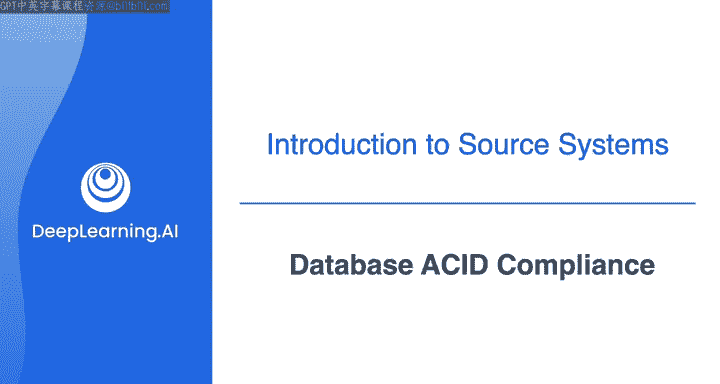
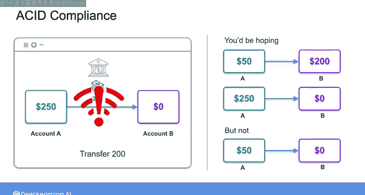
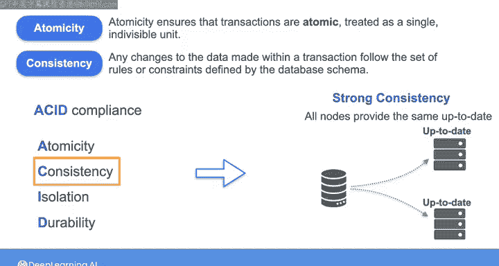
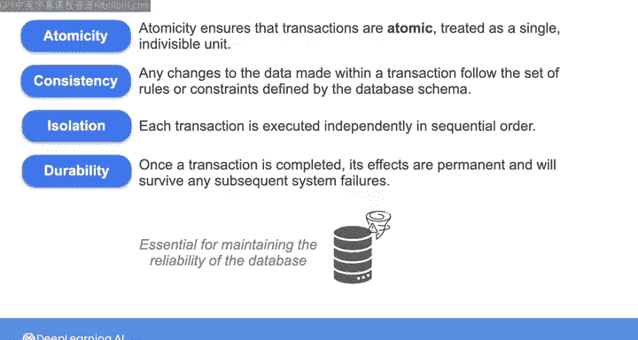
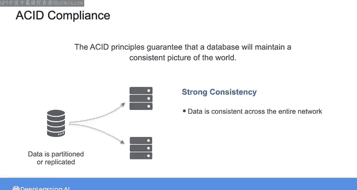

# 吴恩达《数据工程（导论，源系统、数据摄取和管道，数据存储和查询｜1-2-3课）｜DeepLearning.AI Data Engineering》 - P84：6_数据库ACID合规性.zh_en - GPT中英字幕课程资源 - BV1wTtWeeEH5

Both relational and non-relational databases can support very high transaction rates。

 so they're commonly used in online transaction processing or OLTP systems。

 these systems typically need to store rapidly changing application states such as the details of bank account balances or online orders most relational database systems or what's known as asset compliant which means they support the principles of aity。

 consistency， isolation and durability， which help ensure transactions are process reliably and accurately in an OLTP system By contrast many no SQL databases are not asset compliant by default。

 but many offer you the ability to configure them to be asset compliant In this video I'm going to talk about what each asset principle is so you can get a better sense of when these principles will apply to the work you do as a data engineer but first off。

 let's think for a minute about what happens if transactions。

In a banking system or not process in a reliable or accurate manner So for example。

 what if you're trying to transfer money online from one account to another and the bank's website just goes down as you're trying to transfer money when you eventually get back to your account you'd be hoping to find that the transaction either went through or it didn't but not that the money was deducted from one account but not added to the other the same thing applies to all sorts of systems from banking to online shopping and many more So the first asset principle is atity which ensures that transactions are atomic or in other words。

 treated as a single indivisible unit a transaction might consist of multiple operations but the atity principle ensures that either all the operations within a transaction are executed successfully or none of them are for example。

 imagine the transaction of a customer placing an order for an item suppose。

Transaction involves two operations， deducting the total cost from the customer' account and updating the inventory to reflect the purchased item。

 Let's say that the customer experiences a network connection error right after the total cost was deducted from their account。

 But before the inventory update was completed。 the atity principle guarantees that both of these operations happen as a single transaction。

 If the network connection error prevents the second operation from being completed。

 the first operation will be rolled back。 so the customer is not charged and the whole transaction fails。

 The second principle is consistency， which means that any changes to the data made within a transaction must follow the set of rules or constraints defined by the database schema。

 this ensures that the database rule transition from one valid state to another。 For example。

 suppose that the inventory database schema prevents any stock level from going below zero。

 Let's say that the stock level for a particular item is currently one。

 If a customer tries to place an order for two of those items。 then。

will fail and the entire transaction will be rolled back to ensure that the database remains consistent with the predefined schema。

 As I already mentioned， this is the default in relational databases。

 but would need to be configured in most nosQL systems and just a note for clarity the word consistency ends up getting a little overloaded here in the previous video I described the strong consistency property of relational databases which refers the idea that all nodes in a distributed system will provide the same up-to-date data。

 It turns out that strong consistency of a database system is a result of compliance with the acid principles。

 but a slightly different concept than the consistency represented by the C and acid。

 the next principle is isolation， which ensures that when several clients try to execute transactions concurrently Each transaction is executed independently in sequential order for example。

 let's say the inventory shows that there are 10 of one item remaining。

 supposeuppose that two customers each place in order for five of these items。

The exact same time the isolation principle guarantees that even though the timestamp on these two transactions may be the same both transactions will happen independently in sequence so that when the two transaction are completed the inventory level for that item will be zero and not five Similarlyly if one customer orders5 and another order 10 of the item at the same time whichever order gets processed first we will go through and the second one will fail resulting in a stock level of either five or zero the final principle is durability。

 which guarantees that once a transaction is completed。

 its effects are permanent and will survive any subsequent system failures such as a power loss this is essential for maintaining the reliability of the database even when faced with an unexpected event like a natural disaster So in summary。

 the acid principles guarantee that database will maintain a consistent picture of the world that might sound logical and relatively。

even straightforward but in the real world， a database might be partitioned across multiple servers because of its size or replicated across multiple data centers for redundancy and speed In these cases。

 it's especially critical to know that the data you're reading and writing remains consistent across the entire network of servers this is the principle of what's called strong consistency which is a key feature of As compliance it holds even for a distributed database system Now it's important to note that while relational databases are typically asset compliant not all databases are required to abide by all of the asset principles in order to support application backends。

Some No SQL databases only possess some degree of asset compliance。

By relaxing one or more of these constraints， you can improve certain aspects of the database's performance and make it more scalable。

As a data engineer， understanding when your database needs to be asked and can help you prevent disasters in the next lab。

 you'll work with DynamoDB， a NoSQL key value database。

Join me in the next video to take a quick look at the lab before you jump in。

