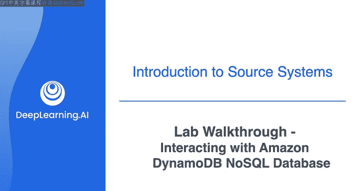
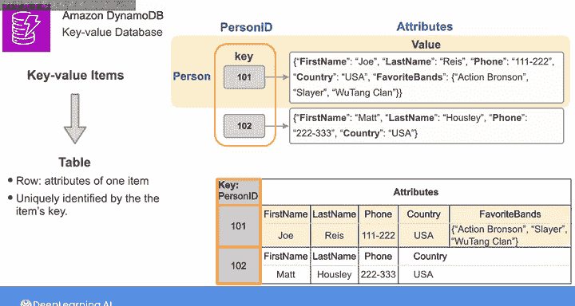
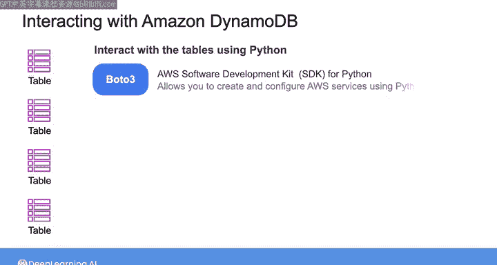
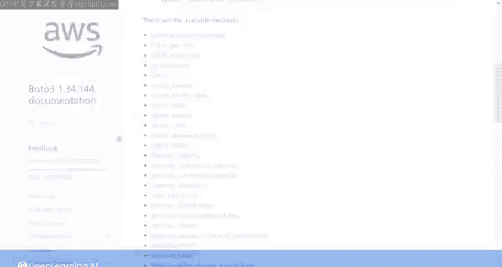
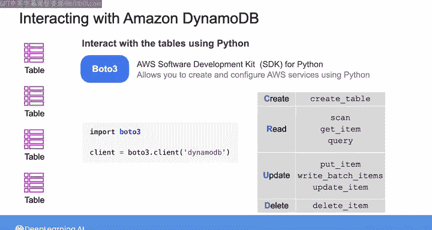
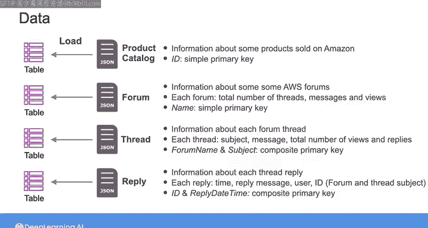
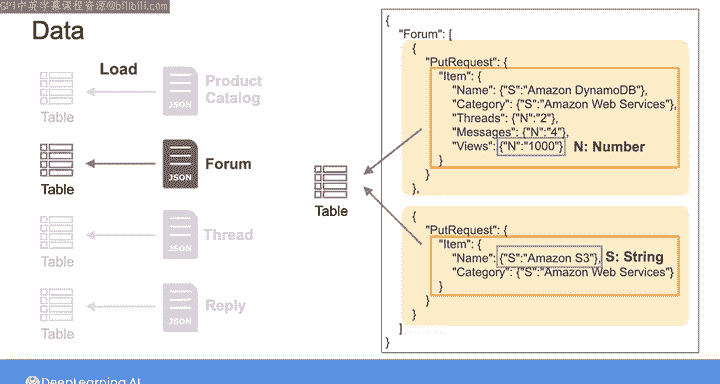
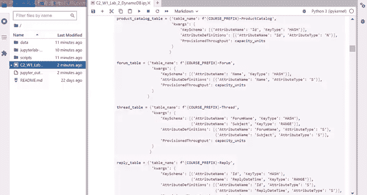

# 吴恩达《数据工程（导论，源系统、数据摄取和管道，数据存储和查询｜1-2-3课）｜DeepLearning.AI Data Engineering》 - P85：7_实验演练：与Amazon DynamoDB NoSQL数据库交互.zh_en - GPT中英字幕课程资源 - BV1wTtWeeEH5

In the next lab youll work with Amazon Dynamod Db as a key value database and apply some create。

 read， update and delete or crud operations on the data in the NosqL database In this video I'll give you an overview of some of the features of dynamo Db the data you'll work on and some of the dynamo Db methods you'll use to applyCd operations on the data Dynamo Db is a key value database that stores a set of key value items in a table Each row contains the attributes of one item and is uniquely id by the item's key For example。

 here are two key value items where each corresponds to one person。

 The key represents the person's ID and the value consists of a set of attributes that describes the person。

 Dynamo Db stores this data in a table as shown here each row contains the person ID and the corresponding attributes Since the person ID column uniquely identifies each row。

 it represents the primary key for this table When you work with dynamo Db you can also refer to the primary key as the part。

ition key This is because dynamo Db uses the primary key to determine the partition or in other words。

 the physical storage in which the item will be stored。

 You can also define a composite primary key for a dynamo Db table For example。

 here's a table where each row represents an order item and is uniquely identified by a composite primary key This composite key consists of two keys。

 The first one represents the order I and is referred to as the partition key。

 The second one represents the items line number with an order and is referred to as the sort key with this composite key you can have two items with the same partition key。

 but they should have different sort keys so that you can still uniquely identify each item Dynamo Db uses the partition key to determine in which partition the item will be stored and the sort key to sort the items within the same partition and these two tables you can see that each item can have its own distinct attributes。

 This is because dynamo Db tables are schemaless， which means you don't need to define the attributes。

For in this lab you will create and interact with four dynamo Db tables using Python code in a Jupyter notebook To do so。

 you will use Boto3， which is the AWS software development kit that allows you to create and configure AWS services using Python Here's a documentation of Boto3 where you can find a list of methods that you can use interact with various AWS resources If you click on Dynamo Db here you can find the list of all the available methods that you can use when working with a dynamo DB table。

In the lab， you'll focus on the methods that you can use to apply the C operations。

 such as createate T to createate the tables。

Put item， write batch items， update item to add or update items in the C tables， scan， get item。

Query to read items from the tables， Dete item to delete items from the tables to call these methods。

 you will first create a client object as shown here。

 which provides you with an interface representing an Amazon dynamo Db table。

 using the client object。 You will call any of these dynamo D methods to create the tables。

 You are provided with these four Json files that are downloaded from the Amazon dynamo Dv developer guide。

 You will read and load each of the contents into a dynamo Db table。

 The product catalog file contains information about some products that are sold on Amazon。

 Each product is defined by its ID which you will use as a simple primary key for the corresponding table。

 The forum file contains information about some AWs forum where users post questions or start threads about AWS services。

 for each forum you can find the total number of threads， messages and views。

 Each forum is defined by its I which you will use as a simple primary key for the corresponding table。

 The thread file contains information about each form。

Such as the thread subject， the thread message， the total number of views and replies to the given thread。

 Each thread is defined by the form name and the thread subject。

 which you'll use as a composite primary key for the corresponding table。

 the reply file contains information about the replylies on each thread such as the time of the reply the reply message。

 the user who posted the reply and the I of the reply。

 which is a concatenation of the form and the thread subject。

 Each reply is defined by the ID and time of the reply。

 which you'll use as a composite primary key for the corresponding table。

 Let's take a look at the form file。 It contains a list of putre elements。

 each of which contains a single item it will be extracting the attributes of each item and then loading them into the dynamo Db table note that each attribute is defined by another key value pair to define the type of the attribute and its value So the letter N here which means number and S which means string or examples of dnamo Db data type descriptor。

That tell dynamo Db how to interpret the type of each attribute All the remaining JSON files followed the same pattern。

 So I encourage you to quickly skim through the other JsonN files to gain a better understanding of each one Let's now go through the first exercise of the lab I already started the lab and follow the instructions to launch the Jupyter notebook I'll run this cell to import the required packages and then this cell to define this variable that you will use the lab for labeling purposes After these two cells。

 you will find some explanation about the data and the dynamo Db table which you already covered in this video。

 Your first exercise is to create the four tables where you will use the Boto3 method create table If you check the documentation you will see that this method expects a name for the table and a definition for the primary key you can define the attributes that make up the primary key using the attribute definitions argument using the key schema argument you can specify for each attribute if it's a partition key or sort key hash here means partition key and range。

St key in the lab you won't need to code these arguments for each table You are instead provided with these dictionaries that represent the arguments for each table to create the tables。

 you are provided with this function， create table DB In of which you will call the Bodo3 method create table the function create table DB takes in the name of the table and quags。

 which is short for keyword arguments is a dictionary that contains the additional arguments for the Bodo3 method The two stars next to quags mean that the elements in the dictionary are impact into a sequence of arguments here you'll need to complete the sign of code where the Bodo3 method is called using the clientan object。

For table name， I'll use the input table name， and then I'll pass in the remaining arguments using quags。

 I'll now run the cell and the following two cells to create the tables。 And from here。

 you can continue working on the remaining exercises。

 Note that some of the exercises are marked as optional。 so feel free to skip the optional parts。

 After the lab， join me in the next video to take a look at the second major type of storage system you'll work with files and more specifically。

 files on cloud object storage。