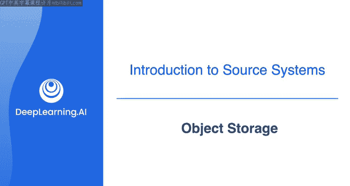
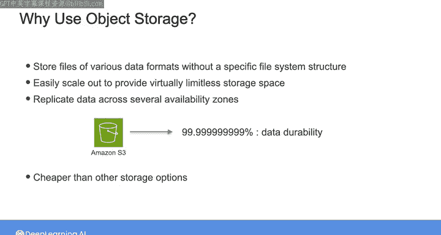

# 吴恩达《数据工程（导论，源系统、数据摄取和管道，数据存储和查询｜1-2-3课）｜DeepLearning.AI Data Engineering》 - P86：8_对象存储.zh_en - GPT中英字幕课程资源 - BV1wTtWeeEH5

As I said earlier this week， files are one of the most common source systems that youll deal with every day as a data engineer and you might be receiving or accessing these files from a file system like Google Drive or an object storage system like S3 or simply as an attachment to an email while files may come at you from many different places。

 Opic storage is arguably the most important mechanism for file storage and retrieval in your work as a data engineer today。

 Op storage treats data files in this case as individual objects and stores them in a flat structure that doesn't adhere to a traditional file system hierarchy This means that while you might be accustomed to storing files in a hierarchy of folders and subfolds on your local computer。

 object storage has no hierarchy Now just as a side note， this flat structure thing can be confusing。

 I know if you go into Amazon S3 for example， there is a create folder button and you can go ahead and create folders and subfolds。

To your heart's content and happily store your files and what looks very much like a hierarchical file system。

 however， it turns out this is just a feature of the user interface to keep things looking organized in a way that looks familiar。

 the actual storage mechanism is flat。Meaning that even though it might look like you have folders and subfolds in the UI。

 all files are actually stored right at the top level and this is by design because it allows quick and straightforward access to all objects without worrying about the overhead of a folder structure Anyhow I digress so objects can be anything from CSV JSO text。

 video image or audio files to machine readable binary data this versatility makes object storage the perfect repository for semistructured and unstructured data which can be useful when supporting applications like serving data for training machine learning models Ob storage plays a crucial role as a data source in later weeks and courses you'll see how object storage is also integrated throughout the entire data engineering lifecycle but for now let's take a look at some of the key components of object storage and object storage each object is assigned a universal unique identifier or UU ID which is。

Sot of a key this key is required for accessing in managing the corresponding object。

 Each object also has associated metadata， which is additional information about the object like the creation date file type or owner It's worth of noting that after the initial write objects technically become immutable and they don't support random write or aend operations In this sense a file in object storage is not like a table in a relational database or a document in a nonrelational database that you can update or a pen to to change the data stored in an object you must rewrite the full object and have the UUI point to this new object with object storage you can enable object versioning which allows you to add metadata to an object to specify its version So when you update an object instead of overwriting the old object under the same UUI you can keep multiple versions of that object So why use object storage well。

Oject storage allows you to store files of various data formats without a specific file system structure。

 This removes the complexity associated with hierarchical folder systems and databases and a cloud environment。

 object storage can easily scale out to provide virtually limitless storage space for massive amounts of data in terms of availability the data and cloud object storage is typically replicated across several availability zones。

 meaning that data is replicated across multiple physical data centers that are isolatedd from each other。

 This makes the data highly durable and available even in the case of natural disasters。 For example。

 as I mentioned in the previous course。 Amazon S3 offers 119s of data durability。

 which means object storage on S3 can withstand concurrent device or data center failures。

 Also object storage is often cheaper than other storage options especially if you're storing data that you don't need access to on a regular basis。

 Cloud object storage is used in many applications and is。

line storage for newer architecture designs such as data lakes and data lake houses because of its flexibility。

 high scalability， cost effectiveness and durability Next you'll get a chance to work with Amazon S3 object storage you will create an S3 bucket query data from the bucket and work with object versioning after the lab join in the next video to take a look at application logs as streaming system data sources。

