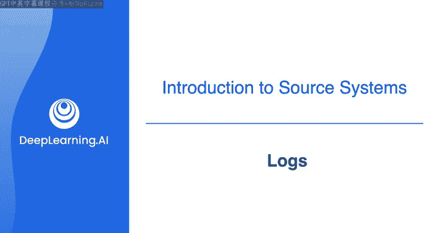
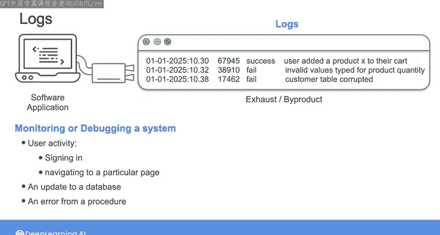
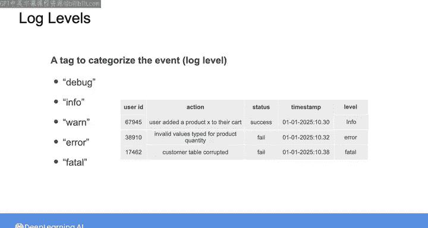

# 吴恩达《数据工程（导论，源系统、数据摄取和管道，数据存储和查询｜1-2-3课）｜DeepLearning.AI Data Engineering》 - P87：9_日志.zh_en - GPT中英字幕课程资源 - BV1wTtWeeEH5

The simplest type of streaming system I can think of is a log。 In fact。

 a log isn't even a system at all。 It's just a record of information about events that can serve to track the activity of a system or an application in the previous course I mentioned that it used to be common for developers regard the data coming from software applications as a sort of an exhaust or a byproduct not necessarily having any intrinsic value on its own。

 but useful for monitoring or debugging a system， the specific data that is most commonly regarded as exhaust is the data contained in logs produced by software applications So when a developer deploys a product or a platform like a website or mobile app they'll set it up such that all activity that occurs within the application is recorded in a log the log might include user activity like a user logging in or navigating to a particular page it might also include a record of events on the backend。

Update to a database or an error that was generated when trying to run a particular procedure logs are most commonly used in practice as a means of monitoring the health of systems。

Engineers will use logs to trigger alerts or to debug what went wrong when an error occurs。

In this sense， logs can seem kind of boring and the characterization of logs as application exhaust might seem appropriate。

 However， logs are a rich source of data that can be useful for much more than just monitoring the health of an application and as such they can be an important source system you'll ingest data from in your work as a data engineer and so at its core a log is an appendon sequence of records ordered by time capturing information about events that occur in systems For example。

 if you're the data engineer for an ecommerce-merce company your web server logs can capture detailed user activity data that could be used to support downstream analysis of user behavior patterns many database systems will have logs that you could use to track changes in the database through a process known as change data capture or CDC for short。

 you could use those changes to trigger your ingestion process so that they run based on the arrival of new data in the database。

Or you might ingest log data for use in certain machine learning applications like anomaly detection if for example。

 you're ingesting log data from security systems and so logs play a crucial role in tracking what happened in many of the upstream software systems you'll work with and this makes them a rich data source that can support downstream use cases like data analysis。

 troubleshooting issues， monitoring performance， machine learning applications and automation as I mentioned before。

 log is a record of information about events。In general。

 the data you'll find recorded first for each event in a log is the person system or service account that's associated with the event like a user ID and their IP address。

 Next you'll find a record of the event that happened along with its metadata for example。

 a user added a specific product to their cart along with the status of that action and finally。

 you'll find a record of the timestamp of the event log data may be recorded as simple unstructured text or in JSsonN or CSv format。

 or even as binary encoded data in addition to the data describing the time and substance of an event logs will also often include a tag to categorize the event by assigning what's known as a log level to each record log levels might include tags like debug info War error or fatal that let you know what kind of information a particular record contains。

 So for example， a record containing basic activity information would be assigned the。

Info log level well a record containing an error message might be assigned the error log level or if something more serious happens like major systems have failed and need urgent attention。

 this might carry the fatal log level as a tag we'll talk more about log levels later on when you start building logs into your own data pipeline applications instead of monitoring for your own systems and so as a data engineer it's important that you understand how to work with logs。

 their types， formats and applications。

Lologs will be an important source of data for the work that you do and can help you troubleshoot issues。

 monitor performance and serve lots of downstream use cases join me in the next video to take a look at some of the streaming systems。

