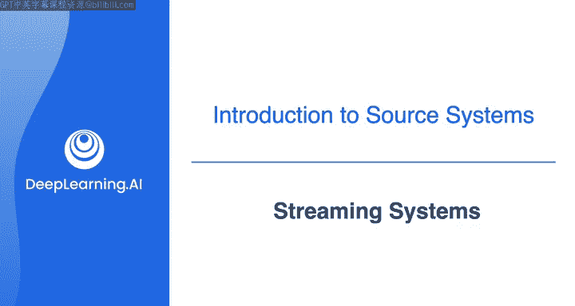
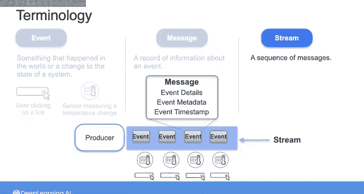
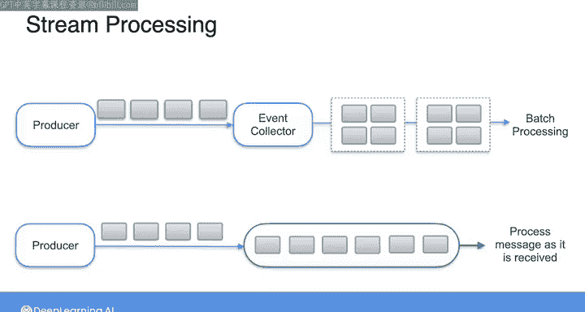
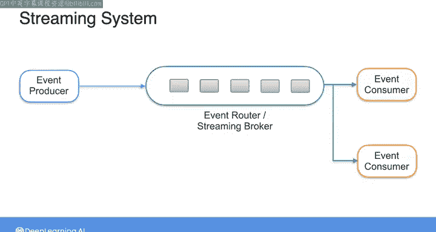
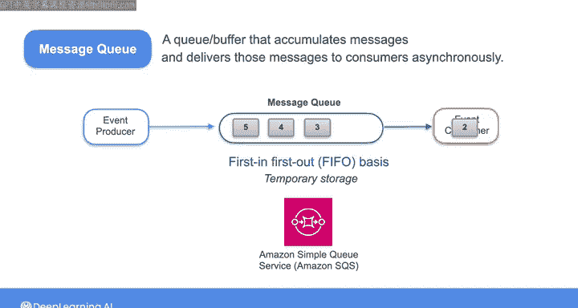
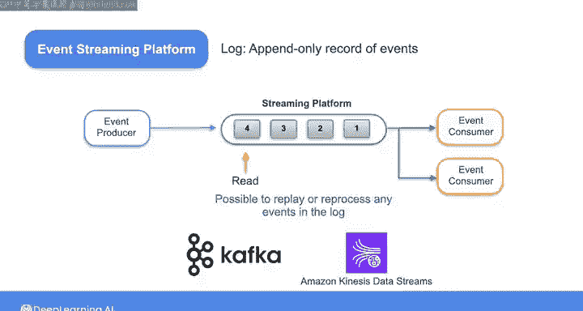

# 吴恩达《数据工程（导论，源系统、数据摄取和管道，数据存储和查询｜1-2-3课）｜DeepLearning.AI Data Engineering》 - P88：10_流系统.zh_en - GPT中英字幕课程资源 - BV1wTtWeeEH5

In the first course of the specialization， we looked at the difference between batch and stream processing as they appear across the different stages of the data engineering lifecycle。

And then the last lab that course， you worked with an example of a data architecture where batch and streaming work together in the context of a recommendation system。

In this video， we'll take a closer look at the details of event driven architectures and how message queuees and streaming platforms work as source systems for your data pipelines。

First， let's define some terminology throughout these courses so far we've been talking about streaming data in terms of events。

 messages and streams broadly speaking， an event is just something that happened in the world or a change to the state of the system for example。

 a user clicking on a link or a sensor measuring a change and temperature are both examples of events and so as I mentioned before in some sense you can think of all data as being streaming data at its source and this is because essentially all data consists of a record of events that happened out in the world or within some system a message is a record of information about an event a message might include details about the event like which button a user clicked or what temperature。

 the sensor recorded as well as some metadata around the event and a timestamp of when the event happened messages can be generated continuously to form a stream。

A stream is a sequence of messages that might be a series of sensor readings or website clicks over a period of time messages and streams collectively make up streaming data if you want to handle chunks of this data all at once like over a specific time interval then that would be batch processing applied to a stream of messages and if you want to process each message as it's received then you need a system that's set up to take action based on incoming messages so then what you have is a system where messages record information about events and action is taken as messages are received or in other words。

 a streaming system now out in the real world you'll often hear the words event and message used almost interchangeably when it comes to describing the various components of an event- drivenriven architecture but don't let that worry you while it's technically accurate to say that events or the things that happen and messages or the information or data recorded about those events。

For all intents and purposes in data engineering， it's not important to distinguish between the two。

And so when we're talking about events or messages being produced or consumed or stored in a queue。

 it's all the same thing Anyhow there are three components of a streaming system， the event producer。

 the event consumer and the event router also known as the streaming broker that sits between the producer and the consumer and so just note that here I could say message producer message consumer and message router and it would mean the same thing it's just that you'll often see these things described in terms of events and so we'll go with that terminology here the event producer is what generates a message in a stream。

 the producer could be an IoT device and mobile app， an API or a website to name a few examples。

 the event consumer sometimes known as the subscriber is what processes each individual message and there could be more than one consumer in any given streaming system for example。

 in an ecommercemerce scenario。When a user places an order the ordering system might trigger an event that is passed along in a message to the payment service through process payment and then to the inventory service to update inventory in this case both the payment service and the inventory service would be the event consumers the way that events find their way to the correct destination is through the event router or streaming broker such as Apache Kafka which acts as a buffer to filter and distribute the events from the producer to the consumer so it's this router that helps decouple the producer from the consumer which enables a synchronous communication between them so the producer doesn't have to wait for the event to be delivered to the consumer before it can send another one this also prevents events for being lost even if the consumer is not immediately available when you work with event systems as a source system it could be that your upstream source as a simple event producer like an IoT device and your system comprises both the event。

consumer or it could be that your upstream store system is made up of multiple producers。

 routers and consumers and the systems you build are effectively just another downstream consumer of events in your work building data pipelines to process stream data you'll encounter two main types of streaming systems。

Message queuees and stringing platforms I often see these two types of systems confuse with one another。

 and while there are many similarities and potential overlaps in how they can work。

 there's one main difference between them and that's in how the event router works。

And so I'd like to spend a minute talking about that now in a message queue。

 the event router acts as a queue that accumulates the messages sent by the producer。

 the event consumer then reads the messages from the queue in a first in first out order and once the consumer reads the message from the queue and acknowledges this the message is deleted from the queue with a message queue the event producer can push new messages to the queue at any time and the event consumer can read them at any time。

 you can think of the queue itself as a sort of temporary storage solution that allows event producers to be decoupled from event consumers an example of a message queue that you might encounter as a data engineer is Amazon simple queue service or SQS It's a fully managed message queue thats commonly used for microservices。

 distributed systems and serverless applications with a streaming platform like Apache Kafka or Amazon Canisesis data streams the event producer streams events to a log which as we looked at in the previous。

Vide is an appendon record of events The event rather than distributes messages in the log to appropriate event consumers。

 the consumer processes messages in the log sequentially as a readon operation。

 and this means that unlike a message queue the messages do not get deleted from the log and the data is persistent Since the data is retained in this way and a streaming platform it's possible to replay。

 batch or reprocess events in the log from a passpoint in time and so streaming systems will be among the So systems you'll ingest data from as a data engineer。

As you saw in the previous course and as you'll continue to see throughout these courses。

 you can also build streaming systems into your own data pipelines as part of the injectiongestion。

 transformation and serving stages of the lifecycle so that's an overview of some common source systems you might encounter as a data engineer。

In the next lesson， we'll discuss how you can connect to SO systems， I'll see you there。

