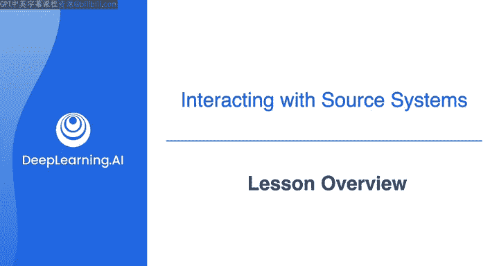
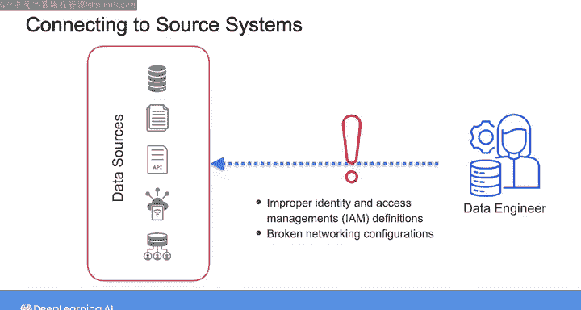
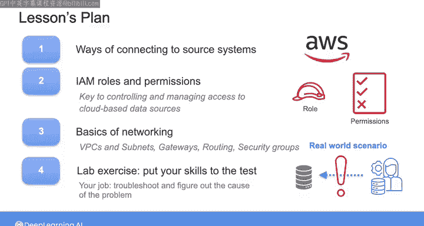

# 吴恩达《数据工程（导论，源系统、数据摄取和管道，数据存储和查询｜1-2-3课）｜DeepLearning.AI Data Engineering》 - P89：11_课程概述.zh_en - GPT中英字幕课程资源 - BV1wTtWeeEH5

In the previous lesson， we looked at some of the practical details of some common source systems you'll work with as a data engineer。

in the labs you got some practice manipulating data in relational and NosQL databases as well as an object storage when it comes to actually connecting to source systems in your work as a data engineer。

 it's relatively common to run into unforeseen issues that block you from accessing the data you're interested in these issues can be due to things like having improper identity and access management or IM definitions。

 broken networking configurations or even just having the wrong set of access credentials these might at first sound like relatively trivial issues but in my own experience running into these kinds of problems happens all the time in data engineering and they could be major blockers if you don't know how to debug and solve them properly。

 In fact， I think that solving issues like these are core skill for data engineers that when I interview new data engineers。

 I like to take a working data pipeline that can connect to the intended source systems can maybe break some of the IM or networking configuration。

and then ask the candidate to solve the problems This shows me how well prepared they are to troubleshoot these issues on the job and so in this lesson I'll start by going over some of the details of how you connect to different source systems I'll demonstrate this in AWS but the principles will be looking at also apply to other cloud platforms in the context of I am ruless and permissions we'll look at the importance of security in the cloud where I am is the key to controlling and managing access to cloudbased data sources and other components within your data pipelines and finally we'll get in the networking I'll start you off as sort of highlevel overview and then Morgan will walk you through the details of networking on AWS including VCs and subnets gateways routing security groups and more so in this lesson you'll build on your knowledge of basic networking concepts that we looked at in the previous course after this lesson you'll put your skills to the test so just like I do with data engineering candidates and interviewing process。

I've set up a challenge for you in the next lab exercise there you'll find a data pipeline that should look familiar from one of the previous labs。

 but now I've broken it in that lab exercise you'll get a taste of what it's like to work as a data engineer task with connecting to a So system on the cloud and I promise you this won't be like your standard hello world exercise where everything works as expected instead you'll be thrown into a scenario where just like in the real world things don't work the way youd hoped your job will be to troubleshoot and figure out the cause of the problem and then solve it to connect to the data sources you need Jo me in the next video where I'll give you a high levelvel overview of ways to connect the So systems。

