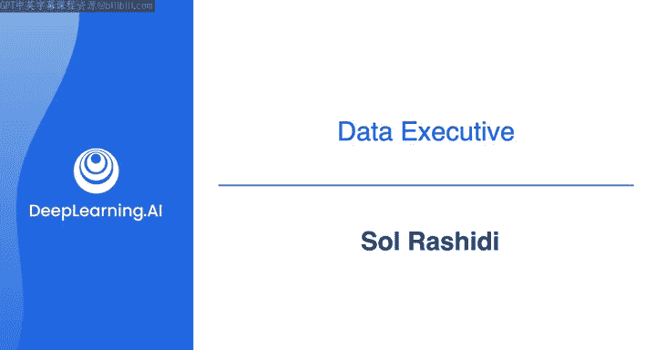

# 吴恩达《数据工程（导论，源系统、数据摄取和管道，数据存储和查询｜1-2-3课）｜DeepLearning.AI Data Engineering》 - P8：7_可选：与Sol Rashidi的对话.zh_en - GPT中英字幕课程资源 - BV1wTtWeeEH5

The position of chief data officer or CDO is a relatively new one in the business world。

 but with the rise of data as a key business asset。

 many companies are building dedicated organizations around managing and arriving as much value as possible from their data Sohiti took one of the very first C suite data executive positions in a role as chief data and AI officer Royal Caribbean in 2016 over the past decade。

 she has led data and analytics organizations as chief data or data analytics officer at large multinational companies including Sony Music。

 Mer Paceuticals and estate Laer she has received numerous award and recognitions including CDO of the Year being one of the top 100 innovators in data and analytics among the top 100 thought leaders in AI and one of the 50 most powerful women and tech among many others She's also the bestselling author of your AI survival guide。

 lessons learned from real world AI deployments。So great to have you here Thank you it's wonderful to be here so let's start with a little background on you how did you get into data and AI Oh cheese？

😊，Completely by accident I don't think anyone grows up and says。

 hey I want to be a data engineer or data analyst or even a data scientist I graduated college with a chemistry degree and I wanted nothing to do with chemistry and so I just decided to pursue what I loved and I played sports in college I went to Berkeley and I ended up carrying it through afterwards so I actually played rugby on the women's rugby team。

And then。😊，Age took its course and as we get older。

 things just don't recover as fast and so I had to hang up the cleats and I decided。

 okay what's the one job that no one wants that I can apply for and immediately get and oddly enough it happened to be the data engineering rule The good news was I found my tribe I found my people the bad news was after six months I told me I wasn't allowed to touch a licka code again because everything I pushed to production was just absolute hackaw in and so they're like you can't touch code1 anymore at all and I was like all right but I still stuck with it it was my tribe。

 it was my community we had the same jehos we had the same styles and then oddly enough though what I found out was。

Really good data engineers are wonderful at what they do。

 but sometimes they may not be able to translate what they do into commercial terms or business terms and one thing that I always loved studying and observing was just business lingo and their metrics in their KPIs and P&L statements so business always fascinated me and randomly I just got into becoming this glorified translator because I understood the work they just wouldn't let me touch code anymore but I started understanding the business and so I was able to translate all the great work that my teammates were doing to why it was relevant for the business and then the business noticed me and they said well we tend to understand you more than some of your peers so can you just be our point person for all things data engineering data analysis and then the career just kind of Christmas treat its way up I took a bunch of random positions but the biggest pivot or two components I became an SAP platinum NDM consultant。

Don't do that All I did was ERRP migrations， there's nothing more stressful than a migration。

 And then I graduated to becoming the enterprisese data management lead and then I ran。😊，A team。

 a practice then a division and I was sort of the go to gal。

 if you will for all things data at IVM eventually at least on the consulting side and then Watson beat Ken Jenennings in 2011 and IVM decided to take Watson to market you can't do AI without data so I had a wonderful wonderful boss his name is Jay Bsimmo I said I want in I want in coach let me in and I remember I like gently begged for four months and then he finally said okay we're ready for you and then things took off from the AI track thereafter。

And what happened after that， how did you become a sea suite？I mean to be honest with you。

 I never asked for permission， I never waited till things were given to me I just always had this knack of identifying stuff and saying that's what I want to be able to do I'd be graceful in my approach。

 it wasn't a bull in a China shop but I was very direct。

 very transparent that that's where I want to get and I was just relentless in my pursuit I was a partner at Ernsten Young eventually when I left IBM Watson and I was a lead partner managing tech and data for the largest client that we had at the time doing a digital transformation this was 2015 so the word digital transformation actually met something and they were my client and I think about nine months in I had suggested that they hire a CDO because we were doing all the work and there was no knowledge transfer happening and at the time it was in Miami and there was no tech talent in Miami so I was even helping them interview candidates and then four months after that they approached me and they said you know you know the good the bad the ugly you show up cheerfully resilient every day you seemed to love data。

And you can explain it to the business really really well so do you have any interest in joining our leadership breaks and so I joined them as our chief data and AI officer back in 2016 So in your experience leading data teams you've obviously had the chance to work with data engineers what's your experience been working with data engineers Data engineers are brilliant and they're the backbone of everything and I think it's a very thankless position to be in but everything they do matters and so I've always been overly protective of my data engineers just because of the fact that it doesn't matter if you're running marketing campaigns。

 it doesn't matter if you're trying to figure out a new consumer segmentation or cohort to market to it doesn't matter if you're trying to do a new product launch at the end of the day all of that is dependent on information and information flowing through and data engineers have the keys to that castlele and their job is literally to analyze and do forensics and build the pipeline so that we can get what we need when we need it so one。

I think data engineers are brilliant too I think they're an underserved community and need more time in the spotlight three。

 no business operation can run without it， they truly are the backbone of every single company and I think we need to do a better job of。

Protecting them， encouraging them， and letting them know that what they do really， really matters。

So what's your advice for aspiring data engineers？If you're aspiring to be a data engineer。

You need to have a backbone and not a wishbone。It does require an element of resilience。

But you hold the keys to the castle。The information that you're going to know and how things flow in and out of any ecosystem is so powerful。

 it's art and science combined， and oftentimes I think data engineers。

I don't want to say they can be ignored， but they may be considered a back office function。

 so don't be afraid to ask to be a front office function。

If you have aspirations of going into management or leadership， work on your communication skills。

 if you just have that fire in your belly and you want to do more than just work in your home office or your cubicle and code all day long。

 get front and center， understand the business lingo， understand the business language。

 context is everything for data engineers because you can flow information from source to target systems and it's going to show up as it appears but without context the business immediately is going to unvalidate it。

 and so I would say if this is a career path you're choosing to take on depending on where you want to go know that you matter。

 know that your function is extremely critical to every business function。

 whether they validate or recognize you or not。Make sure you understand the business language and what's important to them communication is key not just talking but what you speak is received as intended。

 I think that's where we miss with communication and don't be afraid to ask that you want to be more for an office oriented and not necessarily back office oriented if you have those aspirations Okay great all very valuable advice and information so what we're doing at this point in the course is walking through the process of requirements gathering。

I've emphasized that one critical piece of requirements gathering is to understand the overall goals of the business。

And maybe the best way to do that is to talk to leadership so when you were a chief data officer。

 did you interact a lot with your data engineers？I did， but also that was my tribe。

 so I spoke a lot with my data engineers， my data architects， my data analysts， my data scientist。

 one of my favorite things to do is actually like a whiteboarding session when we were trying to problem solve but I'm cut from that cloth and so I think it's really important that if you are going to talk to business executives or leaders of any sorts or even middle management you have to know your audience so if I'm a functional leader which means I don't understand your language whatsoever I would never talk about semantic layers and conform layers and source of target systems and building pipelines like their eyes are going to glaze over and you're going to lose them immediately and you're not going to get a followup meeting。

So know their language before you approach them， but if they're techno functional keep it light。

 meaning you could use some jargon just enough where they could follow along but over don't overwhelm them if they're technical executive 100% show your craft show what you're great at it's not a problem at all but you really do have to know the business executive that you're connecting with and how they perceive your communication so I would say absolutely do it if you want to be more front office oriented。

 just know the language they're using and align to that language so if I'm a data engineer what are some of the things I should look for to gauge how technical I should get with a stakeholder so whether you're in enterprise。

Midsize Company， small startup B VC private equity。

 you're going to immediately know so most startup or small organizations run very。

 very lean and so more than likely it's going to be a bipolar effect in the sense that either you're going to be in amongst a crowd of technical individuals and your CEO was probably an individual contributor at some point in time who decided to become an entrepreneur and a CEO of a tech-based company that have at it。

 speak your normal language you could also get the CEO who's just a phenomenal marketer had a great idea and his superpower and his super strengtheng is hiring the right individuals in that case you may be with a bunch of sales folks and marketing folks and there may be three of you that understands your language。

That's a CEO that's completely functional you can't go into your language midsize and enterprise always take a look at the title and where they report into so unless they're in the office of the CIO or the office of the CDO。

 but I even know CDOs who actually aren't technical they're purely functional very strategically intended。

Automatically， if they're leading a brand， automatically if they're leading a label。

 if they're leading a function or a service， you have to assume that they're functional in nature and in the conversation draw out maybe what they know about your space before you get into it so if I have to give a word of advice。

 look at the title， look where they report into always lean on them being more functionally oriented。

 start the conversation functional unless they lead you down a technical path and then you can pivot that way。

So that was Soul Rashiti who's been a data exec at many large organizations In our conversation。

 Soul mentioned quite a few times that as a data engineer when you're speaking with leadership within your organization。

 you need to know your audience， do they serve of a functional role or a technical role or maybe somewhere between。

 depending on their comfort level with tech， you might need to adjust how you communicate with them in a language that they understand。

You can also apply this advice when you're speaking with other stakeholders outside of leadership as well。

 so next up let's hear from Jordan Morrow who will give you some tips on how to have requirements gathering conversations with different stakeholders。

