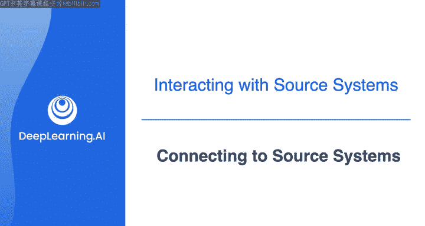
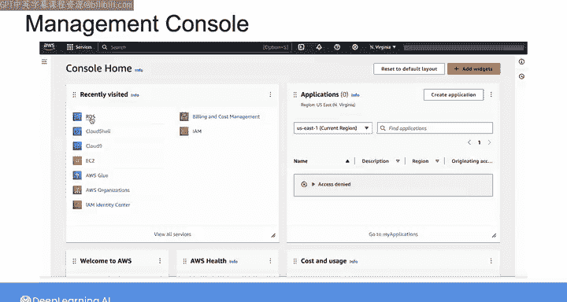
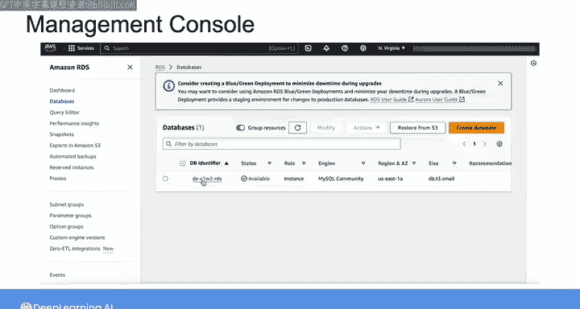
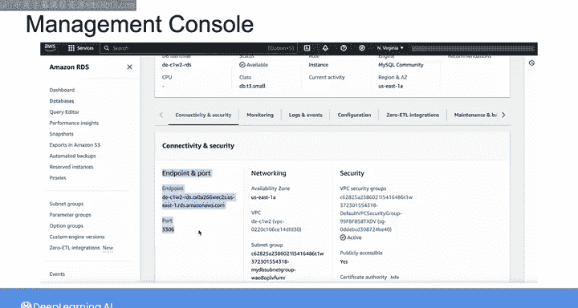
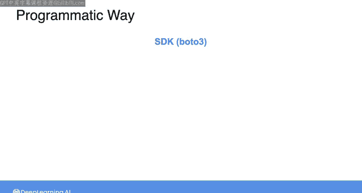
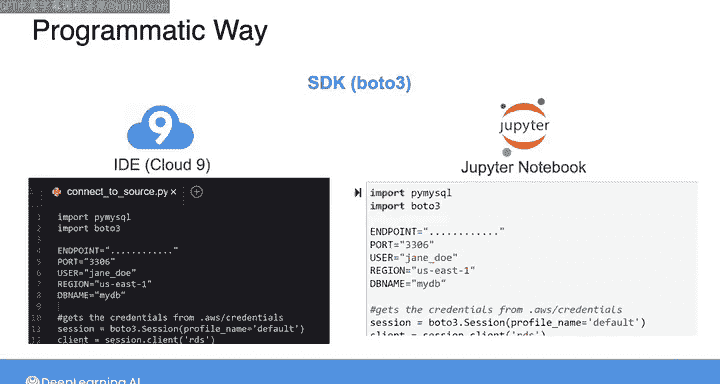
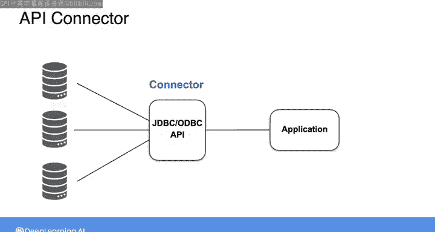

# 吴恩达《数据工程（导论，源系统、数据摄取和管道，数据存储和查询｜1-2-3课）｜DeepLearning.AI Data Engineering》 - P90：12_连接到源系统.zh_en - GPT中英字幕课程资源 - BV1wTtWeeEH5

So far this week， we've looked at a number of examples of source systems。

 but before you can ingest data， you need to first establish a connection to your data source and verify that you're authorized to read data from it。

In fact， you've already had some experience doing this in previous labs。 For instance。

 in the Dynamo Db lab， you use Bodo3， which is the AWS software development kit or SDK for Python to create a client connection to a table within Dynamo DB and you also connect it to an Amazon RDS MySQL instance by running this command with proper parameter values in the cloud9 IDE the endpoint and port information you see here or of what you use to locate the correct database instance and the username and password credentials were used to authenticate you as someone with the proper permissions to access the database。

 And so as you can see， there's more than one way to connect a database or any resource for that matter So let's take a closer look at this if a source system is housed in a resource within your organization's AWS account。

 you can get the connection information from the management console For example。

 if I am trying to connect to an RDS database instance， I can navigate to the RDS。

like thisLocate the database I want to connect to and find the connection information。

 including the endpoint and the port number and just as a side note。

 AWS is always rearranging exactly how things appear in the console so what I'm showing here might look a little different than the console when you're looking at it but this basic set of steps will still be the same and so the console can be pretty convenient for finding information like this or spinning up resources and connections。

 but keep in mind that doing your work from the console involves you navigating through and clicking on widgets and buttons to get things done。

If you had to repeat this process in the future， it could be hard to remember exactly what steps you took。

 and like I said， by the time you want to do this again。

 AWS may have changed how things are arranged in the console， which could make things even harder。

So in general， operating from the console is great to get something done quickly。

 maybe when you're prototyping something in your system。

 but the process is not very repeatable nor traceable as a somewhat more programmatic way of finding the information you need and connecting to source systems。

 you can run code at the command line interface or CLI in this way you can get the database endpoint then you can connect to the database using the command syntaxt specific to the DBMSs you're using。

 and so issuing commands directly in the CI like this is a common practice among data engineers in the connection and ingestion process but it's still relatively manual So it's typically better for simple workloads rather than complicated ones to take another step towards repeatability and automation。

 you can connect to a source system using an SDK like Bodo3 by writing and running code in an ID like Cloud9ine or for example。

 from a Jupyter notebook for certain source systems you can also connect them。

An API connector， for example， you might use a Java database connectivity or JDBC for short or open database connectivity or ODBC for short APIs to connect your application to a DBMS so you can query the database and so you've already had some experience with some of these methods for connecting to source systems and in the reading item that follows this video。

 youll find materials that go over more of the details of each of these methods。

After reviewing these materials， join me in the next video for an overview of identity and access management and permissions。

