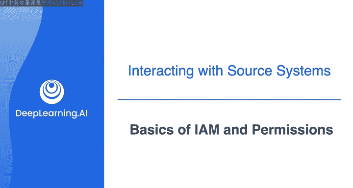
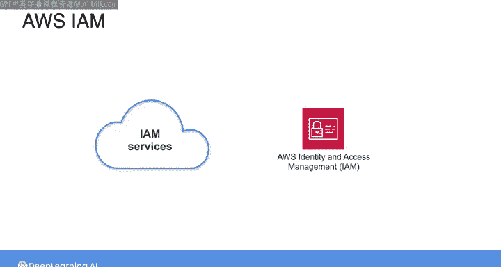
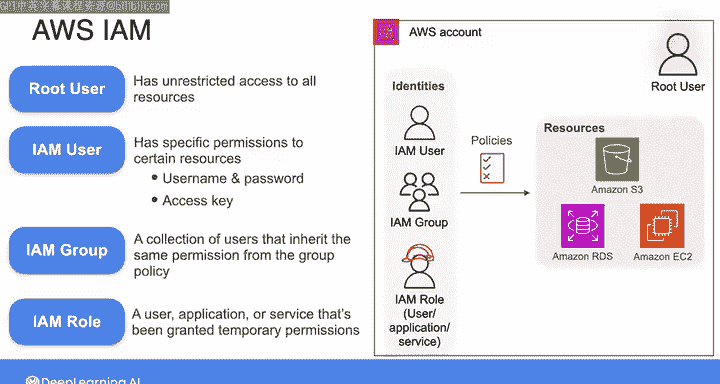
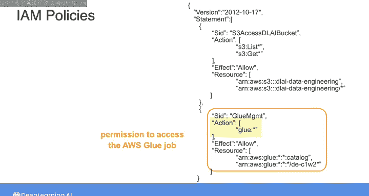

# 吴恩达《数据工程（导论，源系统、数据摄取和管道，数据存储和查询｜1-2-3课）｜DeepLearning.AI Data Engineering》 - P91：13_IAM和权限基础.zh_en - GPT中英字幕课程资源 - BV1wTtWeeEH5

When you're building data pipelines in a cloud based architecture， identity and access management。

 also known as IM， is central to your role as a data engineer。As I said in the previous course。

 as a data engineer， you're entrusted with sensitive data。

Whether that's the personal and private information of your clients or proprietary business information。

The owners of that data are trusting that their information is safe in your hands Now security on the cloud is a vast and complicated subject。

 but for the purposes of these courses， we're going to focus on the basics and that's because by simply adhering to a basic set of best practices you will be able to successfully avoid the vast majority of data disasters In fact a study in 2023 found that more than half of all cloud data breaches were caused by simple human error things like insecure storage of passwords or other credentials or IM misconfigurations these data breaches can be extremely costly so by ensuring the security of your data pipelines you can help your company save money sometimes millions of dollars or more and protect its reputation and yours in my own work with clients I've been amazed at how many mistakes I see that could be corrected with a simple fix I' have seen people do things like storing confidential data in a public。

S3 bucket putting access credentials up on Github or providing essentially admin access to data resources for everyone at the company these types of things are easy to fix but present a major risk to your company and could cost you your job if disaster strikes on your watch So my goal is to set you up for success so this doesn't happen to you down the road let's dive into the basics of how you'll be working with permissions and I am as a data engineer First off I am is a framework for managing permissions permissions define which actions and identity like a person or an application can perform on a specific set of resources like a database or an ETL tool I am ensures that the appropriate set of identities have access to the right resources at the right time remember the principle of least privilege we talked about in the previous course I am is how you exercise this principle in practice as it allows you to grant people an application。

Access to only the essential resources they need to do their jobs and only for the duration that it's required。

 For example， a So system owner can grant a data ingestion system the ability to read data from only a specific table in a database for a limited period of time but not granting unnecessary access to your cloud resources when they're not needed you're also preventing your team from incurring unnecessary cloud costs Many cloud providers have built an IM services that help users manage access and permissions to their cloud resources For instance。

 AWS I am as a web service that helps you manage and securely control access to AWS resources in your account In fact。

 throughout these courses so far we've been using AWS IM to provide you with appropriate access to AWS resources in the labs as a brand new data engineer chances are that you won't be the person setting up I am configurations at a high level across your company's cloud service account。

 but you will be interacting with。

various cloud resources and you may be responsible for configuring IM for the resources you deploy as part of your data pipelines and so you need at least a basic understanding of the different IM components so that you can operate securely and troubleshoot problems as they come up and so we'll look at these IM components in the context of AWS IM but just know that these same types of components or comm and across other cloud providers like GCP or Azure they just might go by different names in some cases in AWS IM you'll use policies a grant identities permissions for actions on AWS resources there are different types of AWS identities there's the root user who created the AWS cloud account and has unrestricted access to all resources in that account then there are IM users who are given specific permissions to certain resources as a junior data engineer it's most likely that you'll be assigned an IM user account within your company's AWS account。

You'll be given a set of longterm credentials like a username and password or an access key that you can use to programmatically access AWS resources using code then there are IM groups which are collections of users that you can attach a policy to a policy is just a JSO document that includes the details of what resources and permissions the group should have in this case This streamlines a process of provisioning resources For example。

 your company might have an IM group for data engineers where every user in that group has access to the resources needed to build and maintain data pipelines and finally there are IM roles which are not associated with a specific person or application long term but are briefly assumed by a user application or service to grant them temporary permissions to perform specified actions on your AWS resources for a limited time For example。

 by default and EC2 instance does not have permission to read or write to Ss3 storage but。

can create a rule that has read and write permissions to specific S3 buckets and let the EC2 instance assume this role when needed This is a much more secure way to give the EC2 instance permission to work with S3 than for example。

 storing your long-term user credentials within the EC2 configurations if you ever get an access ton error message when making a request with temporary rule credentials it's good to check whether those credentials have expired This is another issue that is very common when it comes to IM configurations to help you see how IM policies to work let's take a look at a part of the AWS policy that gave you access to the resources you needed for of the labs the previous course from the first statement here you can see that the policy allows the user in this case you permission to access any S3 buckets whose name begins with the DL AI dash data dash engineering and that's because you have this little asterisk or star after the name and then you are allowed to take these actions which include list star or get star。

So again， these asterisks means you can take any action that begins with list or get in this case。

 these actions include listing the contents of a bucket or the names of buckets you have access to。

Or in the case of get these actions include getting objects from a bucket or information about a bucket like the region the bucket is located in the second statement is similar and allows you permission to access the AWS glue job associated with the lab and this glue dot star under action just means you can take any action with regard to that glued job and so during the lab when you make a request to run the AWS glue job AWS first evaluates this policy to determine if you are allowed to perform this action with glue so those are the basic components of IM you have the root user IM user groups。

 roles and policies。

You'll find more details about these components in the reading materials and follow this video。

After reviewing those materials， join me in the next video to look at networking in the cloud。

