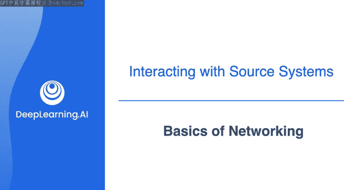
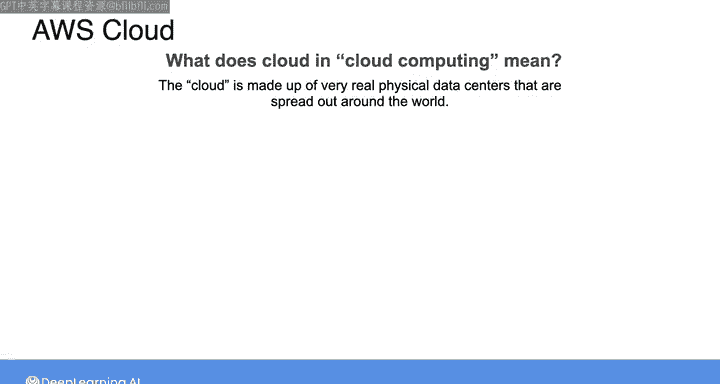
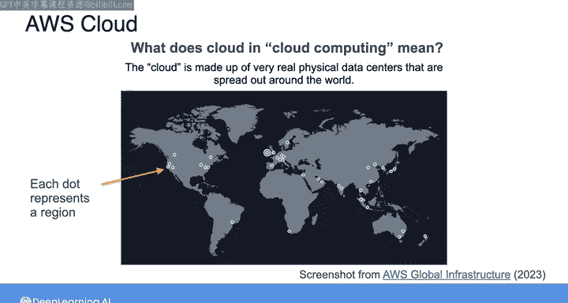
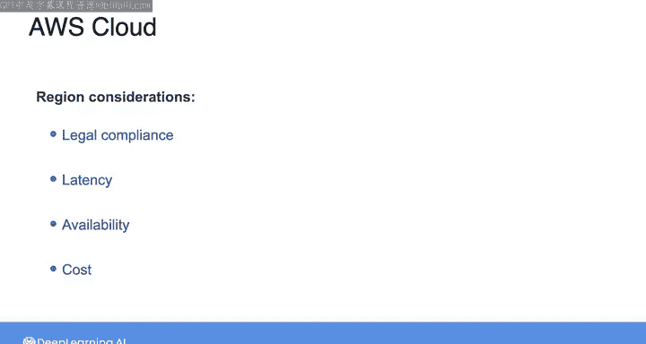
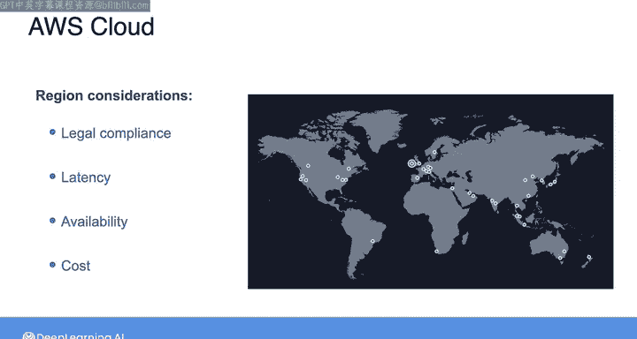
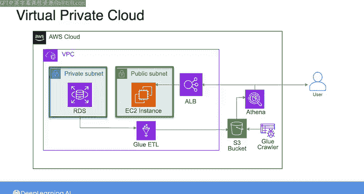

# 吴恩达《数据工程（导论，源系统、数据摄取和管道，数据存储和查询｜1-2-3课）｜DeepLearning.AI Data Engineering》 - P92：14_云中网络基础.zh_en - GPT中英字幕课程资源 - BV1wTtWeeEH5

When you're building a data pipeline in a cloudbased architecture。

 what you're really building is a network of connected resources and so the way you configure that network plays a key role in ensuring that the dataflow properly throughout your data pipeline In the previous course you looked at the basics of networking and how networking is really just a collection of connected devices that can share data and communicate among themselves and over the internet here I'd like to revisit and expand on some of those basic networking principles to prepare you for the problems you might encounter when trying to connect to So systems when it comes to networking in the cloud。

 the basic principles are roughly the same across all major cloud providers。

Here I'll go over the principles in the context of AWS since that's where you're working with in these courses。

 but just know that the underlying concepts apply to whatever cloud you're working on the term cloud computing can sound a little abstract like computation is somehow happening out in the ether but make no mistake the cloud and cloud computing is made up of very real physical data centers that are spread out around the world as you learned in the previous course the AWS cloud is a global network that is spread across different geographical areas known as regions Each region contains clusters of availability zones and each availability zone consists of one or more data centers with redundant power networking and connectivity in many cloud computing applications data and resources are replicated across regions and availability zones to ensure that systems keep working even if one or more data centers were to go down as a data engineer spinning up new resources on the cloud。

 you'll need to decide which region to host。

Re in in doing so you might need to consider things like legal compliance for example。

 does storing your data in a specific region mean it needs to adhere to unique data privacy or regulatory requirements you might also need to consider other factors like latency and availability in general。

 the closer your end users are to the region where your resources are hosted。

 the lower the latency and the more availability zones。

 your resources are replicated across the better you will be able to withstand or recover from a disaster in addition to these considerations the cost of resources can vary from one region to the next which may be a factor in your decision and so when you're actually working with resources on the cloud it can be easy to lose sight of the fact that what you're really doing is interacting with a network of physical devices that are spread out around the globe but as a data engineer it's important to understand how this global infrastructure is set up and how it impacts things like latency cost reliability。

And availability of the systems that you build。So moving back to important things you need to know about networking in the cloud within any given region。

 you can create custom virtual private clouds or VPCs。

 which are smaller networks that span multiple availability zones within a region creating VPCs allows you to have more fine grain control over who can access what resources and so you can then divide the space in your VPC into subnets or subnets for short that house your actual data pipeline resources Each subnet can then have its own security rules known as a network access control list or network ACL for short as well as routing configurations through an internet gateway This lets you create public subnets for internet facing resources like web servers and private subnets for internal resources like databases for example。

 in one of the labs in the previous course you worked with in architecture that look like this where you had a source database inside a private subnet to prevent the data from being accessed over the internet。

Then you had an EC2 instance inside a public subnet that allowed it to run a web application that made analytical data available to customers over the Internet In that lab。

 you adjusted the security group of the application load balancer to control public access to your website。

Instead of keeping all ports open， you edited the inbound rules to block all ports except port 80 to all incoming traffic in the real world。

 things can get complicated very quickly especially when you start setting up multiple VBCs， subnets。

 gateways and routing configurations between resources and it's in this context that the simple act of connecting to a database depends on multiple layers of networking configurations。

 not to mention IM permissions， and so understanding the details of network configuration is critical when it comes to connecting to your source systems。

It's also required for successful orchestration and automation and data pipelines。

 which we'll get into in the last week of this course up next。

 Morgan will walk you through the details of networking on AWS and after that I'll show you what you can expect in the upcoming lab where you'll debug your connection to a database。

