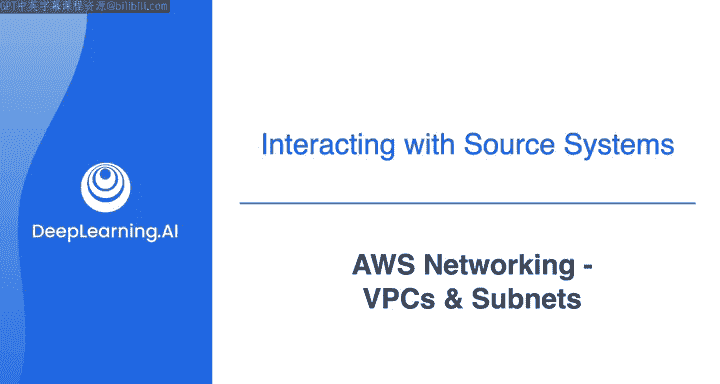
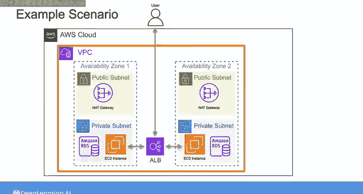
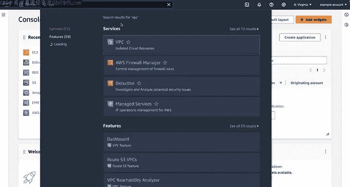
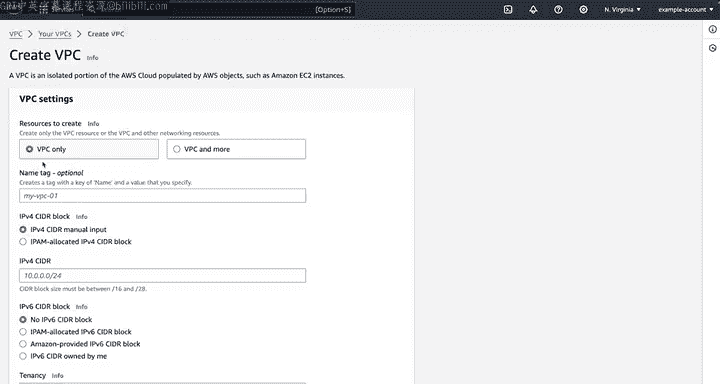
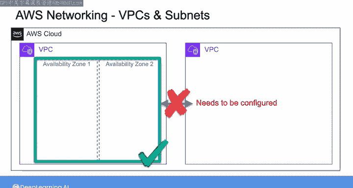
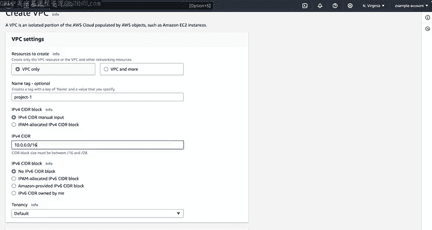
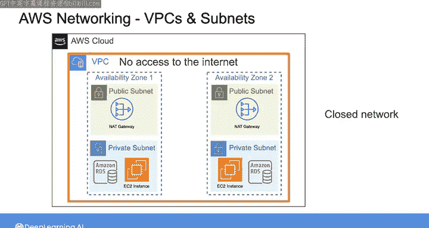

# 吴恩达《数据工程（导论，源系统、数据摄取和管道，数据存储和查询｜1-2-3课）｜DeepLearning.AI Data Engineering》 - P93：15_AWS网络概述：VPC和子网.zh_en - GPT中英字幕课程资源 - BV1wTtWeeEH5

As Joe has already emphasized， networking will be a significant part of your job as a data engineer and networking can feel overwhelming at first。

 with all there is to know about setting up connections between resources， permissions。

 security and all the rest， but don't worry networking in the cloud is something you can become proficient It just takes time and understanding a set of core concepts and how you can apply those concepts in building your data systems through this and the next several videos。

 I'll go over the details of these important core concepts including Amazon virtual private clouds or VBCs。

 subnets， gateways， route tables， network access control list and security groups。

 and I'll demonstrate how you can implement these elements of your data pipelines on AWS。

So I'll go through a series of demos over the next few videos where I'm going to show you how to build out the VPC and networking components for a scenario where you need to deploy an Amazon RDS database and an Amazon EC2 instance。

With this example scenario， let's imagine there is a web application running on the EC2 instance that allows you to query the database running on RDS。

 This is a simple scenario for any kind of web application with a relational database on the backend so the end state will look like this one VPC with two public and two private subnets EC2 and RDS database instances deployed into the private subnets and net gateways in the public subnets as well as an application load balancer to front the web application running on the EC2 instances。

 I'll walk through each setup step for this scenario that is related to networking and explain all of these components as we go along we won't actually deploy the EC2 or RDS instances or the application load balancer but we will build out all of the networking components needed for it Having a scenario in mind will hopefully make the networking concepts easier to grasp So to get started。

 we will need a VPC and sub。place the EC2 and RDS instances in let's go ahead and complete that task from the AWS console homepage。

 I will go to the search bar and type VPC。

Then I'm going to select a VPC。This brings us to the VPC dashboard where I can then select the createreate VPC button Now on the createreate VPC page。

 I am only going to create one VPC， then we will manually create the subnets next Before moving ahead。

 though I want to point out that there is what's called a default VPC in each region by default in an AWS account The default VPC includes a public subnet in each availability zone in that region and an internet gateway。

Using the default BPC can allow you to quickly launch public internet facing EC2 instances without additional setup this can be convenient for experimenting with launching public resources like a simple website。

But for most real world use cases， you likely don't actually want directly public facing resources and instead you want network protected resources so with that in mind your default should not be to use the default VPC for any real work。

Instead， you should create custom VPCs for your specific use cases。

And that's what I'm going to show you how to do here As you learned in the previous course。

 AWS operates in regions around the world， and these regions are made up of multiple availability zones or AZs for short。

 A VPC has the ability to span all of the AZs within the region in which the VPC was created here we're going to create one VPC but a region can have more than one VPC in it。

 For example， you might create different VpCs for different projects。

 environments or other organizational or technical considerations Each VPC is isolated from other VPCs by default resources within the same VPC can communicate with each other but communication between resources from two different VpCs is something you would need to design and configure when you create a VPC you need to give it a name a private IP address range and choose the region you want it to be placed into It's useful to give VPCs a descriptive name so you can more easily identify which VPC is。

。So I will go ahead and name this VpC project1 and you can see here the region I'm creating this VpC in is US East1。

 but I could choose another region from the dropdown if I needed to Next you need to define the IPV4 cider block cider stands for classless interdomain routing and it defines the range of private IP addresses that can be used within the VpC or how many private IP addresses are available in the VPC Any resource that gets deployed into this VPC will be assigned a private IP addresses from this range That being said。

 if you want to create a resource that is available via the internet。

 you would also need to have a public IP address Any public IP address assigned to it would come from a pool of Aws managed public IP So this cider range here is only for private IP addresses So here I'm going to type 10。

0。0。0 16 for the cider and I'd like to pause now and go over this cider。

Because it can seem complicated if you're not used to seeing it。

 I'm going to try to simplify it to make it easier to grasp if this is your first time getting into the details of networking。

IP addresses have four numbers separated by dots。 Each number can range from 0 to 255。

 In other words， each number in the address is an8 bit integer value In the case of this example 100。

0。0 s 16 the 100。0 do0 is the starting address of our network the slash 16 part is a prefix length which tells you how many bits are used for the network part of the address。

 So in this case， the slash 16 tells you that 16 bits or in other words。

 the first two of these 8 bit integers will be the network prefix In binary form。

 an IP address consists of 32 bits which again just means that each number between the dots in the address represents 8 bits with four numbers of 8 bits each there are 32 bits for the entire IP address So as I said。

 the s 16 means that the first 16 bits or the first。

Two numbers are fixed and defined the network while the remaining 16 bits or the other two numbers can vary and are used for host addresses within that network that means that any resource deployed into this network would have a private IP address that starts with 10。

0 then the other two numbers could be anything between 0 and 255 if I wrote slash 24 instead of s 16 that would mean that the first three numbers would be fixed and only the last number would be able to be used to assign host addresses。

You'll see why you need to know this in the next step when we create subnets So now back in the AWS console。

 I have defined find the different pieces I need to create a VPC and I can select create VPC From here I need to create the subnets Subnets are subnet within the VPC or smaller divisions of the private IP space for the VPC that you can use to group resources based on their network access and security requirements Later will use network access control list and security groups to control what types of network traffic can come in and out of each subnet each subnet is associated with a specific AZ meaning that when you create a subnet。

 you must specify which AZ it resides in by strategically placing your resources in different subnets across multiple AZs you can enhance the redundancy and availability of your applications It's common to create at least one gra and one public subnet per AZ that you intend to use here I would like to deploy the。

Two instances and RS databases into private subnets so that they aren't exposed to the internet and for redundancy。

 I plan to create two public subnets and two private subnets across two AZs in this VPC which is a common pattern to follow that way。

 for example， if the primary database instance experiences degradation or if the AZ itself has temporary availability issues you have all of your data and an instance running in another AZ that can absorb the traffic after failover occurs so to create these subnets I will select subnets in the navigation and then select create subnet Now I need to select which VPC I want to create the subnets in I will select the dropdown and choose the project1 VPC from this page I can create all four subnets For the first subnet I will name it public subnet1 and then select a specific Az so later I can ensure I am deploying additional subnets to different AZs。

Select US East 1a for this one then I need to give it a cider range and subnets need to have an IP range that is a subset of the IP range of the VPc。

 The VBC is defined to use 10。0。0。0 16 so I will make the range for this first subnet10。0。

1024 This means that any resource deployed into the subnet will be assigned an IP address that starts with 10。

0。1 Then the last number will be assigned to identify the specific host Now to create my first private subnet I will select add new subnet and then repeat the same steps。

 but this time I will name the subnet private subnet 1 and give it a cider of 10。0。2。0 24。

Now let's do it two more times for the other public subnet and private subnet for the other AZ。

 which I will use US East 1B for。So the next thing to do is to create the public Subnet 2。

 which has a cider of 10。0。3。0/24， and then private subnet2， which has a cider of 10。0。4。0/24。

Then I can finally select create， which will create all four subnets。All right。

 you now have a VPC with two public and two private subnets ready to use and it looks like this。

 the way this sits right now， anything deployed into this VPC would not have access to the Internet。

 you can add the EC2 and RDS instances to this diagram to show them sitting in the private subnet。

 neither of these resources would be accessible from the internet and they wouldn't be able to initiate connections with any resource on the Internet either So at this point it's a closed network and you will need to deploy and configure some more resources to make internet connectivity possible for anything in this VPC Up next。

 we will look at internet connectivity and how Internet and net gateways work。

