# 吴恩达《数据工程（导论，源系统、数据摄取和管道，数据存储和查询｜1-2-3课）｜DeepLearning.AI Data Engineering》 - P94：16_AWS网络：互联网网关和NAT网关.zh_en - GPT中英字幕课程资源 - BV1wTtWeeEH5

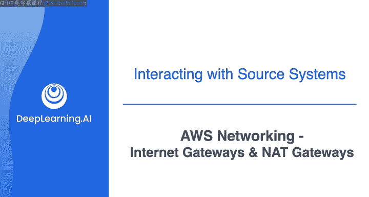

At the end of the last video， we had created a VPC with two public subnets and two private subnets。

 and like I said， if you deployed any resource like an EC C2 instance into one of the public subnets it would not be accessible via the Internet and it would not be able to establish connections to other resources on the Internet either。

 That is because VPCs and subnets alone create an isolated network No traffic in or out in this video。

 we will discuss how to make internet connectivity possible using internet gateways and network address translation or net gateways。

 Now， if you recall the scenario we are following you would have an E2 instance and an RDS database in your VPC as a best practice。

 both the application running on the EC C2 instance and the RDS database should be in private subnets and wouldn't need direct connectivity with the Internet。

 However， I want to call out two considerations we didn't discuss before。

I that the applications running on the EC2 do need to occasionally download updates from resources on the internet for things like application upgrades and patching and the second consideration is that you would still need a way to submit requests to the application running on the EC2 instances through the load balancer so that you can query your data on RDS both of these considerations mean that your VPC does in fact need internet connectivity so to do that you need to first attach an internet gateway to the VPC to better understand what an internet gateway is and what it does I want you to think of your VpC in its current state like a house without a door if you build a house around you without a door you wouldn't be able to leave the house and no one can enter the house from the outside。

If you were in the house， you could move freely from room to room。

 but in order to get out you would need to install a door to the outside world so that's what we have so far here。

 a house without a door and so what we will be doing next with our VPC is to install a door to the internet or in other words we will attach an Internet gateway to it Internet gateways allow resources in your public subnets to connect with the internet they support both inbound and outbound traffic creating an internet gateway and attaching it to the VPC is just one step in allowing internet traffic to flow to and from the public subnets you will also need to configure routes in the route tables and configured network security rules and we will do those in the next couple videos。

😡，Now I mentioned earlier that our EC2 instance will be in private subnets and here I am saying that we will be attaching an internet gateway to allow traffic to flow to and from the public subnets how will this help if our resources are in the private subnets Well let's recall our two considerations from earlier First the E2 instance needs to be able to download updates from resources on the internet This means that our EC2 instance in the private subnet needs to be able to make outgoing connections from the VC and the second you need to be able to submit requests to the application from the internet let's talk about how net gateways and an application load balancer can help us meet these requirements the net andNe gateway stands for network address translation and this is a service that allows resources and a private subnet to connect to the Internet or other AWS services but prevents the Internet from initiating connections with those resources Think of it as a controlled doorway。

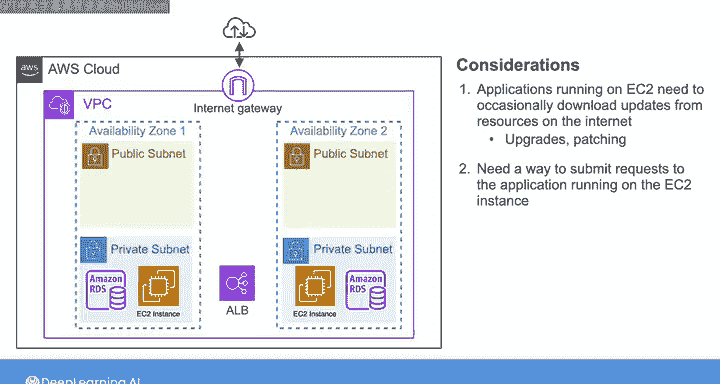

That only allows outgoing traffic and protects the resources inside that are initiating that traffic with the net gateway in place。

 your EC2 instances in the private subnet can download updates and patches from the internet without exposing them directly to the public internet Next。

 we need to address the second consideration allowing external users to submit requests to our application This is where the application load balancer or ALB comes in。

The ALB distributes incoming application traffic across multiple backend targets like our EC2 instances。

 which are hosted across two availability zones。 the ALB serves as the entry point for external users handling the load and ensuring the application remains responsive and available while also allowing us to keep those EC2 instances private we won't actually be building this part since I am focusing on the networking aspect of this architecture for these lessons however。

 it's good to know when to use an ALB to allow for application connectivity without directly exposing your backend EC2 instances All right so now let's create an attach an Internet gateway and deploy two net gateways to the VPC we built in the previous video here I am in the AWS management console on the homepage and I will type in VpC into the search bar then from the VpC dashboard I will select Internet gateways from the navigation panel from the Internet gateways page。

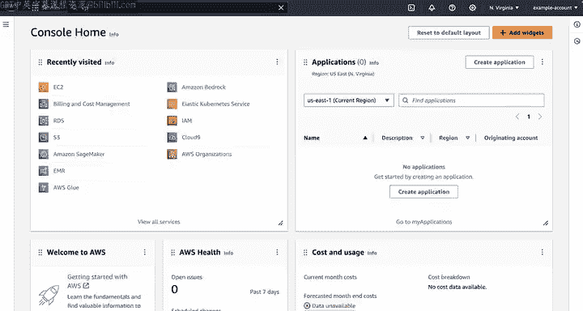

I will select the createate Internet Gateway button on the next page。

 I can give the Internet Gateway aid name， I'll name it Project1 Gateway and then select createreate Internet Gateway。

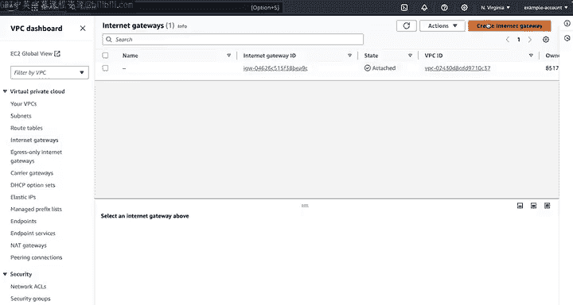

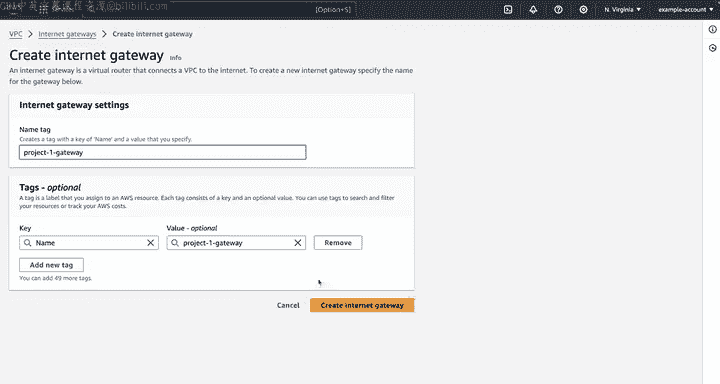

So now we have an Internet gateway， but we need to attach it to the VPC。 just as a note。

 one VPC can have one Internet gateway and an Internet gateway can only be attached to one VPC at a time。

 This is a one to one relationship from here I'm going to select actions。

 then attach to VPC on the next screen from the list of VPcs。

 I can select the project1 VPC and then select attach Internet gateway Now the state of this gateway is attached So we have installed the front door to this VPC The next step is to create the net gateway。

 It's a best practice to create one net gateway in every Az that you are operating in。

 So I will actually create two net gateways and place them in each public subnet。

 to do this from the navigation panel。 I will select net gateways then create nett gateway from this screen。

 you'll configure the net gateway。 So first， I'll give it a name。

 I'll call this one gateway 1 and then select。

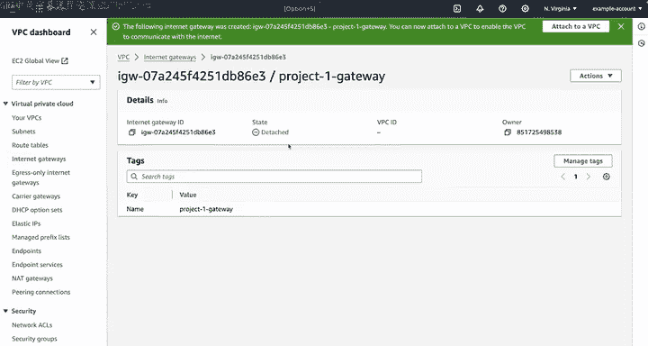

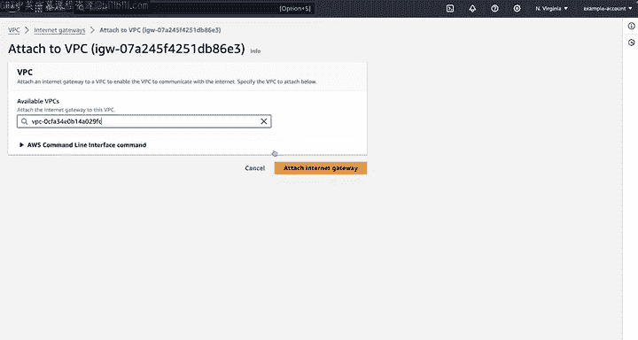

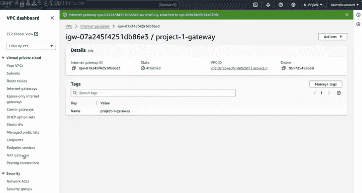

Subnet1 from the dropdown。Then this needs to have an elastic IP address configured。

 which will provide a static IP address， and I will select Alloc Elastic IP to do this。

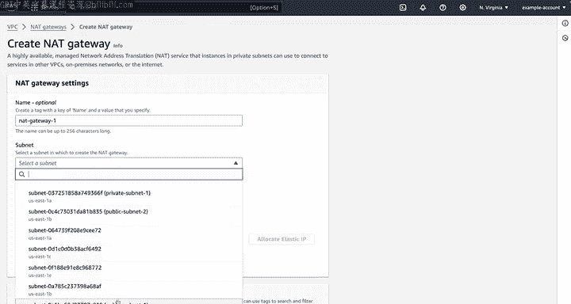

Then I will select createreate NAtGateway， then I will repeat the steps。

 but this time place the NAt gateway into the other public subnet。

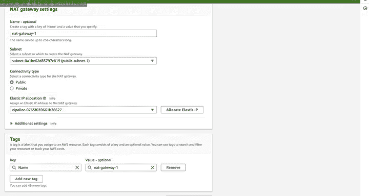

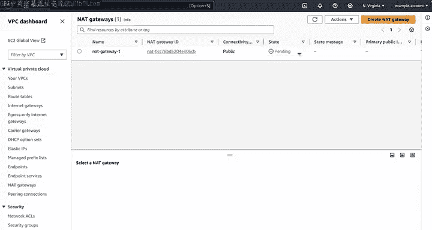

I'll name this one Nat Gateway2， and then select public Subnet2 from the dropdown。

 create the elasticastic IP address， and then finally create the gateateway。

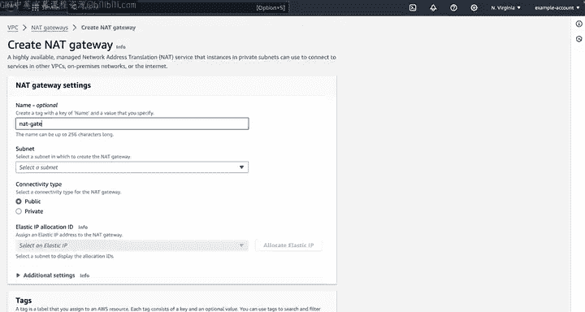

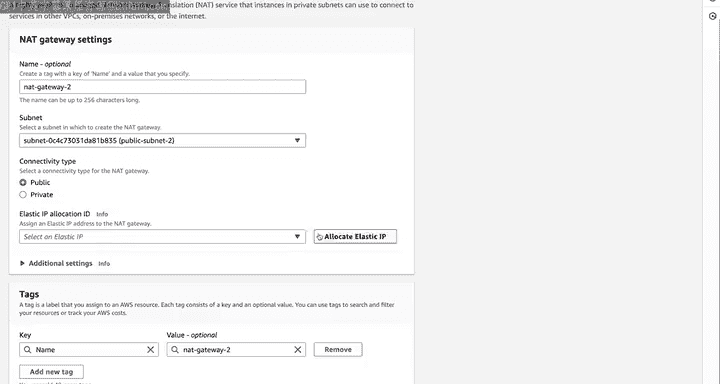

At this point， this is what our network looks like with the EC2 instances。

 RDS database and ALB included， there are a few more steps that we need to walk through before inbound and outbound internet connectivity is working in the next steps we will walk through the process of setting up the necessary elements。

 which will include configuring route tables and defining security rules to secure our VPC。

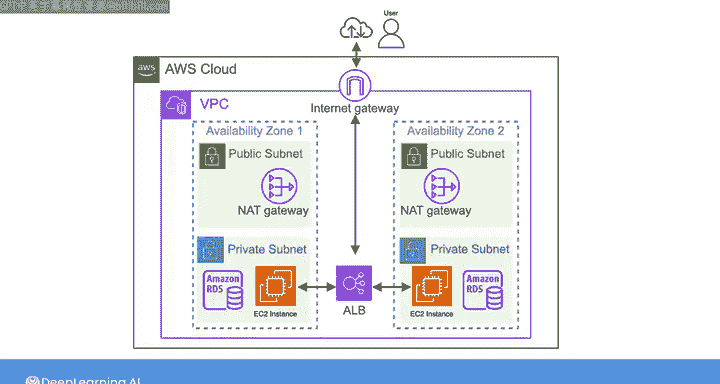

By the end of this series of videos， we'll have a VPC with both secure internet connectivity and robust access control。

