# 吴恩达《数据工程（导论，源系统、数据摄取和管道，数据存储和查询｜1-2-3课）｜DeepLearning.AI Data Engineering》 - P95：17_AWS网络：路由表.zh_en - GPT中英字幕课程资源 - BV1wTtWeeEH5

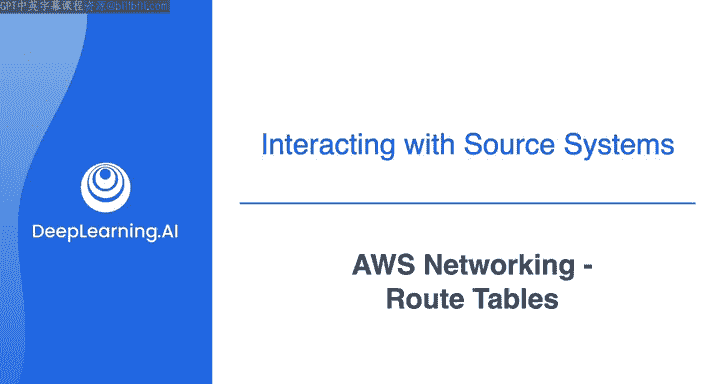

The next basic component of networking on AWS you need to learn about are route tables In the last video。

 we ended with an architecture diagram like this。 There is a VPC with two public and two private subnets across two AZs and an internet gateway attached to the VPC with EC2 instances and RDS database instances in the private subnets netgateways deployed in the public subnets in each Az and a public application load balancer which fronts the private EC C2 instances。

 The next step to enable internet connectivity is to configure the route tables for the subnets route tables are essential for directing network traffic within your VPC Each subnet can be associated with a route table which contains a set of rules or routes that determine where network traffic is directed When you create a VPC AWS automatically creates a default route table This default route table allows internal communication within the VPC meaning resources。

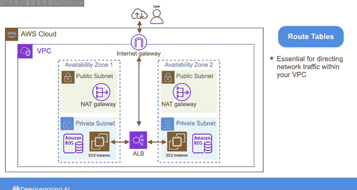

And different subnets can communicate with each other however。

 it does not include routes for internet connectivity This is where you need to customize your route tables to meet your specific requirements Without these routes your subnets won't know how to direct traffic either to the Internet or within the VPC itself for public subnets。

 you'll configure the route table to direct all internetbound traffic to the Internet gateway This allows resources in the public subnet to access the Internet for private subnets。

 you'll direct internetbound traffic to the net gateway in the public subnet This allows resources in the private subnet to make outbound connections to the internet while preventing inbound connections from the Internet Let's hop into the AWS management console and build out these route tables and routes。

First， I will create and associate the route tables。

 Then we will actually go back in and create the actual routes。 starting from the VPC dashboard。

 I will select route tables from the navigation panel and then select create route table。

 I'll create one route table per subnet in our VPC。 The first one， I will name public route table 1。

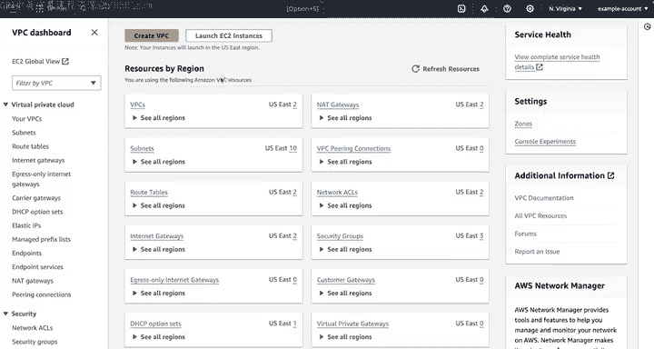

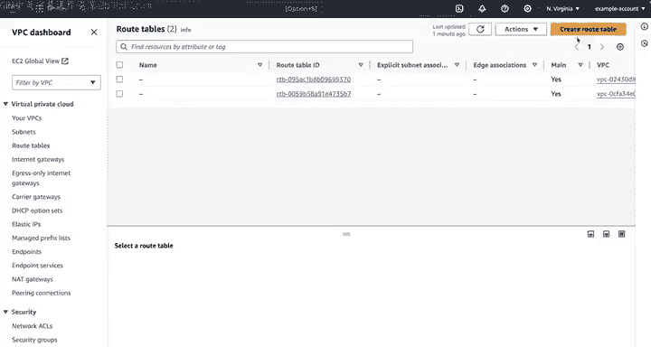

And then select Project1 VPC。And then select createre route table。

 Then I can associate this one with the first public sumnet by selecting actions。

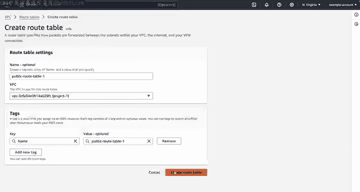

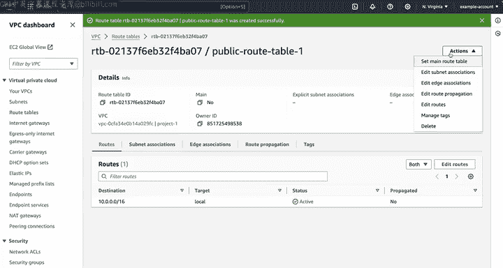

Edit Subnet associations。Selecting public Subnet1 and then save associations Next。

 we will do the same for the other three subnets。 Select route tables， create route table。

 name the second one public route table 2。

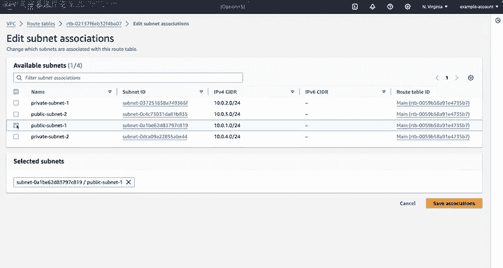

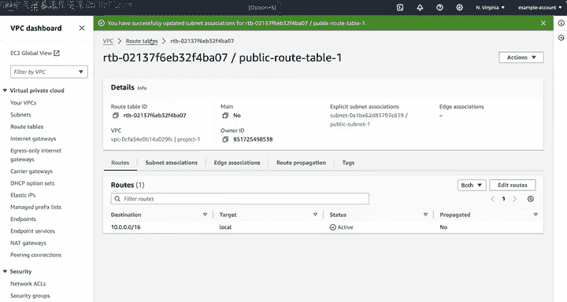

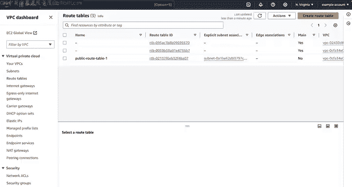

Select the VPC。

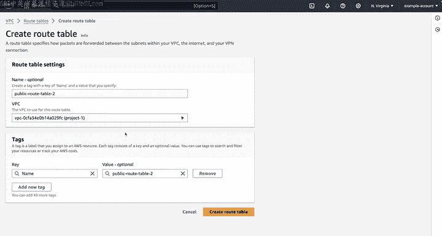

And create。Then associate this route table with public subnet 2。

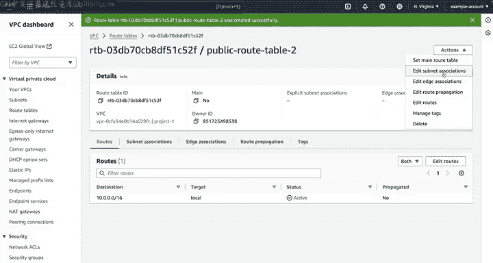

Now it's time to create the private route tables， I can name this one， private route table one。

 select the VPC and create。

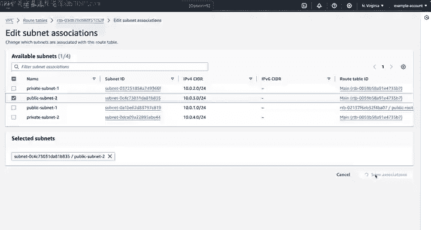

Then associate this route table with private subnet 1。And finally， to create the last one。

 I'll name it private route table2， select the VPC and create。

 then associate this route table with private subnet 2 Now that we have the route tables。

 It's time to create the routes For this step， we will want to create routes for the traffic that will flow between the public subnets and the Internet gateway and routes for the private subnets that will flow to the net gateway from the route tables dashboard。

 I will select public route table 1。 and then select edit routes。

 there is already one route in the table and this route is a default route added to every route table that you create for communication within the VPC to add the route to allow Internet traffic to be directed to the Internet gateway。

 I will select add route， then for the destination， this will be 0。0。0。0 slash 0。

 If you remember the lesson about cider notation。 This has a slash0 prefix。

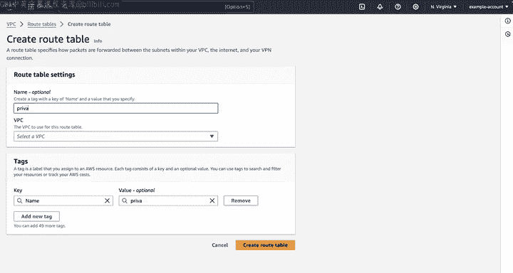

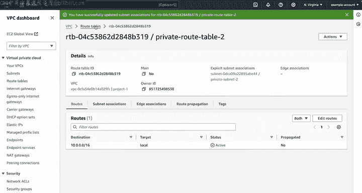

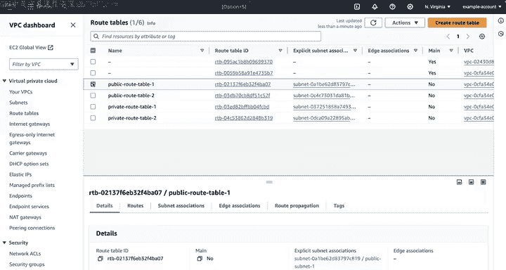

Which means it can match any IP address because zero bits are fixed This represents any IP address or in other words。

 the entire internet So the destination is 0。0。0。00 or any IP address so the route we will want to direct traffic to is the Internet gateway so under target I will select the dropdown and then select the internet gateway attached to this Vpc we created in the last video I'll set up this route along with other networking configurations and the next video to allow instances in our public subnet to send and receive traffic from the internet via the Internet gateway。

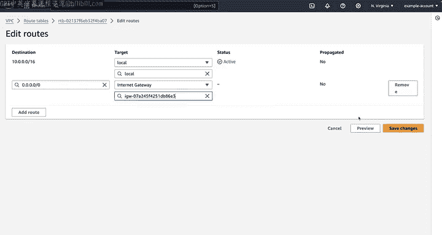

I will now select Save Change and then navigate back to the route tables page。

Let's move on to configuring the private subnets route table。

 I'll select a route table associated with one of our private subnets and add a new route。 Again。

 the destination will be 0。0 do0。0 slash0。 but this time the target will be the net gateway that we deployed to the public subnet。

 This ensures that any internetbound traffic from our private subnet instances is routed through the net gateway。

 allowing these instances to access the internet for updates and patches while remaining isolated from direct inbound internet traffic to complete this。

 you would do the same steps for the other public and private subnets。 Now。

 our route tables are configured to handle both internal and external traffic as required。

 The public subnets have routes directing internetbound traffic to the internet gateway。

 enabling instances within these subnets to communicate with the internet。

 The private subnets have routes directing internetbound traffic to the net gateway allowing instances within these subnets to make outbound connections to the internet。

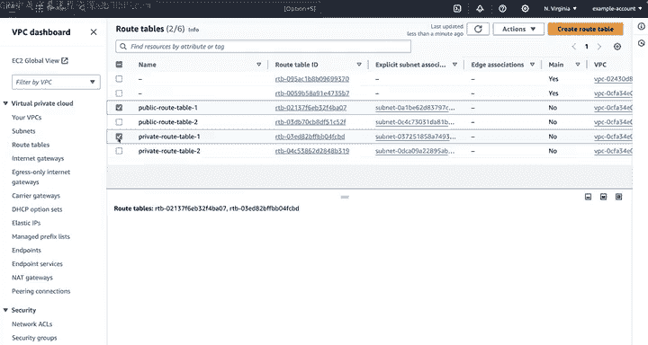

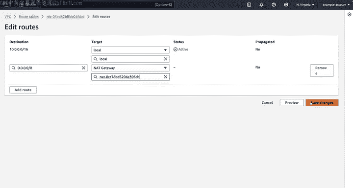

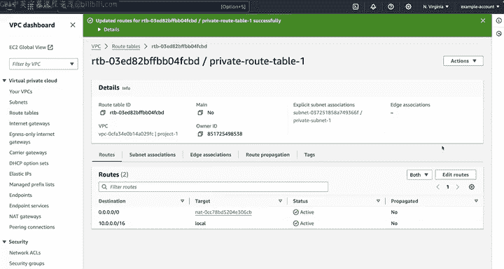

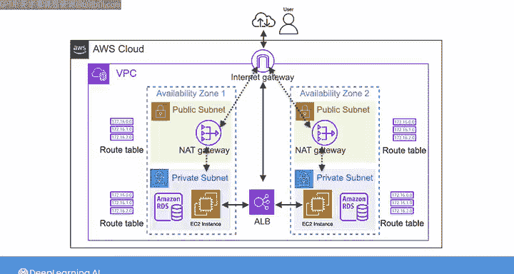

Sely in the next video we'll cover additional networking configurations such as security groups and network ACLs these configurations will further secure our VPC by defining the inbound and outbound traffic rules for instances and subnets。

