# 吴恩达《数据工程（导论，源系统、数据摄取和管道，数据存储和查询｜1-2-3课）｜DeepLearning.AI Data Engineering》 - P96：18_AWS网络：网络ACL和安全组.zh_en - GPT中英字幕课程资源 - BV1wTtWeeEH5

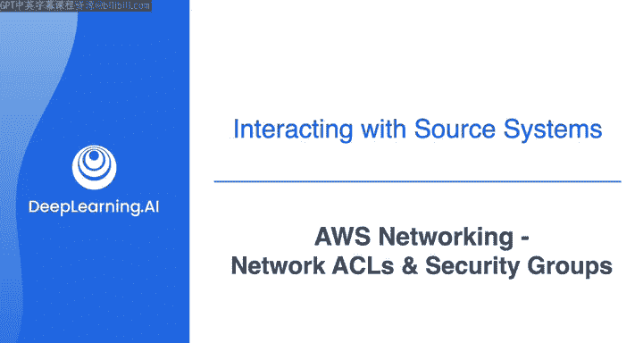

As a reminder， in the previous video， we left off having configured the route tables for these subnets。

 which will direct traffic for the VPC。Here we'll look at a few other networking configurations you're going to need to know about in our scenario。

 the application load balancer will send internet traffic to the EC2 instances which would then create a connection with the RDS database instances for queries you can configure networking rules to allow only the network traffic you want to reach these instances By default。

 no traffic is allowed to reach these instances even with the route tables in place To change that you first need to understand security groups and network access control list or network ACLs。

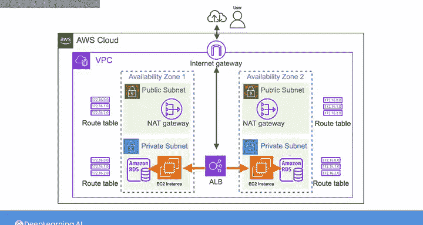

Let's start with security groups think of security groups as instance level virtual firewalls controlling both inbound and outbound traffic by default。

 security groups deny all inbound traffic and allow all outbound traffic so you need to define inbound rules which determine what types of traffic you want to allow and where you want to allow that traffic to come from security groups are also stateful。

 which means that if you allow inbound traffic to an instance。

 the return traffic is automatically allowed even if there are no outbound rules explicitly permitting it for instance。

 if you permit an inbound HtTP traffic on port 80 the responses to those HttP requests are allowed to flow out without needing an explicit outbound rule this stateful nature simplifies security group management because you don't have to create matching outbound rules for every inbound rule。

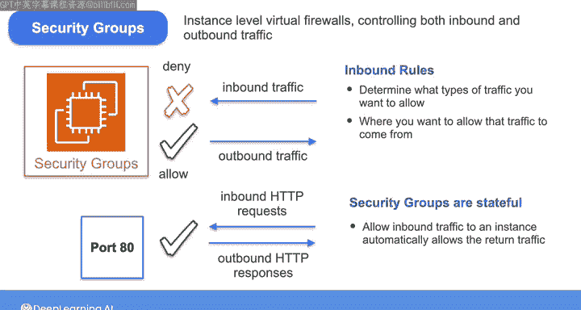

Resources that are placed in VpCs use security groups like EC2 instances。

 load balancers and RDS database instances all can use security groups with different rules and the rules for security groups can reference other security groups In our example we have an application load balancer that would need to accept traffic for httP on port 80 and Https on port 443 from the internet then we have an EC2 instance hosting a web server so you'll need to allow HttP and Https traffic coming from the application load balancer so you could reference the security group used by the load balancer we also have RDS database instances which would need to allow TCP on port 3306 which is commonly used by databases like MysqL coming from the security group used by the EC2 instances This is called security group chaining Now let's walk through an example of creating。

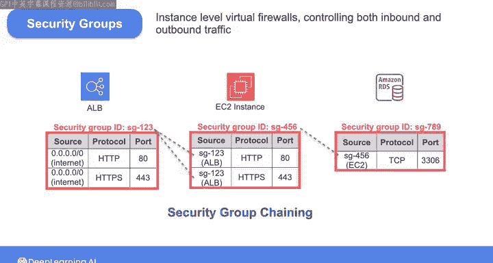

Security group that could be used by the application load balancer to set up a security group。

 navigate to the VpC dashboard， and then select security groups。

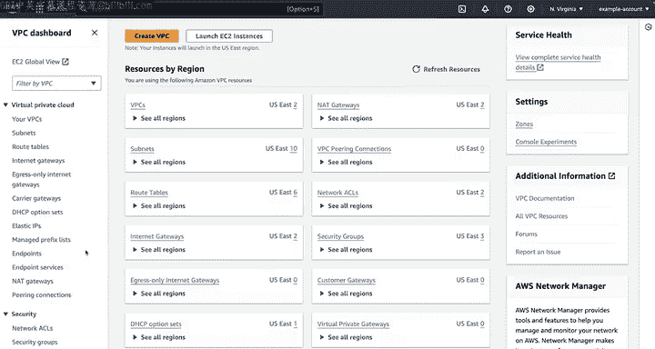

Then select createate Security Group。First， you give it a name like ALBSG。

Then we want to select which VPC this security group belongs to because security groups are associated with one VPC。

We will select the Project1 VPC。

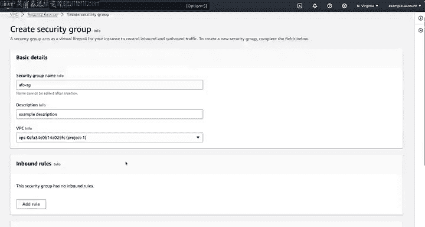

Next we need to define the inbound rules I'll select add rule， then for the type of traffic。

 I will select HtTP， which will auto populate the port range to be 80， then I will select 0。0。0。

0/0 for the source， which will allow traffic from the internet on port 80。

 then I will add another rule for HttPS which uses port 443 and will allow traffic from the internet。

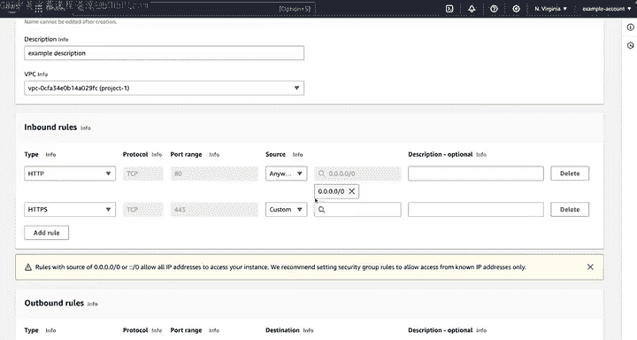

Then I will select createreate Security Group。

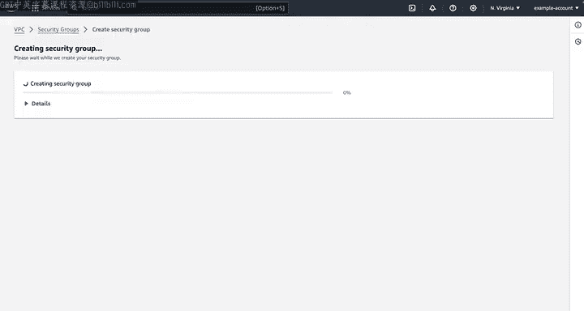

This security group can then be associated with the load balancer。 Now。

 let's move on to network ACLs， which provide an additional layer of security at the subnet level。

 Unlike security groups， which are stateful network ALs are stateless。

 This means you need to define both inbound and outbound rules explicitly。

 they offer more granular control over traffic and can be particularly useful for implementing security policies at the subnet level。

 By default， network ACLs allow all inbound and outbound traffic。

 but you can modify these rules to meet your specific security requirements。

 We don't need to change this behavior for our simple use case。

 but it's still important to know as it's one of the main ways to control network traffic on AWs。

 and you may need to tweak these rules if you are troubleshooting a network issue。

 So this is what our diagram looks like Now accounting for the places where we could apply security groups and network ACLs。

 In the upcoming lab。

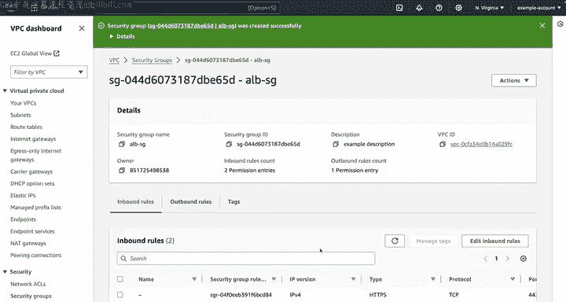

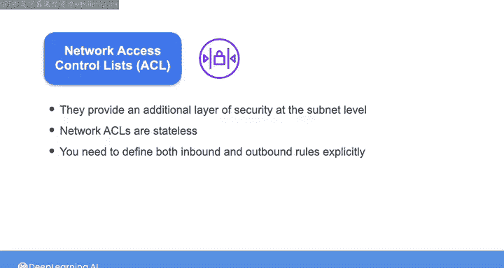

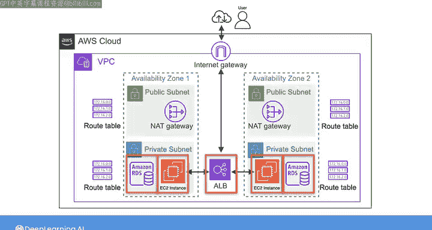

Need to troubleshoot connectivity issues with a database which is a very common scenario you will run into as a data engineer So what I want to do now is summarize everything you learned about networking on AWS in the last few videos so that you know where you need to look when trying to troubleshoot network connectivity issues on AWS First we covered the basics of VPCs and subnets。

 which give you a way to define a private isolated network on AWS。

We discussed the importance of correctly configuring route tables to direct traffic within the VPC and to the internet。

 you learned how to set up public subnets with routes pointing to the internet gateway。

 allowing resources within these subnets to access the internet。Similarly。

 we covered configuring private subnets with routes pointing to the net gateway。

 enabling instances to initiate outbound connections securely。

 notice how we call the subnets public subnets or private subnets。

 but it's actually the route table that determines that access。

 there is nothing magic about creating a public or private subnet It's all about correctly configuring and managing the route tables Next we explored security groups。

 which act as virtual firewalls at the instance level。

 they control both inbound and outbound traffic and their stateful nature means that if you allow inbound traffic。

 their return traffic is automatically permitted。 It's most common to configure inbound rules only on security groups as they by default。

 allow all outbound traffic。 We then moved on to network ACLs which provide an additional layer of security at the subnet level Unlike security groups network ACLs are stateless requiring explicit rules for both inbound。

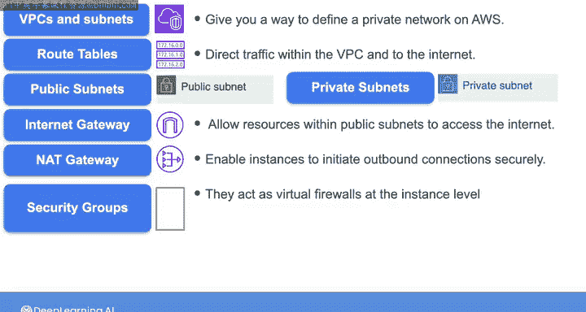

And outbound traffic This allows for more granular control and is useful for implementing specific security requirements。

 So if you encounter connectivity issues， start by verifying your VpC has an internet gateway properly attached that the route tables have appropriate rules to direct traffic correctly and that the route table associations with the subnets are configured correctly Next check security groups to make sure they have the needed rules in place and review network ACLs to confirm they allow the necessary traffic Also double check instance configurations to ensure they are associated with the correct security groups and subnets In the next lab you'll put these concepts into practice by troubleshooting database connectivity issues using the knowledge you've gained to identify and resolve network problems Next up。

 Joe will walk you through the details of the last lab assignment for this week。

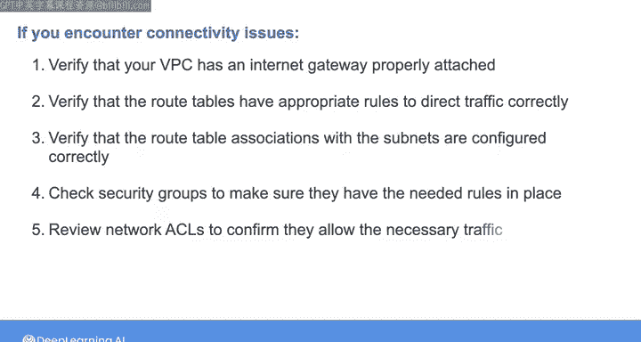