# 吴恩达《数据工程（导论，源系统、数据摄取和管道，数据存储和查询｜1-2-3课）｜DeepLearning.AI Data Engineering》 - P97：19_实验演练：AWS数据库连接故障排除.zh_en - GPT中英字幕课程资源 - BV1wTtWeeEH5

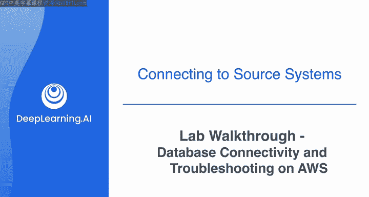

In the last lab this week， you'll be provided with an RDS database that you need to connect to from the cloud9 terminal and then create a table inside the database and populate the table with the data。

 connecting to a database and moving data into it and reading data from it or all super common task you'll encounter as a data engineer and like I said before。

 having to troubleshoot connection and permission issues in these basic tasks is something you'll run into all the time。

 So in this lab， when you first attempt to connect the database you'll encounter several issues that'll need to fix After that。

 you'll need to download a CSv file from an S3 bucket and then copy the data from the CSv file to the database to read the file from the S3 bucket you'll encounter permission issues that you'll need to fix。

 As I said earlier， I like to set up a scenario like this as part of an interview for a new data engineer to see if they can successfully navigate these common issues。

 in the upcoming lab， I want you to be 100% successful。 So in some sense。

 you could say that I'm going to spoil all the fun for you by giving you the answers but I don't want you to be disappointed。

'Tll you how this is going to go and you can sort of choose your own adventure so to speak and decide just how much troubleshooting you want to engage in versus just following the solution I describe。

 Here's how it's going to work。 if you want the maximum adventure you can skip this video jump straight into the lab and go for it the lab instructions contain hints about where to look and what to look for to solve the challenges you'll run into and you can also choose to peek at more explicit instructions on solving the issues if you like in this video I'll walk you through how to solve each of the connection and permission issues but first I'll give you a hint as to where you might look and what to look for to solve the issue if you like you can start the lab and follow along with me as you go through this video and when an issue occurs I'll be inviting you to pause the video to think about the issue and try to fix it yourself。

 After that I'll show you how to fix it Allright let's get started once you start the lab you can directly check out the database and that's provided to you So in the console I'll search for RDS click on that resource。

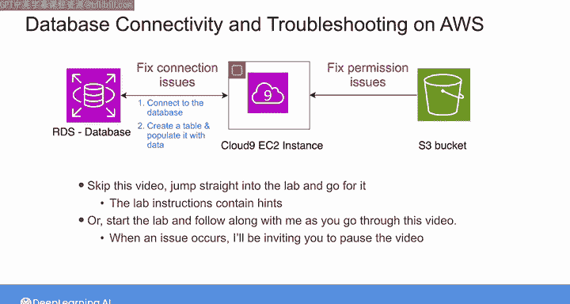

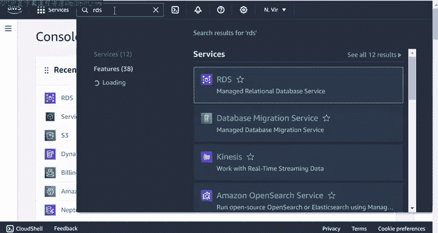

Then on databases， here's a database identifier that'll click on to find the database endpoint。

 make sure to save this endpoint， because you'll need to use it multiple times to connect the database while you're troubleshooting the connection issues。

 I'll now create the cloud 9 environment from which I'll connect to the database。

 So here in the console， I'll look for cloud 9。And then click on create environment。

 I'll type the name D E C2 W1 A1， then choose the T3 small for instance type and secure shell for network settings。

 For now， I'll not choose any particular VPC So this means that the E C2 instance on which the cloud9 environment will run will be launched in the default VPC。

 Then I'll click create environment。 Now that the environment is created。

 I'll connect to the database from the terminal。 Since the database is a Postgres SQL database。

 I'll first need to install PsQL， which is the standard command line interface for interacting with the Postgres SQL database to do that I'll run this command。

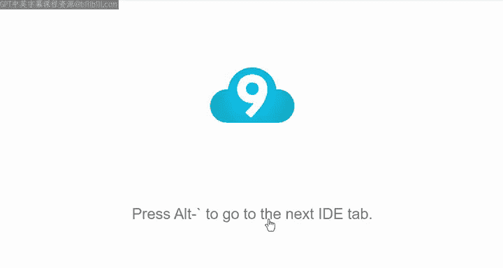

And wait for the installation to complete。

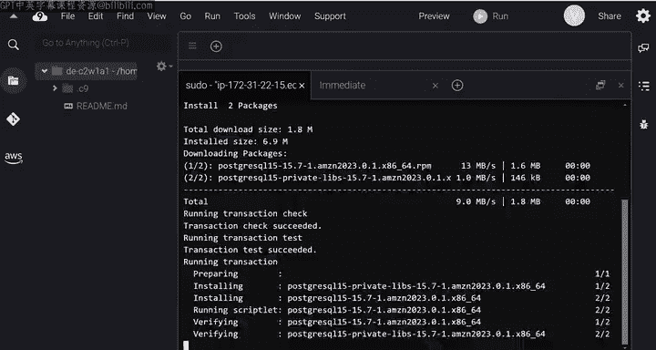

You are given the database username and the password as shown here。

 So once the installation is complete， I'll use this command to connect the database for host。

 I'll replace Postgres SQL endpoint with the actual database endpoint。

 I'll then run this command and type the password。 You'll notice that nothing happens。

 If you press enter， you'll only get empty lines。 Getting something like this is tricky without an explicit error message。

 it's hard to know what's actually going wrong。 But one thing you can say for sure is that the connection to the database has failed。

 to exit this attempt， you can type control C or command C。

 So can you think of why this connection has failed。 Given what you know about networking。

 Can you think of any problems that might be coming from the network setup。

 you have set up in the A C2 instance of E cloudud9 environment and the database instance。

 feel free to pause the video to think about these questions and try to fix this issue。

 And here's a hint。 go to the console pages for cloud 9 and RDS and have a look in the network settings at the VPC identifiers for these resources。

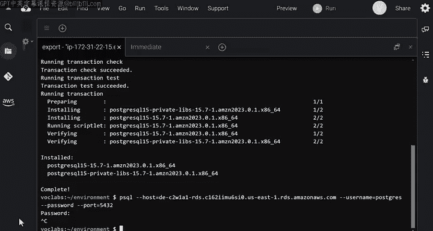

Any potential issue you see here？How might you resolve it？

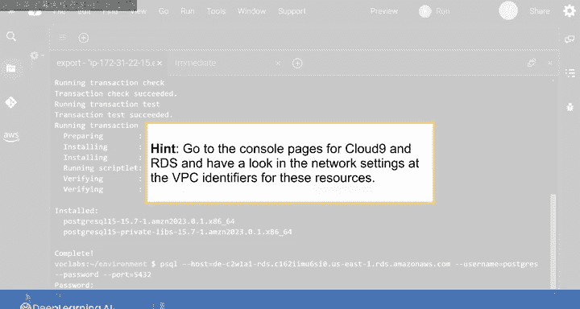

Allright， so here's the solution When I launched the cloud 9 environment， I chose a default VPC。

 but I never checked in which VPC the database resides。

 resources from different VpCs can't connect if the two VPCs are not configured to talk to each other。

 so let's verify in which VPC the database is launched in the console I'll search for RDS click on databases then on the database identifier。

Under networking， I'll click on VPC and take note of a VPC ID。

Let's now verify the VPC of a Cloud 9 environment， so I'll go to Cloud 9 and then click on the environment name。

 then on the Network Ses tab。Here's the ID of the default VPC。

 You can see that the two VPCs are different， and that's why the connection has failed。

To solve this issue， I'll delete the current cloud9 environment and then launch it in the same VPC where the database resides。

 So here in the console， I'll click on delete to delete the current environment。

Then I'll create a new environment， repeat the same steps， but now for the VPC settings。

 I'll choose the VPC named as DEC C2W1A1， which is the same VPC where the database is。

Then I'll choose a public subnet and create the environment。

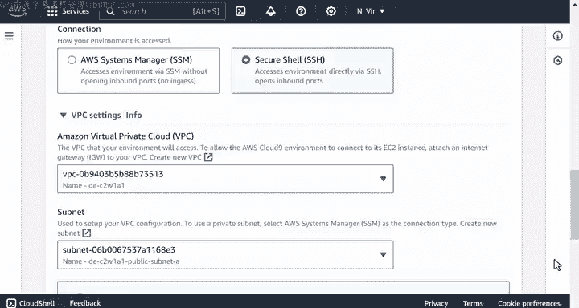

In the terminal here， I'll repeat the same steps to connect to the database。

 I'llver install P SL and then connect to the database。Hm， the connection is still not working。

If the two resources are now in the same VPC， where are you still unable to connect the database In a previous video。

 Morgan mentioned that an RDs instance can be configured to receive certain traffic。 So in this case。

 is the RDS instance configured to receive traffic from the E C2 instance of Cloud 9。

 How can you check。

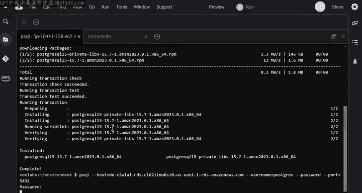

And if there is an issue， how can you fix this configuration？

Feel free to pause the video to answer this question and try to explore or fix the issue。Okay。

 so to verify if the EC2 instance can send traffic to the database instance。

 you can check the security group associated with the database instance。

I'll click on the databasease identifier in the databases window。Under security。

 I'll click on VBC Security Groups。Then on the security group ID。

Here you can find one inbound rule that allows RDS to accept all traffic。

 but from a resource that is associated with the same security group。

This means that any instance associated with the same security group can communicate freely with the database。

 let's verify what security group is associated with the EC2 instance of Cloud 9。

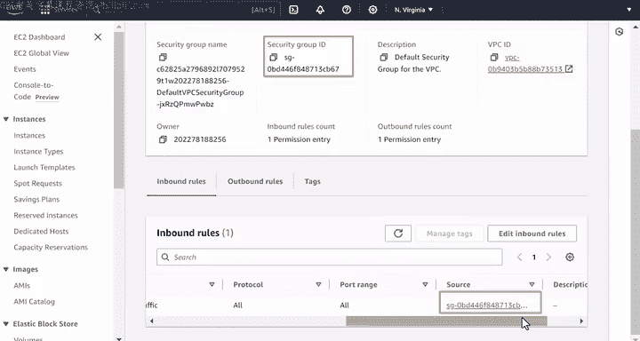

In another tab， I'll search for EC2 and click on instancess。

 here's the EC2 instance on which the cloud 9ine environment is running。

 I'll click on the Insense ID， scroll down and then click on the security tab to find the security group ID。

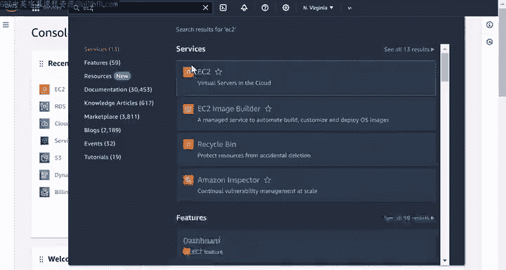

You can see here that this is different from the database security group。

 which means that the EC2 instance can't connect to the database。

One way to solve this issue is to add another inbound rule inside the database security group that allows the database to receive connections from the EC2 instance。

 so to do that over in the RDS instance security settings。

 I'll click on the editit Inbound rules and then add rule I'll type 5432 or 5432 for the port number and that's because this is a Postgre SQL database instance and the default port number is 5432。

If you are dealing with a different kind of database like MySQL， for example。

 the port number would be 3306 or 3306， and so depending on the database management system or other resource you're trying to connect to。

 you might need to look up the port number in the documentation。Now for source。

 one way I could guarantee that the Cloud 9 E2 instance can connect to the database is to choose an address here of all zeros。

 which means that any public traffic is allowed to connect the database。

 but please don't do that unless you're just troubleshooting a connection issue and there's no sensitive data in the database in general。

 opening up your database to all public traffic as something you should definitely avoid What you should do instead is only allow the required resources to connect to the database In this example you only want the EC2 instance that runs a cloud9 environment to have access to the database So to do that I'll copy the idea of the security group associated with the EC2 instance from the other tab here then back in this tab where I'm editing the inbound rules for the RDS instance I'll pace a security group of the EC2 instance in the source here and finally save the rules Now I'll go back to the terminal and try to connect again to the database。

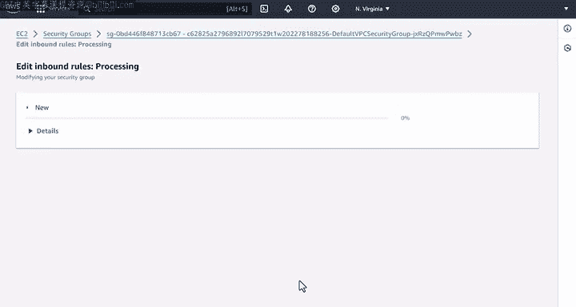

But， oh， no， it failed again。So we're still not connected。

 but now there's an error message saying that password authentication field。 So this is progress。

 So means that the two resources are talking to each other。 but that the password is incorrect。

 This is also a super common issue which could happen when passwords are rotated or you miss the notification about a password update。

 or you just mistype the password。 This happens all the time。 In this case。

 there's no particular strategy to apply。 You just need to get the right password。

 Let's assume you checked your typing and you didn't simply mistype the password。

 Then you talked with your team and got the new password is shown here。 with the new password。

 I'll now try to connect again to the database。 And here you go。

 the connection to the database is now established。 I'll now exit the connection。

 Now that you can establish a successful connection to the database。

 The next step is to create a table inside the database and then populate it with data。 First。

 I'll run this command to download the required files for this part。

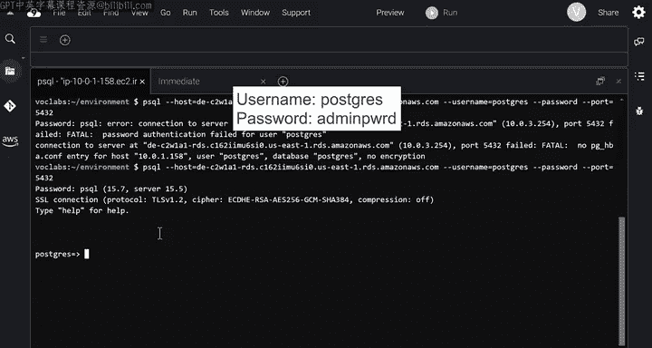

You can see the added folders here on the left。Under the SQL folder， you can find two SQL files。

 the file ratings table DDl。sQL contains the SQL command that creates an empty table that has the schema。

 let's run this command to create the table in the terminal I'll first connect to the database。

 enter the password and then run this i command which reads the SQL statements from the specified file。

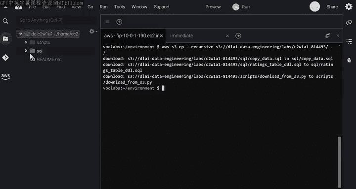

The table is now created， but it's empty， so if you try to run this select statement。

 nothing will be returned。

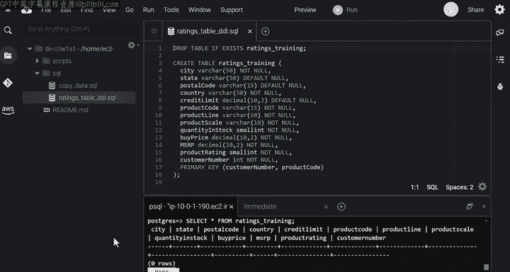

I'll now exit the connection。 The data that you'll need to copy to the table is provided to you as a CSV file in an S3 bucket。

 Let's check out the provided S3 bucket by running this command。 Here's the name of the bucket。

 You can also search for the bucket in the console。

 I'll type S3 in the search bar and then click on that resource。Here's the provided bucket。

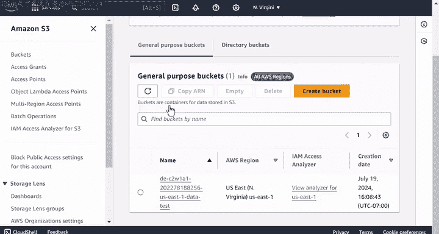

If you click on its name， you'll find a folder labeled CSV which has a CSV file。Back to Cloud 9。

 under the Scripps folder， you can find the Python file download from CSV that contains instructions that downloads the CSV file from the S3 bucket to a local folder labeled as data for the bucket name。

 variable here， I'll type the name of the provided bucket。Then in the terminal。

 I'll first create the folder data。Then I'll install Bodo 3 and then run the Python script as shown here。

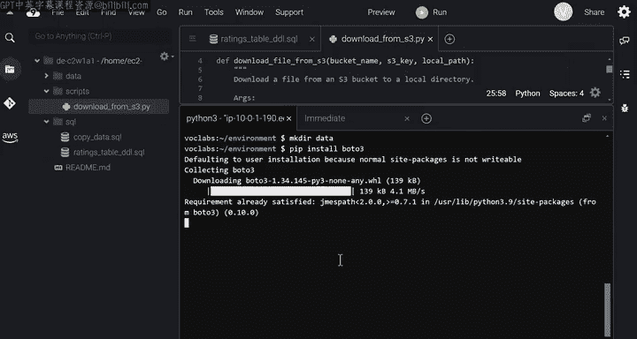

Now I've got an error which means I don't have permission to download data from the S3 bucket。

 so it looks like the S3 bucket is not configured to allow the EC2 instance of this Cloud9 environment to read data from the bucket。

Can you think of a way to fix this， The hint here is to go to the console and check the permissions in the policy associated with the S3 bucket。

And wink wink， there's a new policy that's been provided to you in the lab that might be useful here again。

 feel free to pause the video to explore to this issue and see if you can fix it。

So let's see if we can figure out what's going on here in the console， I'll search for S3。

 then click on the bucket name， I'll then select the tab at permissionmissions and scroll down to bucket policy。

And here I can see that the current policy is configured to deny any resources from reading objects in the estuary bucket。

To modify this， I'll click on editit and then replace this policy with the policy provided in the lab instructions。

This policy allows the EC2 instance of a cloudI environment to read objects from S3 or replace your data bucket with the bucket name。

Then I'll need to get the IPV4 address of the EC2 instance and paste it here， so in another tab。

 I'll search for EC2， click on instances， then on the instance ID Here's its IPV4 address I'll copy and paste it in the policy and then click on saveve changes。

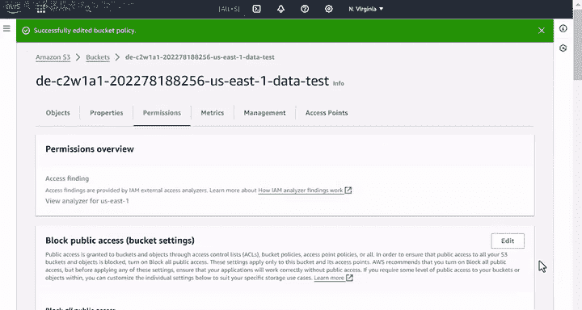

Now in the terminal， I'll run the Python script again。

 and so these script ran successfully with no permission issues， that's awesome。

 so the data folder should now contain a copy of the CSV file。

And I can go ahead and open the data folder and look at the file to verify that it looks like the download was successful。

 and then all that's left to do is copy the data to the ratings table in the database。For that。

 you're provided with a SQL file that contains the needed copy command。So in the terminal。

 I'll connect to the database and then run this i command to populate the table， and finally。

 I'll run the select statement to verify that the table now contains the data， and that's it。

 I hope you enjoyed this lab and I can guarantee you that these basic troubleshooting steps will be very useful in your work as a data engineer you can refer back to this video if you're running into any trouble applying these steps on your own after you finish a lab I'll see you in the next video to wrap up the week。

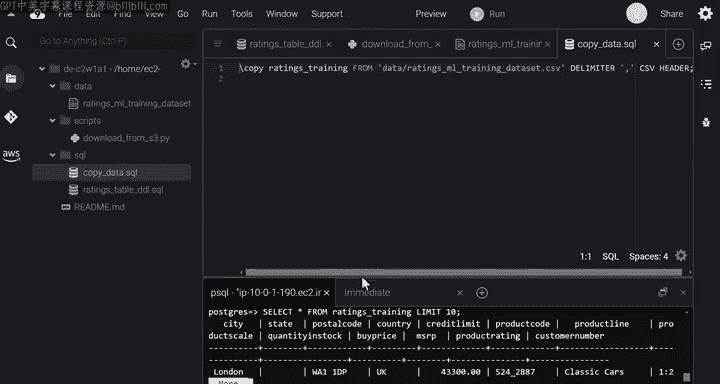