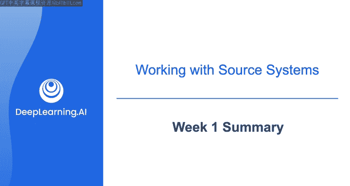
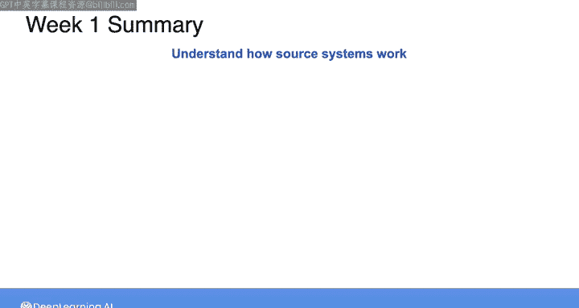
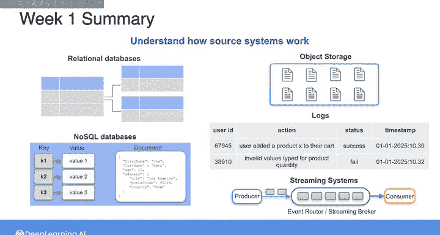
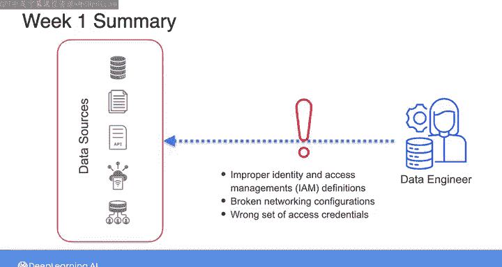

# 吴恩达《数据工程（导论，源系统、数据摄取和管道，数据存储和查询｜1-2-3课）｜DeepLearning.AI Data Engineering》 - P98：20_第1周总结.zh_en - GPT中英字幕课程资源 - BV1wTtWeeEH5

Excellent job making it to the end of the first week of this course on S systems。

 ingestion and data pipelines。I hope you're feeling more comfortable and knowledgeable when it comes to the first stage of the data engineering lifecycle where data is generated in So systems whether you're building a new data system from scratch or updating and maintaining and existing data pipeline you'll need to understand how So systems work this week we started off by looking at the details of some common source systems such as relational and NosQL databases object source for files and logs and streaming systems for events we also looked at some ways to connect to these data sources specifically in a cloudbased architecture。

 we looked at how networking allows you to connect to So systems and the importance of I am and ensuring security and So systems and the rest of your data pipeline throughout the week I highlighted some common issues that you might encounter when working with So systems and you had a chance to troubleshoot some of these common problems in the lab in the next week we'll focus on different ways to ingest data from So systems We'll get further。

Into the details of batch versus streaming ingestion。

 and we'll also go through the different factors you should consider when designing your ingestion or architecture。

 I'll see you there。