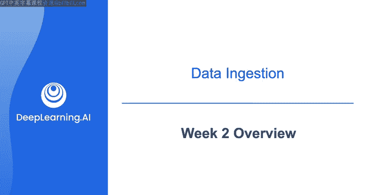
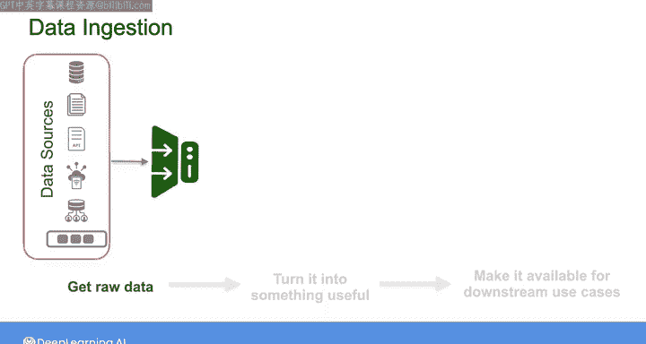
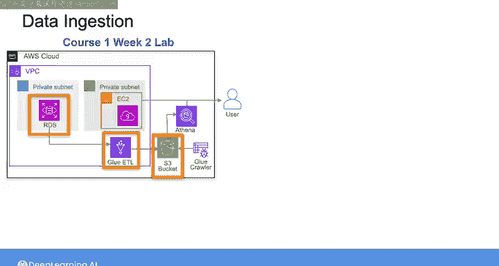
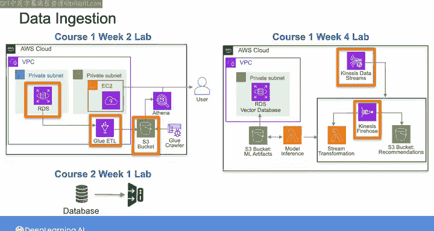
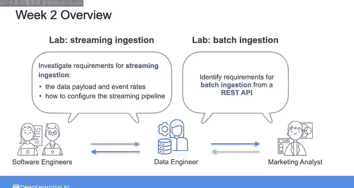

# 吴恩达《数据工程（导论，源系统、数据摄取和管道，数据存储和查询｜1-2-3课）｜DeepLearning.AI Data Engineering》 - P99：21_第2周概览.zh_en - GPT中英字幕课程资源 - BV1wTtWeeEH5

Welcome to week two of this course in week one you looked at So systems in detail and got some practice playing with databases and object storage in some sense the focus of the last week of materials was on how you will connect to and interact with So systems because like I've been saying all along these source systems or typically not something you set up or control directly as a data engineer。

 however， connecting to and interacting with So systems is really the beginning of the next stage of the data engineering lifecycle which is data ingestion。

As I said before， your work as a data engineer is to get data from somewhere。

 turn it into something useful and then make it available for downstream use cases and so data ingestion is the Get rawaw data from somewhere part of your work As you already know that somewhere could be a database an API a set of files or even a streaming system and you've already been performing data ingestion in several of the lab so far in the previous course you ingeeststed data from an Amazon RDS MySQL database into S3 storage using an AWS glue ETL job and you ingeeststed data from AWS kinesis data streams and you kinesis Fire hose to deliver the events to an S3 bucket and then in the final lab of week1 in the course you were able to troubleshoot some common connection issues when it comes to connecting to a database All this is to say that you already know a lot about data ingestion and this week we're going to add depth and detail。

To your existing knowledge so this week we'll start with a closer look at the details of some batch and streaming ingestion patterns。

 which is to say ingestion patterns where you process data either in chunks or batches versus processing a continuous stream of data then we'll have a conversation with a marketing analyst where you'll identify the requirements for doing batch ingestion from a rest API which is a so system we haven't spent much time with thus far and after that we'll have a conversation with a software engineer。

 to investigate some of the requirements for streaming ingestion that we sort of gloss over in the previous course。

 things like characteristics of the data payload which just means a characteristics of the individual messages you're ingesting as well as event rates and how you'll need to configure the streaming pipeline to get the data where it needs to go and finally you'll get a chance to build these solutions yourself in the labs namely batch ingestion from a rest API in streaming ingestion from a web。

Ser log， join me in the next video to get started。

