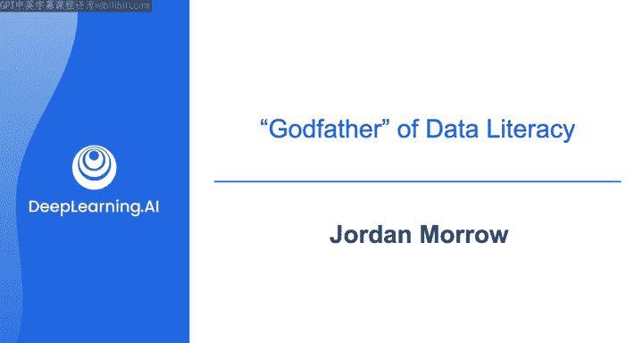

# 吴恩达《数据工程（导论，源系统、数据摄取和管道，数据存储和查询｜1-2-3课）｜DeepLearning.AI Data Engineering》 - P9：8_可选：与Jordan Morrow的对话.zh_en - GPT中英字幕课程资源 - BV1wTtWeeEH5

So Jordan， how's it going， Hey， how we doing， my friend。 Good， good， good。Yeah。

 so for the learners out there。 this is my good， Jordan Morrow， we actually live in the same city。

 although we chance we really see each other when we're out of town。 So You're too much， friend。

 Yeah， yeah awesome。 So I think you're you're known as one of the founders data literacy。

 I would I call you the godfather data literacy， I think much to your sugar in。 Yeah， I not sure。

 not sure where I fill on that one， of course。😊，Awesome。

 but for the learners out there can you describe what what is data literacy Yeah。

 think of data literacy is comfort and confidence in using data so by definition the ability to read。

 work with analyze and communicate with data， but it's basically can we help everyone not just data analytics professionals have comfort with data。

 but give everybody that chance so that if it is democratized or they're trying to use data in their job。

 they're more comfortable doing so。It's awesome。And I guess why is that important Why Why don I just assume everybody knows data。

Well， I mean， think about it from all the data products like organizations have quote unquote been trying to bring value to data for how long now。

 And that's a whole different topic right， to define what value really means。

 But if you're building data products， AI products and anything of the like。

 you need people to adopt them。 but if that's not their comfort or they don't have a skill set in that it could get right in the way of having true success with data work。

 data strategy。 And so when organizations are investing in data tools， technology。

 you can't just put it in front of people and say， there you go。

 it's like I know you're a rock climber right so you can't just put someone in front of a really difficult wall without them going some through some sort of training around it to develop that comfort in doing that wall and it'd be the same thing with data。

 I can't just put dashboards in front of people and say， go find the insight。

 we need them to have this ability to harness the power of the good work that people do so that it gets adopted and used effectively plus you don't want to run into culture problems where。

Don't want to touch data and that could be a big problem。

 So a big part of the early part of this course is about talking to the business。

 figure out requirements， figure out what the business wants what suggestions you have for people who are trying to gather requirements trying to find the business objectives and so forth Well。

 one of the keys that to me that maybe gets lost in you know these objective gatherings and requirements gathering that we have to do for good data products is this really big key of understanding your audience So the first thing to do is is really understand the business goals of the company that comes from communication。

 reading， networking all of that but the next step in requirements gathering is I want you to pay attention to the people that you're building this for what are they looking for not what the business is looking for you definitely need to do that but what are they looking for what is it they trying to tie into this And so if it's a marketing officer or chief risk officer or a sales team or whomever。

What are the things that get them going that way when the product is done and you're trying to sell the product with adoption。

 Hopefully， you've got the business objectives met。

 But hopefully your story can tied to their requirements。 The audience itself。

 because then they can buy in differently。 So always do the the requirements gathering。

 But requirements gathering should also be audience understanding。 that's such a good point。

That's such a good point and I'm guessing that there are different personas for the audiences too。

 where of person there's yeah。Because they think about it。

 if you're meeting with the C suite and you're meeting with a chief sales officer。

 sales officer is looking to his sales targets。 If you're working with a marketing officer。

 how do we improve marketing。 If you're meeting with a chief finance officer。

 how do we make cash flow stick。 These are different things。

 And so if depending on what you're building it， you might be building something for all of them。

 So it becomes even harder or more complicated because you have to tie into each of them。

 So I think it's fun， I think it' it's a good exercise and it definitely requires this building up of your people skills。

 Yeah， for sure。's any other advice you have for aspiring data engineers。

 what I would get really good at and and aspiring data engineer is。

 and my next book that comes out when I'm not sure where the course launches。

 but it launches the end of this year is business  one on one for the data professional。For me。

 it's I don't just like with data literacy， I don't want to turn everybody into data professionals with business literacy。

 you could call it。 I don't want to turn you all into business people。 be a data person。

 be authentic， be yourself。 But get really good at understanding how a business operates。

 how the business operates is a key for data engineers so that when they're engineering。

 They're building towards the operations of the business。 So when they're communicating。

 it's directed towards us。 So I would just tell them don't think you have to become the next salesperson or business person。

 be a great data engineer。 but get really good at understanding the business side of it。 for sure。

 It's awesome。 Thanks for your time， Jordan I think。

