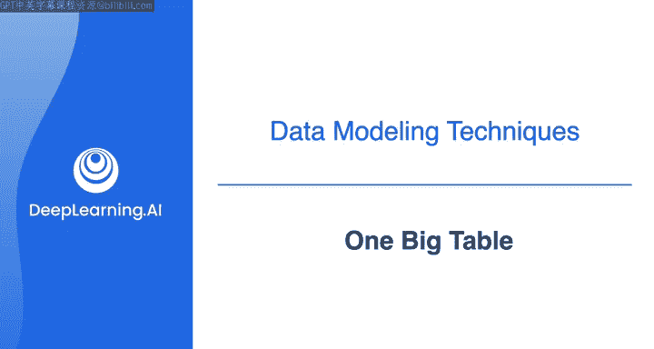
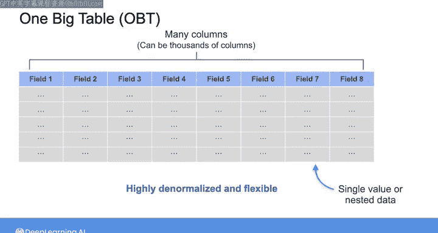
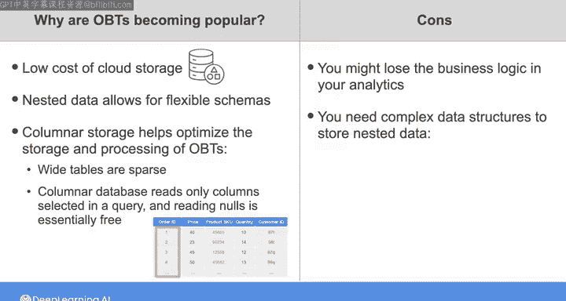

# 吴恩达《数据工程（数据建模、转换和服务）第4课，完结｜DeepLearning.AI Data Engineering》 - P10：9_大表模型.zh_en - GPT中英字幕课程资源 - BV13mtpe7ESt

The modeling approaches we've looked at so far this week， in particular。

 Kimball and Inmin were developed when data warehouses were expensive on premises and heavily resource constrained with tightly coupled compute and storage。

While batch data modeling has traditionally been associated with one of these strict approaches。

 more relaxed approaches such as what's known as one big table or OBT for short or becoming more common with one big table you throw all your data into a single wide table which is exactly what it sounds like a very wide collection of many columns typically created in a columnar database。

 a wide table can potentially have thousands of columns whereas tables in relational databases typically have maybe a dozen or so columns and a column may be a single value or contain nested data so wide tables with one big table are highly deormalized and flexible here's an example of a wide table which is the deormalized table you saw in an earlier video this is just a small example and the wide table as you'll encounter with one big table can have way more columns and as you can see this table combines various data types and each row represents a customer order you can think of one big table as the deormal。

extension to Kimball's approach where you have facts and dimensions represented in the same table by doing so。

 you can free the data analyst from performing any complex joins or any joins for that matter。

 Moreover， you can run the same analytical queries faster on wide tables than on highly normalized data or even on data modeled as a star schema where you might still need to join dimension tables with the fact table the wide table simply contains all of the data you would otherwise need to join together any more rigorous modeling approach which can have a huge impact on scanned performance This one big table approach is becoming more common because the lowcot of cloud storage Also many organizations are choosing to design flexible schemas in their source and analytical systems by using nested data and with one big table you can store this nested data altogether in one table without having to worry about the optimum way represented it in storage wide tables are usually sparse meaning the vast majority of entries in any given field maybe null values so it's extremely expensive for you to store。

read a wide table with a bunch of null values and a traditional roworiented relational database because the database allocates a fixed amount of space for each entry and the database must read the contents of each row in its entirety when reading from the database but with the emergence of columnar databases you can read only the column selected in a query and so reading Knowles is essentially free。

 so columnar storage helps optimize a storage and processing of wide tables the biggest criticism towards the one big table approach is that as you blend your data you lose the business logic in your analytics Another downside is that you need complex data structures like arrays to store nested data these structures have poorer performance when it comes to updates and aggregation of elements and so I suggest using a wide table when you have a lot of data that needs more flexibility then a traditional data modeling approach might provide when it comes to modeling your data there's no one size fits all solution so make sure you understand the tradeoffs between the possible approaches。

When it comes to flexibility， data integrity and ease of use by downstream stakeholders to choose the best approach for your use case in the next lab you'll practice taking normalized data and modeling into a S schema and one big table。

 which is a common task you'll have to do as a data engineer， but before you head to that lab。

 I have included a demo on DBT and an exercise for you to practice right in the SQLqueries that you'll use in the lab to model your data。

 I'll see you in the demo。

