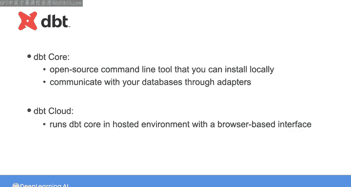
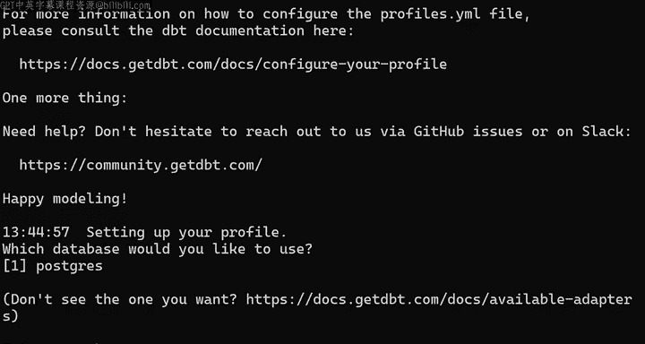
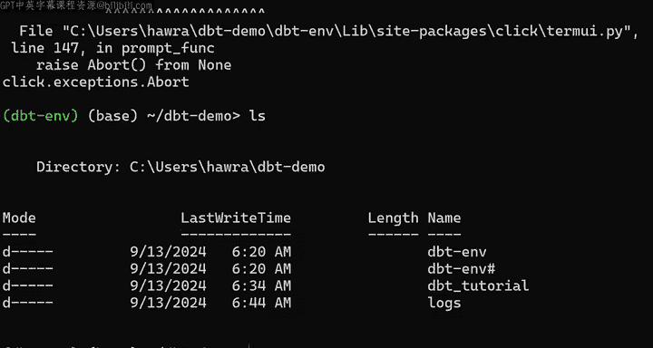
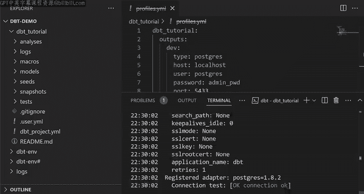

# 吴恩达《数据工程（数据建模、转换和服务）第4课，完结｜DeepLearning.AI Data Engineering》 - P11：10_演示：使用dbt转换数据（第1部分）.zh_en - GPT中英字幕课程资源 - BV13mtpe7ESt

In this video， we'll use DBT to model some normalized data you've seen previously into a star schema。

 This is something you'll do in the lab Behind the scenes。

 I have set up a local Postgres database with five tables order items orders。

 customers items in stores。 and I created these tables under a schema labeled staging schema。

 I also inserted a few rows into each table。 Now I' use DBT to create a new schema that will label as star schema under which I create the fact order items table and the dim stores。

 dim items and dim date dimension tables In an earlier video。

 we already discuss these sQL statements you can use to create each table in the star schema。

 DBT provides an easy way to create these tables by wrapping each sQL statement with another sQL statement that will create the tables under the new schema。

 DBT also helps you document and validate your data within your database or data warehouse。

 Let's first install DBT and set up the environment。 DBT provides two types of environments。

 DBT core， which is an open source。😊，Aline tool that you can install locally in your own environment and communicate with your databases through adapters DBT Cloud。

 which runs DBT core in a hosted environment with a browser based interface in this video we'll go with the DBT core option which is what you'll use in the lab so here in the terminal I'll create a new virtual environment and then I'll activate it。

Then I'll install DBT core and the DBT Postgres adapter DBT core will use this adapter to connect the Postgres database。

 depending on the type of database or data warehouse you're using you can choose other adapters。

 you can find the list of adapters in the DBT documentation。

After DBT core and DBT Postres have been installed。

 I'll create the DBT project folder that will contain the files used to define the new tables。

 I'll run the DBT and command， specifying the name of the project to be DBT tutorial。

 Then DBT will ask you to specify the type of database。 Since I've only installed DBT Postgress。

 I just have one option。 So I'll type 1。 Then DBT will ask you to enter the database information to automatically create the file that contains a connection details to the database。

 For now， I'll stop this process by typing control C。

 I'll show you how to manually create this file later。 After you run DBT and。

 a folder labeled DBT tutorial will be created in your working directory。

I'll open an ID to go through the files in this folder and run the DBT commands。

Here are the folders and files created in the DBT tutorial project folder。

 The model subfold is the main directory where you'll spend most of your time in this directory for each table you want to create in your star schema。

 you will create a dotsQL file that contains a SQL statement that defines the corresponding table in the same directory。

 you can add a Yal file to define some model configurations and some other testing and documentation information。

 When you initialize your project。 some example files will be generated under the model directory。

 feel free to take a look at them， but we won't use them in this video So I'll delete them when I create the files for our star schema。

 you can use the analyses subfolder to include any SQL statements that are not part of your model directory and that could be a part of your own exploration When you run DBT only a SQL statements that are in the model subfold will be executed in the macro subfold。

 you can store pieces of SQL code that you want to reuse multiple times in your models directory in the seed subfoldder。

 you can have some CSv files that you want to load into your data warehouse or database using。😊。

In the snapshots subfolder， you can record the changes in your tables over time。 and finally。

 in the test subfolder， you can create SQL statements to perform some specific tests on your data in this video and lab willll just work with the modelss subfold。

 In addition to the subfolds。 There's also this DBT underscore project Yaml file that's also automatically generated by DBT in it。

 This is an important file that contains the configurations of your project。

 So let's take a look at the file。 In this file you specify the name and version of your DBT project。

 Next， you select the profile for your project。 the profile should contain the details for connecting to the database and you need to define the profile within a Yaml file called profiles Yaml here。

 DBT automatically labeled profile with the project name。 I'll leave it as it is。

 but you can definitely choose another name for the profile。

 Next you'll define the directory configurations that tell DBT where to the subfolds of your DBT project。

With clean targets， you can specify the directories to be removed when you run DBT clean。

 The target directory contains the compiled SQL files of your models that will be created after you run DBT and the DBT packages is a directory that you can create to store thirdpart packages if your project depends on them。

 And finally， you can specify the default configurations for your models。

 This includes whether you want to create the models as tables or views in your database。

 Views mean that you only save the SQL statements without creating the actual tables。

 You can specify this information using the materialized key。

 If you have defined multiple subdirecties inside of the models directory。

 You can organize the model configured by the subdirecties。 So in this example。

 we telling DBT to create all models defined under the example subdirecty as views。 Later。

 I'll delete this configuration and replace it with the configurations for the actual tables of the star schema。

 Now let's create the profiles file to specify the connection to my local Postgres database In the DBT tutorial project。

 I'll create profiles Yaml。ify in this file more than one profile and each can correspond to one data warehouse here I'll create one profile labeled as DBT tutorial。

 make sure that the name of the project matches the names you specify in the project configuration file。

 the profile can consist of multiple targets where you can specify different connection details under each category。

 For example， you might need to create two targets。

 one for development and another for production Ulysses targets under the outputs key。

 I'll specify one target that I'll call dev to populate this target。 I'll specify the database type。

 which is Postgres in this case。 Then I'll specify the database credentials for a Postgre target。

 I'll specify the hosts username， password port number and database name in the DBT documentation you can find a sample profile for each possible target type。

 Finally， I'll specify that this DBT project will run on one thread and that the default schema is the star schema to wrap up the DBT tutorial profile。

 I need to specify the default target which is dev because that's the only target I have right now。

To verify the connection to the database， I'll go to the terminal and I'll make sure that I'm in the DBT project directory and I'll type DBT debug if there's no issue with the credentials。

 you should see that the connection is okay。Since the profiles Yaml can contain sensitive credentials。

 you can move this file to the hidden dot DBT file that's created by DBT inside your home directory。

 If DBT does not find the profiles in your project directory。

 it will automatically check the dot DBT folder。 So let's move the profiles files to the dot DBT folder and then verify the connection。

So at this point， I created a profiles file and successfully connected to a local Postres database。

 joinin me in the next video to create the SQL files used to create the tables。

