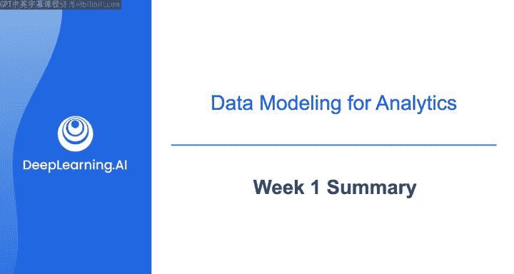
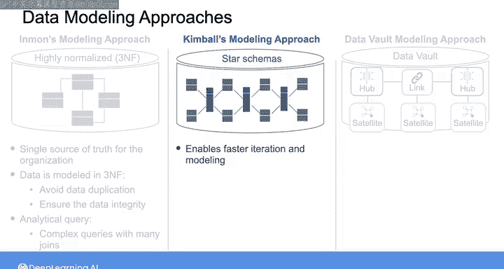
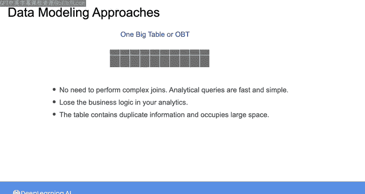

# 吴恩达《数据工程（数据建模、转换和服务）第4课，完结｜DeepLearning.AI Data Engineering》 - P12：11_第1周总结.zh_en - GPT中英字幕课程资源 - BV13mtpe7ESt

This week we looked at the different approaches you can use to model your data for batch analytics use cases in the labs you implemented multiple normalization steps to turn theorized data into third normal form and you also model normalized data into a star schema using DBT when it comes to modeling data for the data warehouse we discuss the inmin modeling approach which focuses on using the highly normalized model or third normal form to model the data in the warehouse as well as a Kimmball modeling approach which focuses on directly modeling the data as a star schema in the data warehouse and the datavault model which focuses on separating the structural information from the descriptive context of the data we also went over the simple one bigtable approach let's go over a quick summary of each of these four approaches。

 the major benefit of an inmin data modeling approach is that it makes the data warehouse into a single source of truth for the organization and ensures the integrity of the data this is because when you model your data in thirdn form you avoid duplication and redundancy in the data。

Wwhich makes it easier to ensure the consistency of the data when you add update or delete rows from the data。

 however， to perform analytical queries on data in third normal form。

 you often need complex queries that rely on many joins which can result in slow query performance Kimball's modeling approach enables faster iteration and modeling because you directly model the data in the data warehouse using star schemas a star schema you collect the measures or facts of a business process or event in a f table then to provide detailed contextual information about these facts you surround the fact table with dimension tables this allows a data analyst to aggregate the measures of the fact tables and use the dimension tables to group or filter the queries however to use this approach you need to have a good understanding of the business requirements which in some cases might not be well definedfin or very stable the datavault model on the other hand offers a more flexible design that you can use in an agile environment where the business requirements or structure of the So systems might regularly be changing the datavaultt approach。

Model the core business concepts in hub tables and represent the relationship between them using link tables these tables only contain the business keys that identify the core concepts to provide more meaningful context you can connect the hub and link tables to satellite tables that contains the attributes of the parent hub or link however with this model you still need to do some work downstream by modeling the data in the information delivery layer into star schemas or some other structure that makes a data easy to query and finally we looked at the one big table or OBT approach which is perhaps the simplest way to model your data。

 which is to say just throw all your data into one big table this way the data analyst doesn't need to perform any complex joins so it's fast performform analytical queries。

 however with this approach you lose the business logic in your analytics and might end up with a big table that contains duplicate information and occupies a lot of space so each approach has its own strengths and weaknesses and in your work as a data engineer there's a chance you might end up combining more than one of these approaches next week。

We' continueinue our discussion on data modeling， but we'll focus on how you can model and transform your data for machine learning use cases。

 I'll see you there。