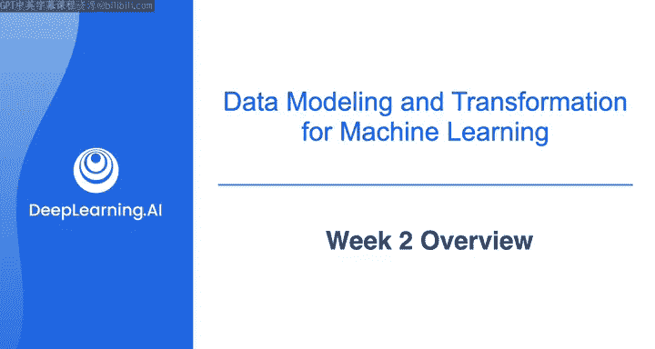
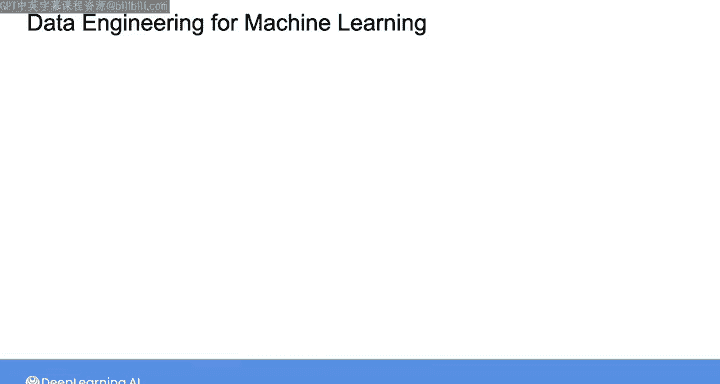
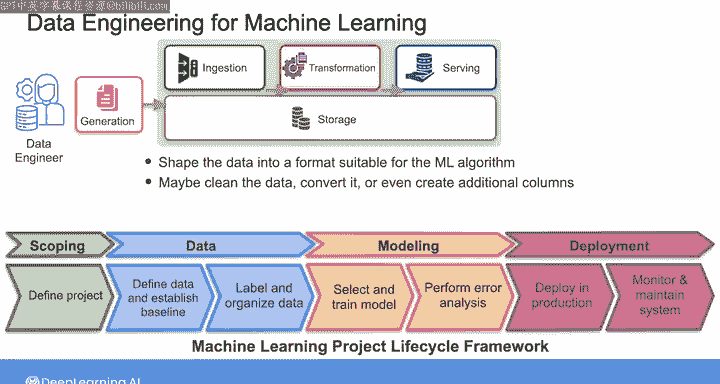
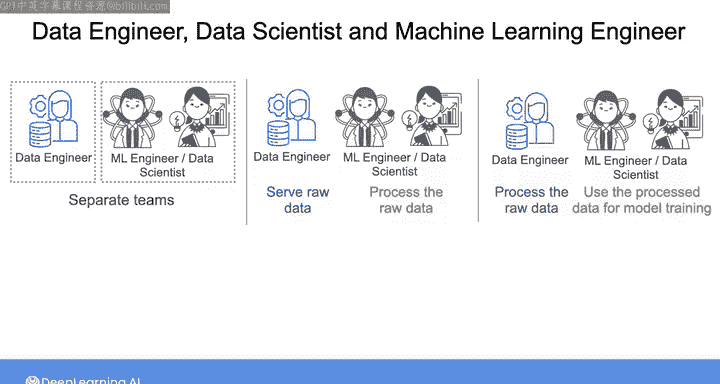
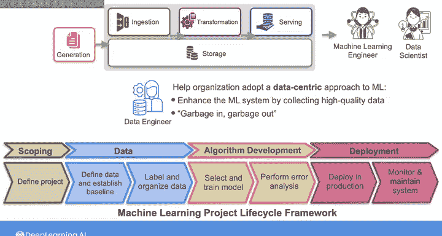
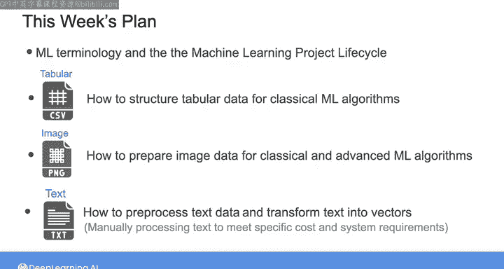

# 吴恩达《数据工程（数据建模、转换和服务）第4课，完结｜DeepLearning.AI Data Engineering》 - P13：12_第2周概览.zh_en - GPT中英字幕课程资源 - BV13mtpe7ESt

Last week， we covered several data modeling approaches for batch analytics that structure data in a way that supports analytical queries。

This week we'll cover how you can prepare and model data for machine learning use cases。

The goal of this type of modeling is to structure the data in a way that can help the data scientist or a machine learning engineer understand what the data represents so they can use the data to develop machine learning systems and discover hidden patterns in the data building a machine learning system involves several phases so here I'm going to refer to the machine learning project lifecycle framework that andre in as machine learning and production course you'll find this framework useful for a large variety of machine learning projects these phases include scoping out the machine learning project collecting and preparing the data developing the machine learning model and deploying the machine learning system your job as a data engineer is to build and maintain the data pipelines that serve data to one or more of these stages and these pipelines you collect data from multiple sources and combine the data into a format that is suitable for the machine learning algorithm you might also be tasked with cleaning the data converting it or even creating some additional columns or features and finally you store and share the data with the machine learning or data。

Science to help you avoid confusing a machine learning model with what you'll be doing as a data engineer which is modeling the data。

 I'll rename this modeling phase to algorithm development to clearly indicate that this phase of the machine learning project lifecycl is all about developing the algorithm for the machine learning project This framework is highly iterative and will dive into the details of each phase later this week So you might wonder how the role of a data engineer is different from that of a data scientist or machine learning engineer admittedly the boundaries between machine learning engineering data science and data engineering are increasingly fuzzy and the responsibilities of each of these roles very dramatically between organizations some organizations might have entirely separate data teams that handle the entire lifecycl for all machine learning projects in other settings you the data engineer might be responsible for serving just the raw data to the machine learning or data science team then the machine learning engineers or data scientist take over the data process。

TOr you might be asked to process the raw data so that these downstream stakeholders can use the process data directly to train the machine learning algorithms If your organization is small or doesn't have a mature machine learning team。

 you might even handle some of these tests that are extremely specific to machine learning such as feturization of data but in any case as a data engineer。

 you play a key role in helping your organization adopt a datacentric approach to machine learning which focuses on enhancing the machine learning system by collecting high quality data。

 you might have heard to saying garbage in garbage out。

 which refers to the idea that the quality of the output of any system is determined by the quality of its inputs so by carefully preparing the data for the machine learning algorithms。

 you can help the data scientists or machine learning engineers extract accurate and meaningful insights。

 creating more useful machine learning systems and so I suggest you develop a basic understanding of how machine learning works because this will go a long way in helping you provide value to your organization。

When it comes to building machine learning systems I won't attempt to teach you everything about machine learning but will' focus on how to structure tabular image and text data when working with classical or advanced machine learning algorithms to learn more about these machine learning techniques I have included a list of books and courses that you can check out in the resource section at the end of this week so this week I'll start with an overview of some key machine learning terminology and we'll dive into the phases of the machine learning project lifecycle then we'll discuss how you can structure tabular data for classical machine learning algorithms in particular you'll perform some aspects of feature engineering and data processing steps in the first lab of this week in lesson two you'll learn how to model and process unstructured data you'll prepare image data for classical machine learning and also more advanced machine learning algorithms such as convolutional neural networks。

And finally， you'll work with text data nowadays， most preprocessing steps where textual data can be handled by large language models。

 however， you should still be aware of these steps in case you need to manually process your textual data to meet the specific cost or system requirements of your machine learning project so I'll cover some basic preprocessing techniques and show you how to transform text into vectors that can be used to train a machine learning algorithm and you'll get a chance to practice working with textual data in the second lab of this week so there is a lot to cover this week join me in the next video to get started。

