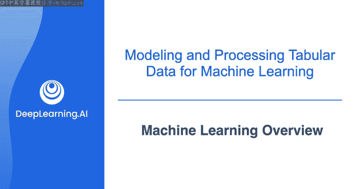
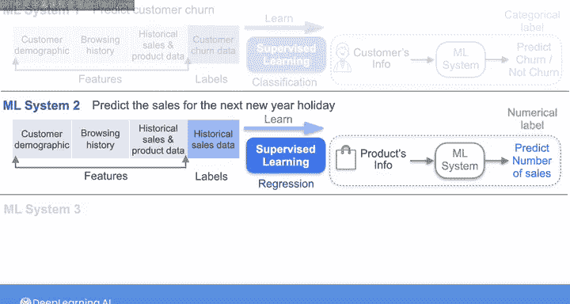
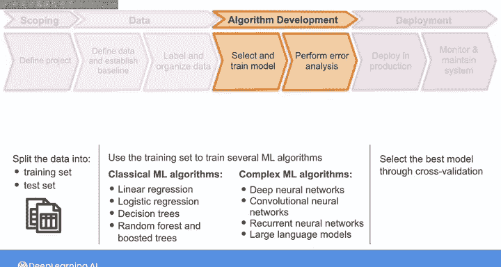
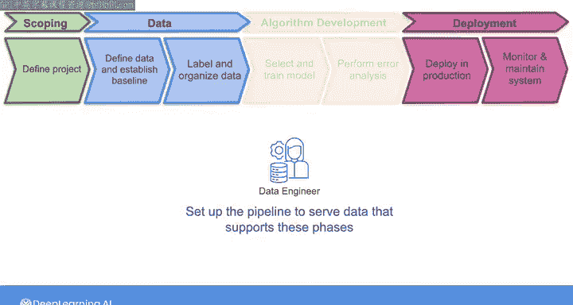

# 吴恩达《数据工程（数据建模、转换和服务）第4课，完结｜DeepLearning.AI Data Engineering》 - P14：13_机器学习概述.zh_en - GPT中英字幕课程资源 - BV13mtpe7ESt

Let's go through some basic machine learning terminology and concepts that you should be familiar with as a data engineer in this video I'll cover topics such as supervised versus unsupervised learning。

 classification versus regression and training versus testing。

I'll also go over the different phases of the machine learning project lifecycle to give you a framework for thinking about how data is used throughout the development of a machine learning system so if you're already familiar with these machine learning concepts this video should feel more like review for you and feel free to skip ahead but if you're new to machine learning this video should cover what you need to be ready for this week's materials。

 let's say you work as a data engineer at an ecommerce-commerce company that's interested in developing three machine learning systems。

 the first system aims to predict customer churn in other words whether a customer will stop purchasing from the company over a specific period of time suppose you have access to historical customer demographic data that browsing and purchase history and the past 10 years worth of customer churn data the company wishes to learn from this data and create a rule or formula that can take in a customer's information and predict whether they will churn or not within a specific time period instead of manually looking at the data to figure out this rule which will likely be very complex the company can train。

A machine learning algorithm to automatically learn the rule through a technique called supervised learning it learns from the characteristics of historical customer information。

 which are also called features and the value that needs to be predicted。

 meaning whether or not a customer will churn which is called a label This type of machine learning is called supervised learning because the labels supervise what needs to be learned from the features so when you create a data pipeline that serves data for supervised machine learning use cases you would need to work with the machine learning team to learn what features and labels they want the data to contain the second system the company wants to develop aims to predict the sales or products for the next New year holiday。

 this is also a supervised machine learning problem because the machine learning algorithms learning to predict future sales from a set of features and labels with the features being characteristics of historical product and sales data and the labels being historical holiday sales and amounts but the type of labels used in the second system meaning the kind of values we're aiming to predict is different。

From the first system in the first case， the label is categorical and only takes on a limited number of values the customer will either churn or not This type of supervised learning is called classification you are classifying a customer as a customer who will churn or a customer who will not churn In the second case the label is numerical representing the value of sales this type of supervised learning is called regression so as a data engineer the type of labels youll serve will be different for classification and regression machine learning use cases the third system the company wants to develop aims to segment customers in the groups based on their purchasing behaviors although you have lots of historical customer data this data is not labeled for this purpose。

 meaning that it does not contain specific information about the groups themselves such as the number of groups or the characteristics that separate the groups and it does not indicate which group each customer belongs to this is what the company would like to know by applying what is called an unsupervised learning algorithm in this case there are no。

Labels in the data to supervise the learning the algorithm will instead have to figure out how to group the customers based on the similarity of the profiles or purchasing behaviors。

 When you serve data as this type of learning， the data will only contain features without any labels。

 So now that weve covered these three types of machine learning systems let's take a look at the phases of the machine learning project lifecycle framework that Andrew proposed。

 you'll find this framework helpful for many machine learning projects and we' be focusing on where you can provide value as a data engineer。

 The first phase is scoping where the machine learning engineer or data scientist has to define the project and decide exactly what business problems they want to apply machine learning to then the second phase is all about data。

 the machine learning engineer will work with you to determine what features and labels you need to collect for training the machine learning algorithms This is the phase that you' will be most involved with as a data engineer and includes defining the data and establishing a baseline and also labeling and organizing the data the third phase involves selecting and training the algorithm and。

Eero analysis the machine learning engineer takes the data you serve them， maybe process it further。

 then uses it to train machine learning algorithms。

 they typically split the data into a training set and a test set then they use the training set data to train several machine learning algorithms with different configurations they can choose from classical machine learning algorithms such as linear regression logistic regression。

 theseci trees， random forest and boosted trees， these classical algorithms are generally easy to implement and train and they expect data to be in a tabular form However。

 as the size of the data increases the performance of these classical machine learning algorithms will reach a plateau This is more complex machine learning algorithms such as deep neural networks can help these complex algorithms not only work with tabular data。

 but they can also work with image data using convolutional neural networks。

 time series data using recurrent neural networks and text data using large language models。

 after the machine learning team train several machine learning algorithms。

They select the best one in a process called crossvalidation Finally they evaluate the selected model using the data from the test set to analyze the model's performance they might discover that they need to fix something in the collected data add more features or simply collect more data so the team might ask you to serve an updated set of data to continue with the algorithm development phase This iterative process can continue until the team is happy with the performance of the machine learning system The final phase is deployment before the machine learning engineer takes the system to deployment theyll carry out a final check to make sure that the system's performance is good enough and that it's sufficiently reliable for the application then they will write the software to put the system into production monitor the system track the data that continues to come in and maintain the system during the deployment phase。

 you might be responsible for preparing and serving the data that needs be fed to the deployed model you might also help with maintaining the machine learning system by serving an updated set of data that's used to retrain。

and update the model as needed so in the machine learning project lifecycle you might not be involved with the details of the algorithm development and analysis。

 but you will be responsible for setting up the pipeline to serve data that supports these phases in the next video we'll start with the classical machine learning algorithms focusing on how you can prepare data that meets their data structure requirements I'll see you there。

