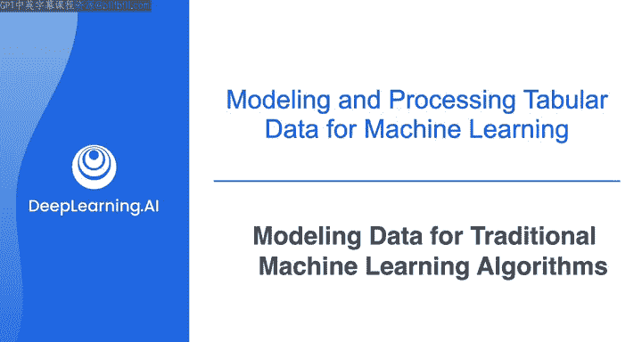
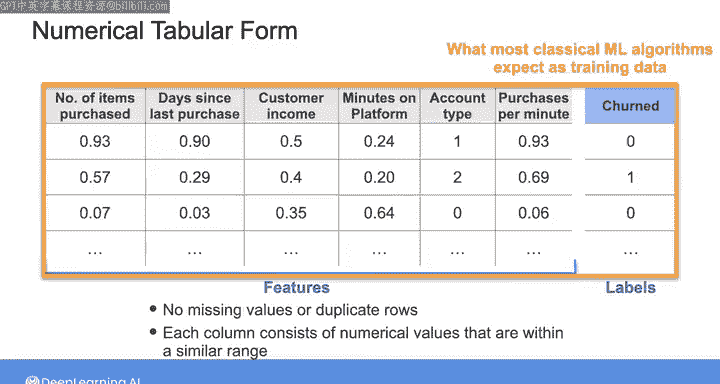
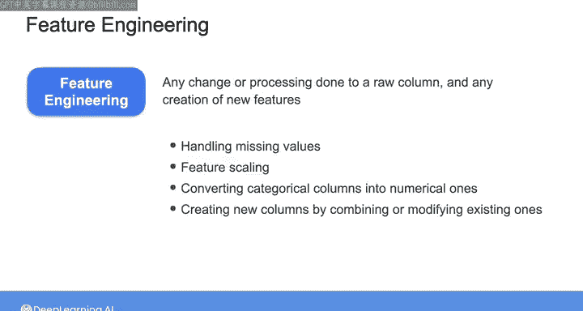
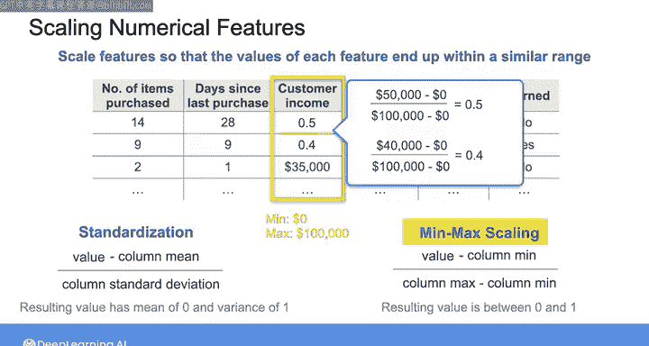
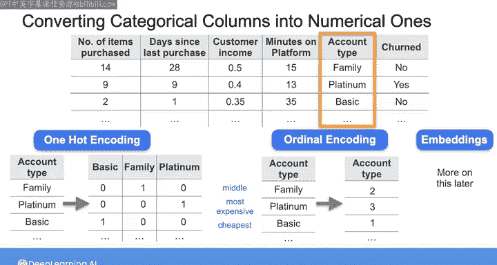

# 吴恩达《数据工程（数据建模、转换和服务）第4课，完结｜DeepLearning.AI Data Engineering》 - P15：14_传统机器学习算法的数据建模.zh_en - GPT中英字幕课程资源 - BV13mtpe7ESt

When you serve data for training classical machine learning algorithms。

 typically the data is expected to be in a tabular form containing only numerical values。

When you model the data for these use cases， you need to decide what features to include and what label to use the decisions are usually made by the machine learning or data science team so depending on the project and the level of iteration you might just serve raw data to the team if they are interested in exploring the data or you might need to process the data and convert the features and the labels into a numerical tabular form before serving it to them so let's go through some basic pre-processing steps to prepare tabular data for training back to the customer churn example that I introduced in the previous video here's what the raw data set might look like each row corresponds to a customer showing the number of purchases they made the date of their last purchase。

 the customer's income， the timebased on the platform。

 their account type and whether they have churn or not depending on the project in the team you're working with you may be expected to serve raw data like this or you might be asked to process the data and convert it into a numerical tabular form which might look something like this。

Notice that I've separated a churn column into a vector that contains the labels for each customer where one means that the customer has churn and zero means that they have not You can see that there are no missing values or duplicate rows and each column consists of numerical values that are within a similar range Moreover。

 notice that I've created a new purchases per minute feature by dividing the number of items purchase column by the minutes on platform column combining or modifying existing columns you create new features is something that seally decided by the machine learning team and communicatingd to you this numerical tabular data is what most classical machine learning algorithms expect to receive as training data and machine learning when you process a raw column or create a new feature that's called feature engineering This process includes operations like handling missing values feature scaling。

 converting categorical columns into numerical ones and creating new columns by combining or modifying existing ones let's take a closer look at these common feature engineering operations。

You'll likely encounter missing values when working with data。

 you should first understand why the values are missing。

 then determine the most appropriate way to handle this issue。

 The simplest approach is to delete either the columns or the rows that contain the missing values but you might unintentionally lose important data this way。

 So only delete rows or columns when there's no risk of losing valuable data another approach would be to impute the missing values with some summary statistics from the column such as replacing the missing values with a mean or median of the column or with the value from a similar record however。

 when you impute the missing values， you might introduce noise or bias to the data in our customer churn example。

 the third row had mostly null values and suppose I spoke with the machine learning engineer and determine that the non- null value that we have isn't particularly valuable So I decided to delete that row and for the missing customer income value。

 I decided to replace it with a value from a similar record there's no single perfect way to handle missing values and you'll usually work with the machine learning team to select the best。

Approach that doesn't impact the performance of the machine learning system After dealing with any missing values。

 you want to scale numerical features so that the values of each feature end up within a similar range without going into the technical details machine learning algorithms are essentially optimization algorithms that use training data to calculate a set of parameters that result in the most optimal outputs if the feature values vary drastically it might take a long time for the algorithms to converge Moreover。

 certain machine learning algorithms are based on distance metrics so their acuracies can be affected by the different ranges of the feature values in our customer churn example the range of values for the number of items purchase feature will be much smaller than the range for the customer income feature to scale the values for each column you can apply standardization or min max scaling with standardization you take each value within a column subtract the column mean and then divide by the column standard deviation the standardized values in the column will have a mean of zero in a variance of。

With min max scaling， you take each value within a column subtract the minimum column value and then divide by the difference between the maximum and minimum column values this way the normalized values in the column will be between0 and1 Let's say the customer income feature has a minimum value of the  zero and a maximum value of $100。

000 what values would you get if you were to apply min max scaling to these first two values in the customer income column。

For the first value you would get 50，000 minus0 divided by 100，000 which is 0。

5 then for the second value you would get 40，000 minus0 divided by 100，000 which is 0。

4 Now what if your raw data contains nonnuical categorical values For example。

 suppose that the account type can either be basic family or platinum like you see here since classical machine learning algorithms expect each feature to be numerical you need to apply a pre-processing step to convert this categorical feature into a numerical one one way to transform this column into an numerical one is to apply a method called one hot encoding with this method replace the account type column with three columns the first one representing basic the second representing family and the third representing platinum since the first customer here has a family account type I will denote the family column with a one and the other two columns with0 and you do the same for all the other rows。

Colums are easy to interpret， but if the number of unique values and a column is large。

 it can increase the number of columns in the dataset significantly another encoding approach is to use ordinal encoding。

 which is useful when there is a natural ordering between the unique values of the categorical column so suppose that the account types can be ordered by their subscription fee with basic being the cheapest family falling in the middle and platinum being the most expensive account type then you can replace basic with a one family with a two and platinum with a three this way you can convert a categorical column into an numerical one without adding columns to your data there's also other methods such as hashing where you apply a mathematical hash function to replace a category with a calculated hash value or you can create embeddings which is something I'll go into later this week again you will work with a machine learning engineer to figure out what method to use depending on your use case So these are some of the preprocessing or feature engineering steps that you might apply to prepare data for training a machine learning algorithm and you should always work close。

With the machine learning team to decide on the steps and methods that are most appropriate for the given project Next up I'll go over a short demo to show you how to apply these feature engineering steps to an actual data using pandas if you aren't already familiar with pandas you might want to check out the Pada tutorial link in the resource section at the end of this week and before we dive into that demo I also included an optional video where I speak with Wes McKinney the creator of Padas if you'd rather skip that video I'll see you in the demo after that。

