# 吴恩达《数据工程（数据建模、转换和服务）第4课，完结｜DeepLearning.AI Data Engineering》 - P17：16_演示：使用scikit-learn处理表格数据（第1部分）.zh_en - GPT中英字幕课程资源 - BV13mtpe7ESt

Let's apply some of the preprocessing steps you saw in the last video on an example dataset I'm going to use the open source machine learning library PsyHL This library includes several modules that you can use to define and develop supervised and unsupervised machine learning systems It also provides tools for preprocessing data I included a link to the psyHtLn user guide in the resource section at the end of this week and I encourage you to check it out to learn more about the various preprocessing tools available In our example I'll use two preprocessing methods standardization for the numerical columns and one hot encoding for the categorical columns for this demo I have downloaded a customer churn data from the data science platform called CAggle if you'd like to follow along with me you can find the notebook file and the data CSV file under the resource section of this video Let's quickly explore this data using pandas I'll import pandas and then read the CSV file that I sort locally into a pandas data frame called data。

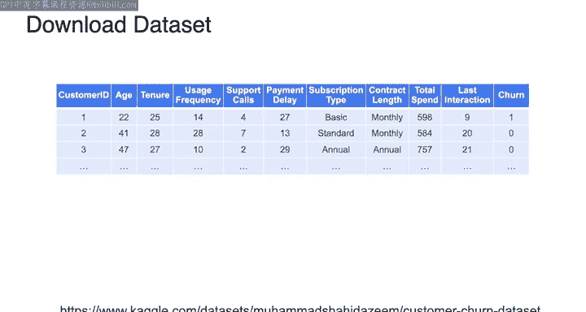

Checking the shape of the data I see that it consists of around 440，000 rows and 11 columns。

 You can use the head method to examine the first few rows of this data。

 Each row corresponds to a customer and contains a set of features including the customer's age their usage frequency。

 the number of support calls they made to the service provider their subscription type and so on It also contains the column churn which consists of the target label for each customer a value of one indicates that the customer has churned and the value of0 indicates that they have not churned you can also use the describe method to quickly explore the summary statistics for the numerical columns so you can see that the mean age of the customers is almost 40。

 the number of support calls range from  zero to 10 and the median total spend is $661 you can also see that the count for each feature is one less than the total number of rows indicating that there's one null value in each。

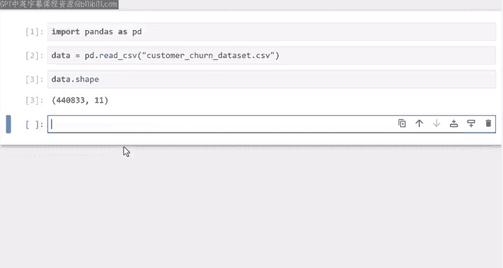

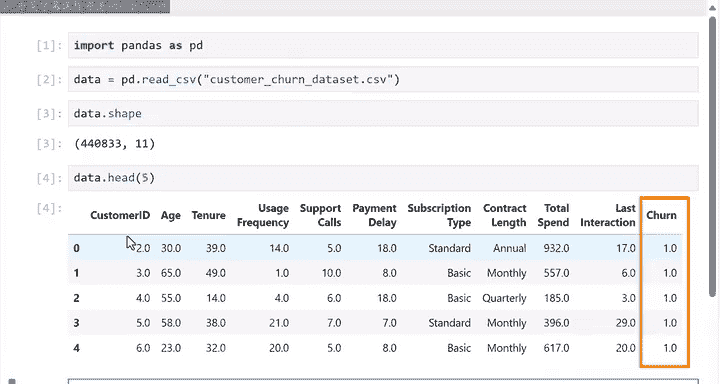

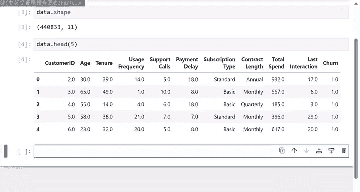

Of these numerical columns， you can verify this by using the I null method。From these outputs。

 you can see that the table contains one entire row of missing entries。

 since it's just one row and all the columns for this one customer arenolls。

 all drop it from the dataset using the D NAA method。

 you can verify that there are no null values anymore in any of the columns。

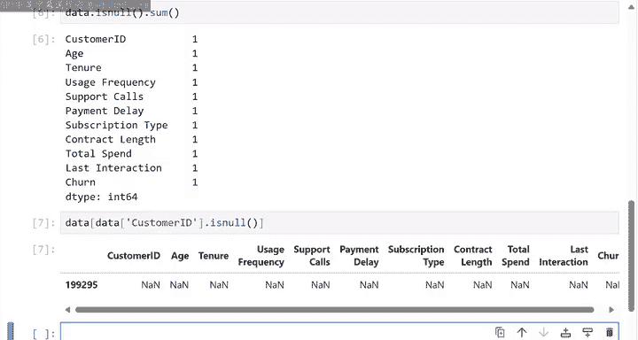

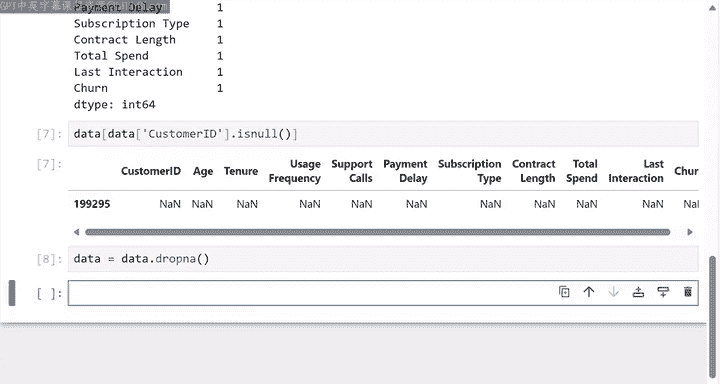

To quickly explore the categorical columns， which are subscription type and contract length。

 I'll use the value counts method on each column which will return the unique categories and the percentage of rows that belong to each category you can see that each categorical column has three unique values since the number of unique values is small you can use one hot and coding to convert these categorical columns into numerical columns but first since most of the machine learning models expect the features and labels to be sorted separately I'll create a variable called features and assign it all the columns from our data that represents the customer features then I'll create a variable called labels and assign it these single column that represents the labels。

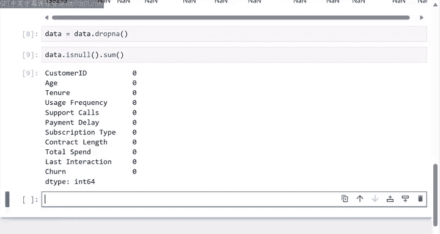

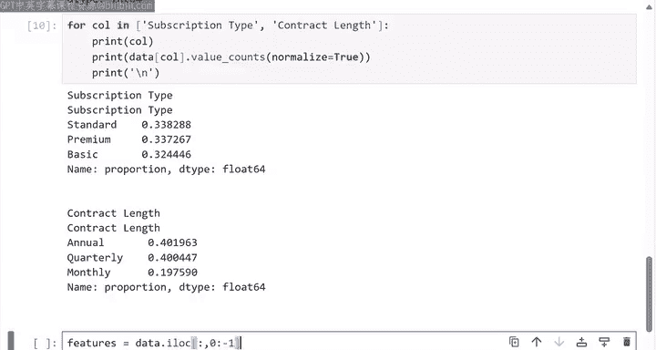

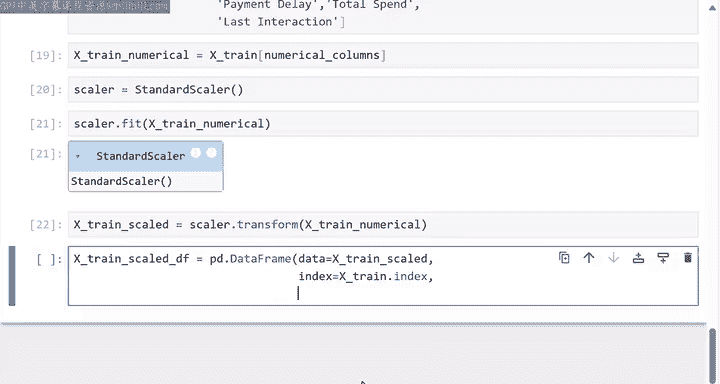

You can take a look at the first few rows of the features and labels to make sure they're separated properly。

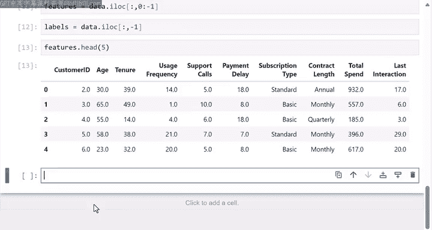

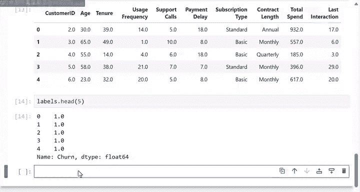

Now assume you met with the machine learning team and you're asked to prepare this data for training a machine learning model For that。

 you asked to split the data into 80% for training and 20% for testing and each set you'll need to preserve the custom ID standardizing the numerical columns that consist of age。

 tenure usage frequency support calls， payment delay。

 total spend and less interaction and perform one hot encoding on the categorical columns the training and test data sets should be stored intular format as parquet files given these requirements here are the steps will follow to prepare the data for training first I'll split the data into training and testing sets then I'll focus on processing the training data first I'll extract the numerical columns of the training set and then standardize each numerical column I'll extract the categorical columns of the training set and encode them using one hot encoding then I'll combine the process numerical columns and the encoded categorical columns with the custom ID into a pandas data frame before converting this panda。

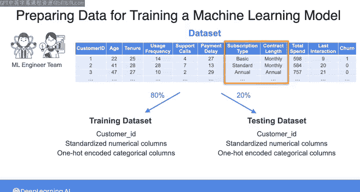

Data frame into a parquet file concatenating the process columns into a pans data frame brings together the metadata。

 meaning the row and column labels and the values into a single object This makes it easier to store the data as a parquet file After that I repeat the same processing steps on the test set when evaluating or testing a machine learning system you should apply the same preprocessing steps with the same computed statistics used on the training set to the test set this is a good practice because the test set is used to evaluate the machine learning algorithm on data that it hasn't seen before so to transform the test set you should use any statistics used to transform the training set with so with this plan in mind let's move on to the next video to see how to carry out these steps insyitL。

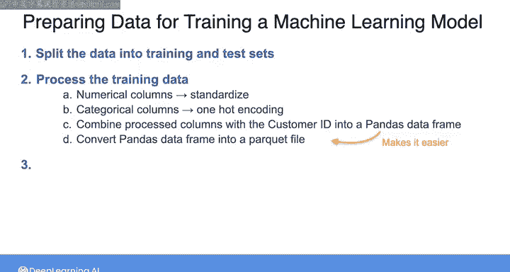