# 吴恩达《数据工程（数据建模、转换和服务）第4课，完结｜DeepLearning.AI Data Engineering》 - P18：17_演示：使用scikit-learn处理表格数据（第2部分）.zh_en - GPT中英字幕课程资源 - BV13mtpe7ESt

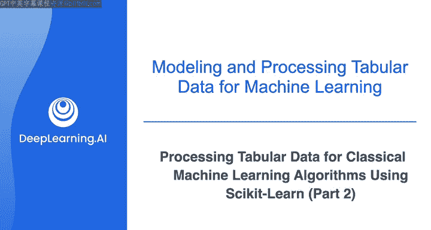

Here's the plan you saw in the last video to prepare tabular data for training a classical machine learning algorithm。

 let's start with splitting the data into training and test sets using PsyitLearn's Tra test split method。

 which I'll import here I then need to specify the features， labels and test size。

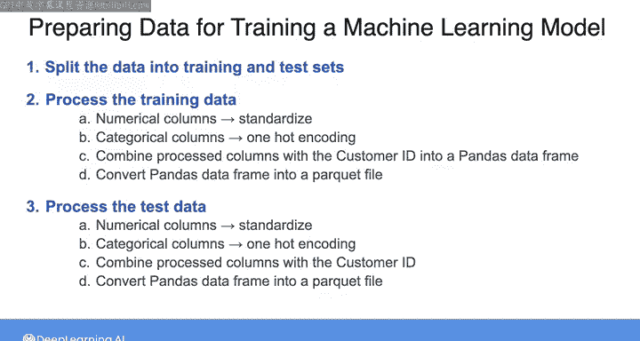

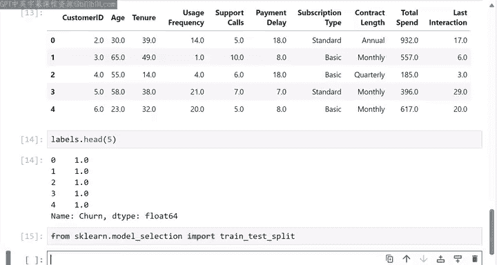

The random state parameter ensures that you can reproduce a splitting when you run this code again at a later time so I'll just set it to 42 but you can use any integer you want This method returns the features denoted by X and the labels denoted by Y for the training and test sets Now that we have our training and test sets let's focus on preprocessing the training dataset set first then I'll apply these same steps at the end of this video to the test set starting with the numerical columns since I want to scale these features first from the TK learn preprocessing module I'll import the standard scalar class I'll create a list called numerical columns to specify the age tenure usage frequency support calls。

 payment delay， total spend and last interaction columns then I'll create a data frame called X train numerical to extract just the numerical columns from the training features dataset set。

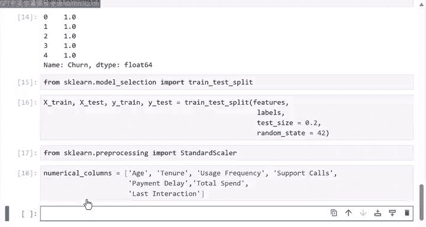

In order to use the functionalities of the standard Scalar class。

 I'll instantiate a standard Scalar object with this object I can call two methods fit and transform the fit method computes the mean and standard deviation of each numerical column and the transform method uses the computer statistics to scale the values of each column。

 so I'll call the fit method on the numerical data frame。

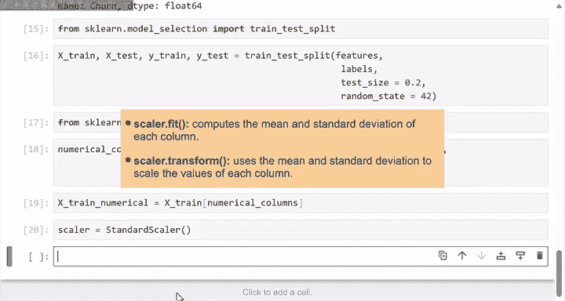

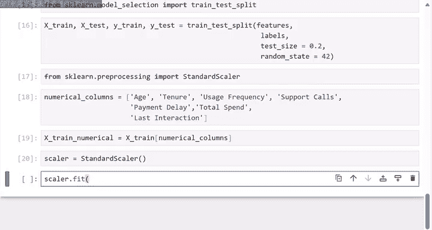

And then I'll call the transform method on the same data frame。

 the transform method returns the scaled columns as a numpy array Since I'll need to concatenate the process numerical and categorical columns into a pandas data frame I'll first convert this nuy array into a pandas data frame so itll be easier to create the final pandas data frame later on。

 So using the pandas data frame constructor I'll pass to it the scaled features。

 the index of a training data frame to ensure each row and the output data frame maps to the correct row of the original training set and finally。

 I'll pass to it the names of the numerical columns。

 So now you have a data frame containing these scaled numerical columns。

 Here are the first five rows of this data frame As you can see。

 all the features have been scaled to lie within a similar range。

 Let's set this aside for now and move on to the categorical columns since I want to convert these columns into numerical columns using one hotencoding from the psychit learnar preprocessing module。

 I'll import the one hotenr class similar to what we did before。

 I'll create a categorical columns list。

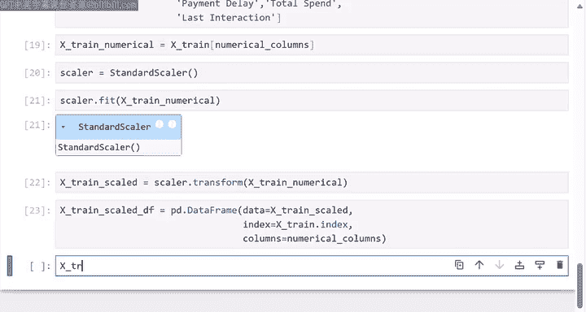

To specify these subscription type and contract length categorical columns。

 then I'll create a data frame called X train categorical to extract the categorical columns from the training features dataset set。

To use the one hot encoder class on this categorical data frame while first instantiate it with this encoder。

 you can also call it the fit and transform methods。

 the fit method will check the unique values within each categorical column to know how many columns need to be created for each feature and it'll prepare the labels of the output columns。

 so I'll call the fit method of the encoder on the categorical data frame and finally I'll call the transform method of the encoder on the same categorical data frame。

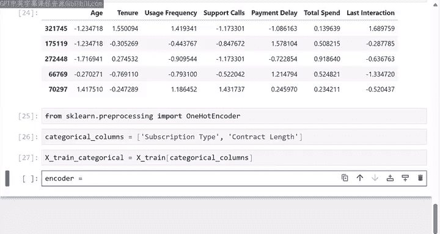

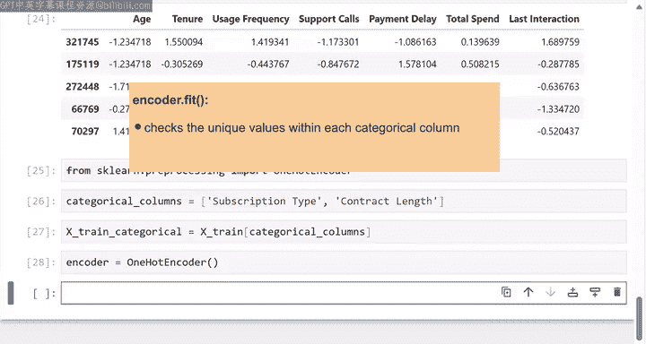

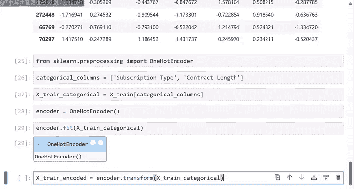

The transform method returns the encoded columns as a compressed matrix。

 so if you try to get its type， you will see that it is a sparse matrix stored in a compressed sparse row or CSR format。

 a sparse matrix contains a lot of zeros which is what happens when you use one hotcoing so instead of storing the entire matrix。

 only the locations that contain a1 are stored， you can see this information when you print this compressed matrix。

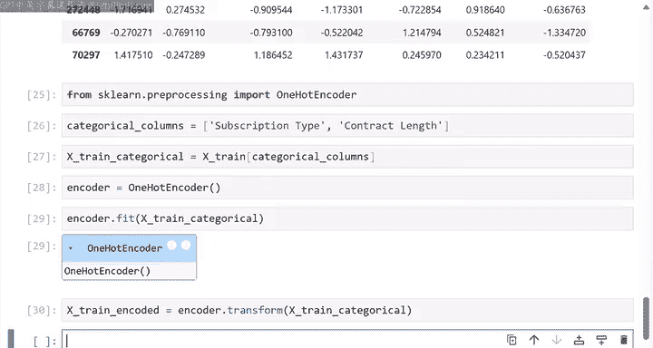

To convert this matrix into a regular matrix， you can use the two dense method so these are the encoded columns for each category of the original categorical columns to know what each column represents。

 you can use the encoder method called get features names out so you can see that the first three columns represent subscription type and the last three columns represent the contract length type Now let's convert this matrix into a data frame that represents the encoded categorical columns again I'll use the pandas data frame constructor。

 This constructor expects a regular matrix So first I'll convert the encoded outputs from the compressed matrix to a regular matrix using the two dense method you saw earlier then I'll pass it the index of the training data frame and for the name of the categorical columns I'll use the encoder method get features names out so that creates a data frame with the encoded categorical columns here are the first five rows of the data frame you can see that these categorical features have all been converted into numerical values Now I can。

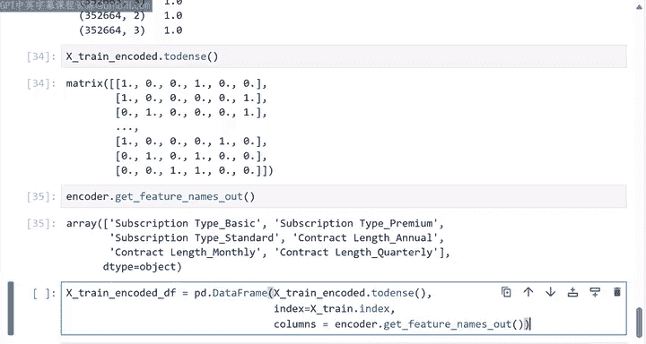

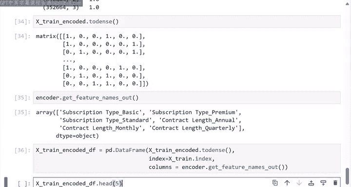

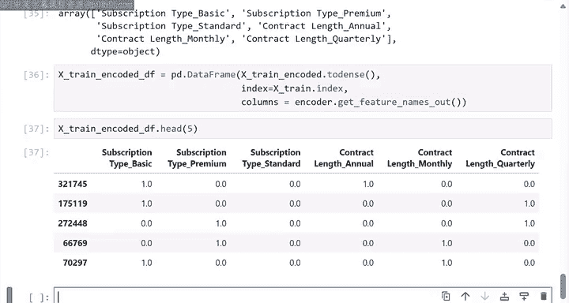

EPAda's concate method to concatenate the customer ID the scaled numerical features and the encoded categorical features into one data frame the parameter access equals1 specifies that it's a horizontal concatetnation here are the first five rows of the data frame that represents the process training data Finally I'll apply these same steps for scaling the numerical features and encoding the categorical features on the test set So first I'll scale the numerical columns and then transform the scaled columns into a panda's data frame then I'll encode the categorical columns and then transform the encoded columns into a panda's data frame。

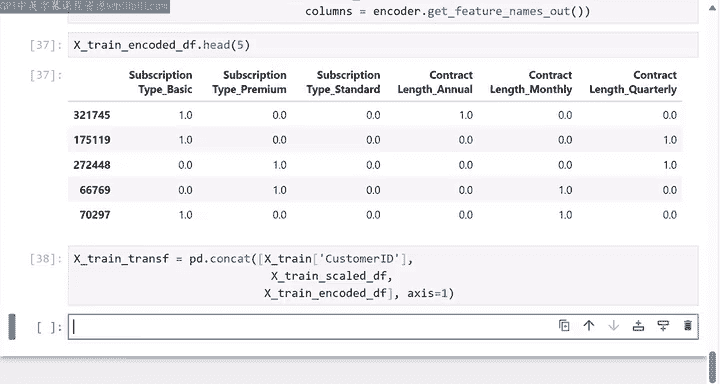

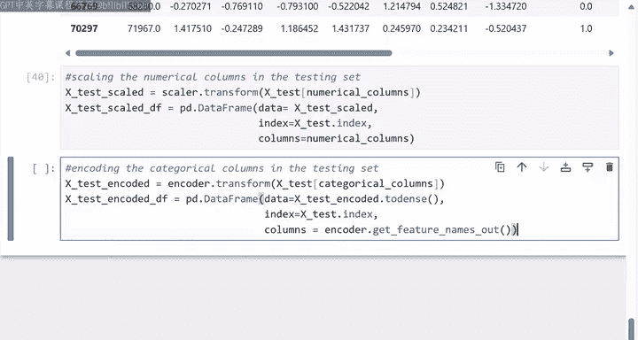

Finally， I'll concatenate the custom ID D column with the processed numerical and encoded categorical columns。

 It's important to note that I did not reffit the scalar and the encoder on the test set。

 I simply use the same scalar and encoder that I previously fit with the training set That's because you want to ensure the same scaling as applied to the numerical features meaning the same mean and center deviation are use to scale each column in the test set And finally to save the training and test features as parquet files I'll call the method two parquet as shown here and there you have it。

 we just applied scaling on all the numerical columns of the training and test data sets and applied one hot encoding on the categorical columns for both training and test sets you would then pass these data sets to the machine learning engineer or data scientist to train and evaluate the various machine learning algorithms For the first lab of this week。

 you'll revisit the lab for course1 but this time you'll use siteit learn to process the data used to train the recommender system After that。

 join me in the next video to discuss。How you can process images before using them to train machine learning algorithms。

