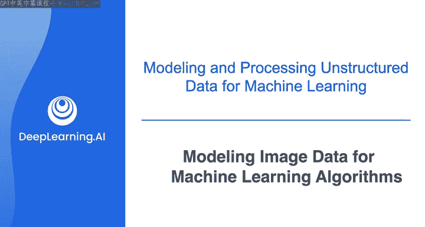
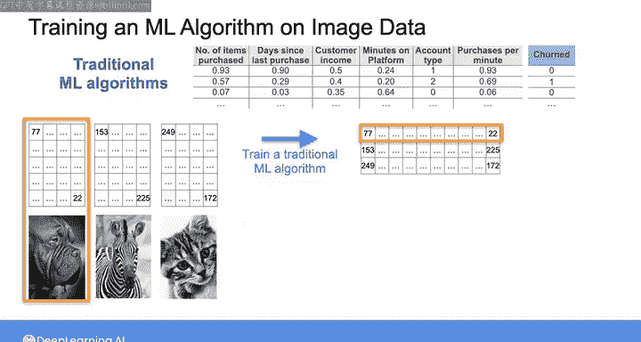
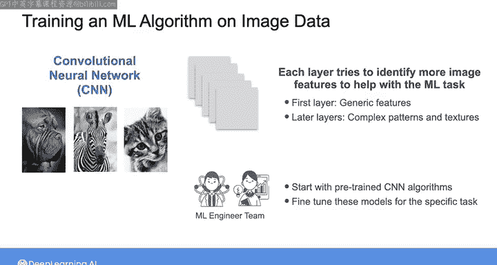
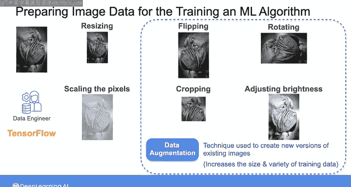
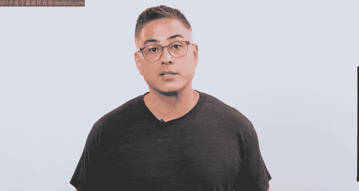
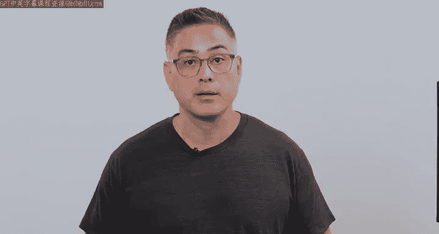

# 吴恩达《数据工程（数据建模、转换和服务）第4课，完结｜DeepLearning.AI Data Engineering》 - P19：18_机器学习算法的图像数据建模.zh_en - GPT中英字幕课程资源 - BV13mtpe7ESt

Aside from predicting sales and segmenting customers based on tabular data。

 you can also use machine learning algorithms to identify patterns and images。

 Some applications of this include image classification like identifying the type of plant from an object object detection such as recognizing a pedestrian in a photo of an intersection and pixel segmentation such as detecting cancerous regions in an x-ray image when in preparing images to be trained by a machine learning algorithm what you'll do will depend on the type of algorithm being used。

 let's take a look at these different cases， as we discussed in the previous lesson。

 traditional machine learning algorithms or even regular neural networks expect data to be in tabular form consider for example。

 this set of grayscale images with these pixel representations of each image。

 let's say the machine learning team wants to use a set of images to train a traditional machine learning algorithm then you would need to flatten each image into a long vector of pixel values and then concatenate the vectors from all images into a tabular form like this that can be used by the machine learning。

AlrithmEach row in this table corresponds to the flattened pixel values of one image。 However。

 this approach has limitations。 When you flatten an image。

 you ignore the spatial structure of the image and with that you lose a spatial information that can be extracted from how one pixel is located with respect to other pixels Moreover this approach can create a high- dimensionmenional vector of features for each image For instance。

 if each image is of size 1000 pixels by 1000 pixels。

 then by flattening each image you obtain a vector or size of 1 million which would require a lot of compute and memory resources if trained on a regular neural network without going into too much of the technical details。

 this can also affect the performance of the machine learning algorithm。

 especially if the dataset contains way fewer than 1 million images included a link to Andrews deep learning specialization in the resource section so feel free to check that out for more details the alternative approach is they train a more advanced deep learning algorithm and as a convolutional neural network or CNN on these images。

A convolutional neural network can work directly on images without having to first flatten them These types of networks consist of several layers where each layer tries to identify more and more features in an image that can help with the machine learning task。

 The first layer learn generic features that could be applied to any images things like lines horizontal and vertical edges and simple textures later layers learn features such as more complex patterns and textures features that are more specific to the task at hand。

 This is why you'll find that many machine learning teams use pre-train convolutional neural network algorithms that were trained any large set of images and then finet these models for their specific tasks by training the deeper layers using their own specific set of images So you might be responsible for providing the machine learning team with the set of specific images that they'll use to fine tune a convolutional neural network or even to train these networks from scratch In any case you would still need to prepare the images for the training algorithm For instance。

 you would need to resize the images into a shape that is expected by the neural network。

Algorithm or you would need to scale the values of the pixels so that they are in the range of values expected by the algorithm。

 Another preprocessing technique that you might apply is data augmentation Amenting images is a technique that you can use to create new versions of existing images by applying geometric transformations such as flipping and rotating or other techniques such as cropping or adjusting the brightness of the images data augmentation can help increase the size and variety of the training data which in general can help with a performance of the machine learning algorithm you can apply these preprocessing steps using open source tools like Tensorflow。

 which is a framework that's used to build and deploy deep learning models Tensorflow provides preprocessing functions that you can apply directly to your images included an optional code example in the reading item after this video that shows how you can use centerflow to resize scale and augment a set of images So that was a brief overview of the techniques you can use to pre-process images A from preprocessing image files。

 you might also need to preprocess of p file that contains a scale。

Doment that you need to extract textual data or tables from There are also techniques that can help you with this task For more information I included a link to a short course on preprocessing unstructured data for large language model applications that shows you examples of these techniques in the next video we'll continue discussing how you can preprocess unstructured data for machine learning algorithms but now we'll focus on textual data。

