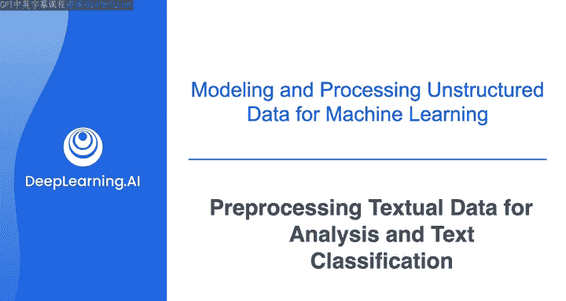
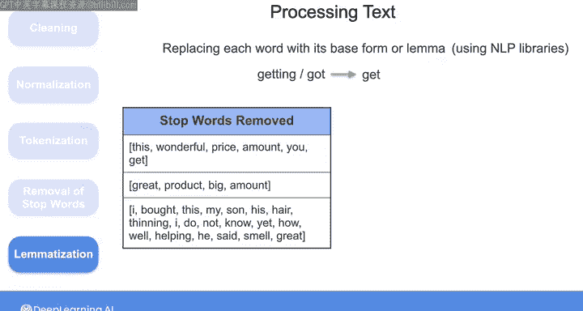

# 吴恩达《数据工程（数据建模、转换和服务）第4课，完结｜DeepLearning.AI Data Engineering》 - P20：19_文本分析和分类的预处理.zh_en - GPT中英字幕课程资源 - BV13mtpe7ESt

As organizations increasingly generate and collect large amounts of text， including product reviews。

 social media posts and customer support interactions。

 it's essential for them to extract insights from this textual data to make critical business decisions as a data engineer。

 you could be tasked with preprocessing and serving textual data to machine learning engineers so they can analyze the data and use the train machine learning systems for various applications such as sentiment analysis of product reviews。

 classification of news articles， chatbots and virtual assistance， spam detection。

 customer segmentation， product recommendation and much more natural language processing or NLP is a subfield of AI that enables computers to process。

 understand and generate human texts。 NLP is an old field that has existed for more than 50 years and it encompasses various text analysis techniques that have evolved over time。

 While classical machine learning algorithms are effective for NLP tasks like text classification。

Centment analysis， the latest development in NLP， known as large language models or LLMs。

 have significantly enhanced computers capabilities in interpreting and generating text with remarkable accuracy and fluency In this video will look at some text pre-prosing techniques you can use to prepare textual data for training machine learning systems for NLP tasks。

 let's say your company wants to perform sentiment analysis to analyze customer reviews to determine if they are positive or negative。

 This technique typically relies on using a pretrained machine learning system or on training a machine learning system on your customer reviews as a data engineer in addition to collecting and storing these reviews。

 you can also help transform this textual data into a format that the machine learning algorithms can understand the degree of pre-processing that you need to apply will depend on the type of machine learning algorithm used Class machine learning algorithms cannot work directly with sentences So in this case you need to apply preprocessing techniques to first clean the text and then vectorize it。

On the other hand， LLMs can work directly with a sequence of tokens or words from your sentences without you having to first vectorize the sentences into numerical form。

 In any case， I think it's important that you are familiar with the various strategies for pre-processing in preparing textual data for further analysis This is because textual data might contain typos inconsistencies and repetitions that you need to address in order to provide clean and high quality data to train a machine learning model and ensure its performance regardless of whether the machine learning algorithm is classical or advanced like an LLM。

 Moreover， not all words or characters that are in your textual data might be relevant for the given NLP task so in order to reduce processing and storage costs you would need to remove any words or characters that do not carry any relevant information for your use case and finally it's true that LLMs are currently excelling at many NLP tasks。

 but training such an algorithm is still expensive and timecon so they might not be the best solution for all use cases the machine learning team you work with might。

Still prefer using classical machine learning algorithms where simpler solutions are enough to address the use case requirements。

 There are also use cases where you would need to combine numerical。

 categorical and textual features in a trained data so for all these reasons let's take a look at some common pre-processing techniques for prepping textual data to clean your text。

 you can start by removing punctuations extra spaces or any character that doesn't add meaning to the text。

 For example， here are three original text reviews and here is what you want to end up with after cleaning the data I've included the python code used to clean the data in the reading item that follows this video so feel free to look at the explanation of that code if you're unfamiliar with working with strings After cleaning the data you can apply normalization to standardize the text by converting it into a consistent format despite might include transforming the characters to lowercase converting numbers or symbols to characters or expanding contractions or acronyms to reduce variations in spelling use for the same words for instance。

 looking at our three。Example reviews， the customer in the second review wrote amount as AMT and you could have another review that maybe capitalizes the a in amount。

 when you apply normalization， you resolve these inconsistencies by replacing all these instances with the lowercase spelling of the word amount in the third review。

 you also see the contraction don't which you can replace with do not Other examples of text normalization include converting common units like K G to kilograms or LBS to pounds or replacing acronyms like D or D do E with data engineering again。

 you can take a look at the python code that performs its normalization in the reading item that follows after you normalize the data you should end up with text that looks like this to prepare the text for further analysis。

 you then apply tokenization for each text review， meaning you split each review into individual units or tokens which are typically words but can be any meaningful unit of text such as subwe。

Or short sentences for simplicity， I'll just split each review into a vector of words。

 This can be done with the Python string methods split that you'll see in the reading item。 Next。

 you can remove frequently used words such as is or the4A that usually don't add any meaning to the data These words are referred to as stop words you can define your own list of stop words or use NLP libraries like Spacey NLTK。

 Gensim and textblob among others that come with a builtin set of stop words Here's what the example reviews look like after I remove the stop words that belong to the set。

Finally， you can replace each word with its base form known as its lemma using a technique called leization。

 For example， the base form of getting and got is get So when you apply leization to text you replace all these variations with as Lemma which is the word get again you can use NLP libraries to obtain the lemma of each word This is what I got after applying leization to all three reviews depending on the needs of the machine learning engineers or data scientists。

 you might not need to apply all these steps or you might need to apply other preprocessing steps This depends on the models your end users applying to use and how much processing they want to perform themselves I included links in the resource section to some additional courses that talk about other text pre-processing steps so feel free to check them out to learn more about preparing textual data for training an LLM or other algorithms In any case。

 after you perform the necessary steps to clean and pre-processed data the next thing you might have to do especially。

Work with machine learning algorithms that expect numerical data in tabular form is to vectorize the data。

 So in the next video， I'll cover some common techniques for vectorization where you convert clean and tokenized text into a vector of numbers。

