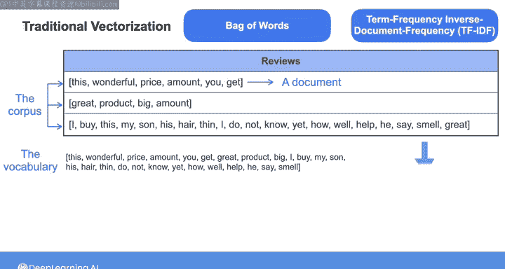
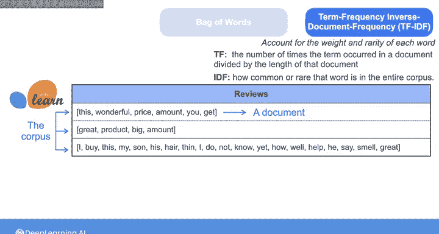
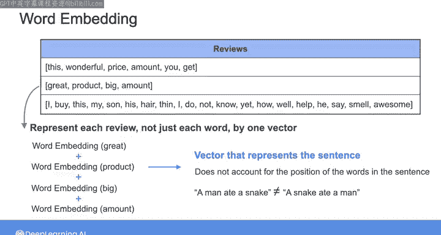
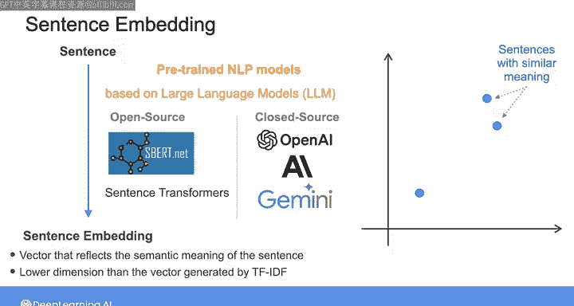
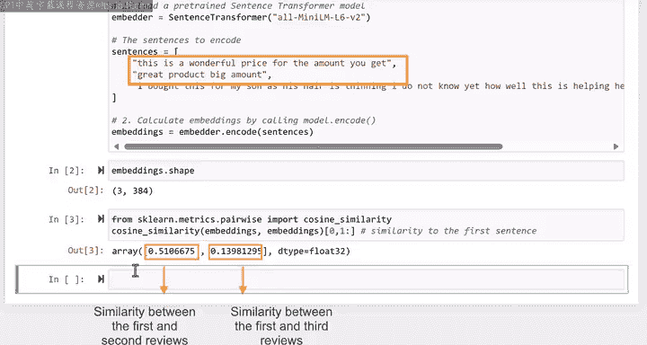
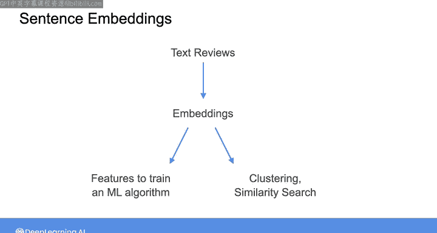

# 吴恩达《数据工程（数据建模、转换和服务）第4课，完结｜DeepLearning.AI Data Engineering》 - P21：20_文本向量化和嵌入.zh_en - GPT中英字幕课程资源 - BV13mtpe7ESt

Now that we've covered the common preprocessing steps for textual data in the previous video。

 let's go over how you would turn your preprocessed text data into vectors。

 the traditional techniques to vectorize text consists of methods like bag of words and term frequency inverse document frequency or TF IDF these methods assign a number to each word in a text based on its frequency of occurrence Here's the example you saw in the previous video I'll refer to each customer review as a document and the three reviews collectively make up what is known as the corpus in a real example。

 the corpus would include all the customer reviews and will be much larger let's first extract the vocabulary of the corpus。

 meaning the list of unique words at make up this collection then you can convert each document meaning each customer review into a vector that has the same length as this list of vocabulary in the bag of words method each entry in the vector reflects a number of times that corresponding word appeared in the document so in the first review the words this wonderful price。

Amount you and get all appeared once and all the other words and the vocabulary appeared zero times you can usesyitL to quickly vectorize your text using the bag of words method feel free to check out these specific code in the reading item that follows this video however the bag of words method only takes into account how frequently each word and the vocabulary appears within each document in a large text corpus some words might appear very frequently across all documents but carry very little meaningful information about the actual contents of the document for example。

 if you're looking at a large data set of product reviews the words purchase and buy might appear many times across many document if you were to feed the frequency count data directly to a document classifier that perform sentiment analysis on the reviews at these high frequency but low meaningan words might overshadow the frequencies of more rare but more significant words like break or exceptional with the TFIDF method you can account for the weight and rarity of each word or term when。

Vectctorizing the documents for each word you will consider its term frequency。

 which represents a number of times a term occurred in a document divided by the total number of words in the document and you will also consider the inverse document frequency which indicates how common or rare that word is in the entire corpus the closer this number is a zero the more common it is and the closer it is to one the more rare it is in practice you would use psyitLar or another library to help you vectorize your text using the TF IDF method so I won't go into details of the calculation here but if you're curious about these details。

 feel free to check out the reading item after this video So here's a TFIF vectorization of these text reviews the traditional way of vectorizing a text is considered a simple easy to understand an interpretable method of vectorizing text and you might choose to use these methods for quick experimentation these simple vectorization methods are useful when you have a smaller data and they can perform very well on document classification or the presence of a specific key。

Tms strongly indicate the class of the document。 However。

 it gives no attention to the meaning of the words or the sentences in the document and you can end up with a high dimensionmensional vector with very sparse values。

 if you want to better capture the semantic meaning of a word you can replace the word by a vector are called a word embedding these vectors are generated in such a way that if two words have similar meaning they mapped to vectors that are geometrically closer to each other So for example。

 the embedding vector of the word useful should be closer to the embedding vector of the word helpful then that of the word tree you can generate embedding vectors using popular word embedding algorithms such as word tove and glove which have been trained to learn the embedding in words from their cooccurrences in very large collections of text。

 The idea is that if two words frequently appear together they should share similar context and this have similar meaning let's go back to our text reviews here you want to represent each review and not just each word by one vector you could。

Compute the word embeddings for each word in the sentence then add a bold of vectors to get a vector that represents the sentence。

 but this method doesn't take into account the position of the words in the sentence。 For example。

 a man a a snake has a different meaning than a snake a a man but if you add the word embeddings of each word in these two sentences you'll get the same vector This is where sentence embeddings can be helpful。

 a sentence embedding is a vector that reflects the semantic meaning of the entire sentence。

 It takes into account the position of the words in a sentence and the meaning of each word similar to word embeddings。

 if two sentences have similar meaning， the embedding vectors would be close to each other。 Moreover。

 a sentence embedding is a vector that has a lower dimension than the dimension of the vector generated by a TF IDf you can obtain these sentence embeddings using NLP models that are pre-trained on large dataset sets several open source and close source embedding models exist。

 but the say of the art models are based on large language models For example。

 sentence transformers is a python framework that enables。

To access open source embedding models On the other hand。

 LM research companies such as OpenaiI Anthropic and Google offer closed source API embeddings。

 let's apply sentence embeddings to the text reviews here I'm using the sentence transformer is Python package first I need to instantiate an instance of the sentence transformer and specify an open source LLM model in the documentation page you can find a list of open source models that you can use with sentence transformer I'm going to use a model called all many Lm L6 v2 which you'll see again in the lab exercise later on then I'll take the text reviews that I've cleaned and normalized and pass it to the embedding model for each review the model returns and embedding vector that has 384 entries let's see how similar these vectors are to each other I'm choosing to use the cosine similarity metric here but you can choose other distance metrics as well the cosine similarity between the first review and the second review is 0。

51 and the cosine similarity between the first review in the third review is 0。14。

That the first review is closer remaining to the second review than it is to the third This makes sense since both the first and second reviews are about the amount of product the customer received Now what can you do with these embeddings these embeddings can serve as features to train a machine learning algorithm for product recommendation or they can be used for clustering or performing similarity search in the second lab of this week you'll be provided with the text review data you saw in the previous course you'll apply embeddings to this data and process theular metadata using similar techniques that you used in the first lab and after that。

 join me for a summary of this week。

