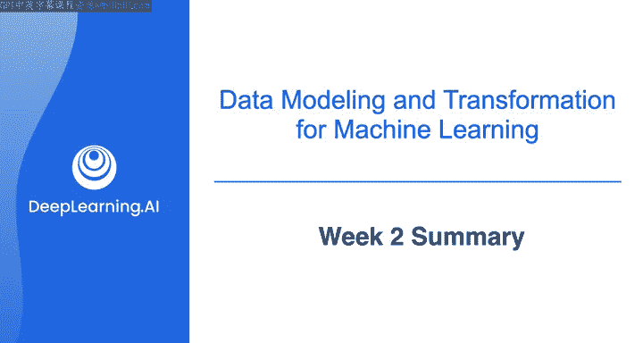
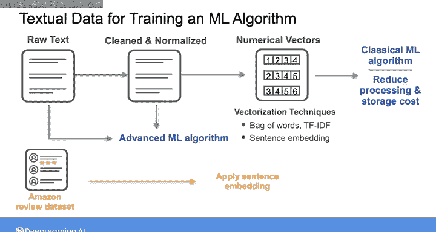

# 吴恩达《数据工程（数据建模、转换和服务）第4课，完结｜DeepLearning.AI Data Engineering》 - P22：21_第2周总结.zh_en - GPT中英字幕课程资源 - BV13mtpe7ESt

This week we looked at approaches for modeling and preprocessing tabular data， images。

 and text to prepare them for machine learning use cases。

You've seen how a machine learning project lifecycle looks like and how you can help the data science or machine learning team by serving the data they need throughout the stages of the project Many machine learning algorithms expect data to be in numerical tabular form however real data doesn't always exist in this form it can have missing values or contain categorical columns to handle missing values you can apply data imputation or in some cases you can simply delete the empty records or columns to convert categorical columns to numerical ones you can use encoding techniques such as one hotencoding ordinal encoding or other methods we also discuss the importance of scaling the numerical features in a training data to help the machine learning algorithm convertverge faster in the first lab of this week implement these processing steps and more using the psyit learn library when it comes to image data you need to enroll the images in a long sequence of pixels if you're working with classical machine learning algorithms more advanced neural network techniques such as convolutional neural networks can directly process images and learn properly。

about the images in each layer while you don't need to enroll images when working with convolutional neural networks。

 you might still need to apply pre-processing techniques to the raw images such as image reshaping and normalization。

 or you might be asked to help augment the data set of images by applying techniques such as flipping。

 rotation or adding distortions。Finally， when it comes to textual data。

 you learn how to preprocess text， if the end use case involves more advanced NLP models。

 then you might just serve the raw data or the clean text data to the machine learning engineer or data scientist however if the end use case involves training classical machine learning algorithms or you want to reduce processing and storage costs by preprocessing the text before feeding it into an LLM then you would need to perform extra preprocessing steps to convert the text into numerical vectors you learned about two traditional vectorization techniques bag of words and TFIF and you also saw a more advanced technique。

 sentence embedding in the second lab this week you applied sentence embedding to the Amazon review data set and combine it with other product features when it comes to building machine learning systems developing a basic understanding of how machine learning works will help you serve quality data to your stakeholders and provide value to your organization and with that we've covered modeling techniques for analytical use cases and processing techniques for machine learning use cases。

Next week we'll discuss more transformation techniques and look at transformation frameworks such as Spark。

 I'll see you there。