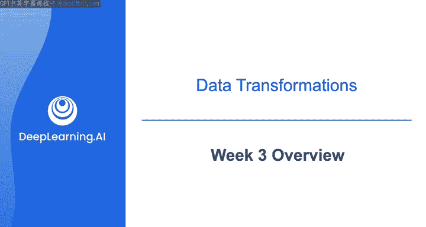
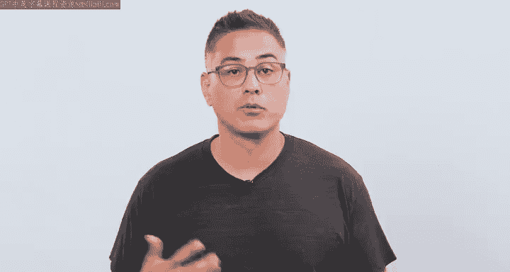
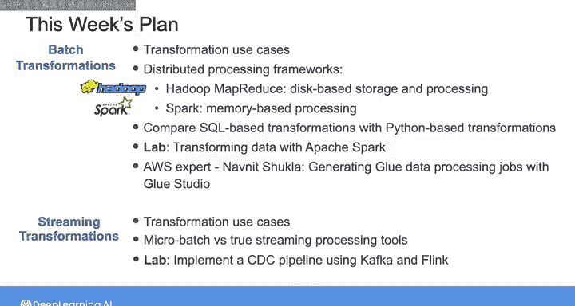

# 吴恩达《数据工程（数据建模、转换和服务）第4课，完结｜DeepLearning.AI Data Engineering》 - P23：22_第3周概览.zh_en - GPT中英字幕课程资源 - BV13mtpe7ESt

So far in this course， you've modeled data for analytical use cases by defining a normalized schema。

 a star schema， and one big table schema。 you've also modeled data for machine learning use cases and done some simple transformations on small data sets using Pada's data frames but when you're working with largescale data that requires complex transformations Pada's data frames alone might not offer the scalability and performance you need and so this week we'll get into the details of transformations and look at the technical considerations for various data processing frameworks that you can use to transform your data。

 as I already mentioned the transformation stage of the data engineering lifecycle is when you manipulate and enhance data for downstream stakeholders and is where you the data engineer can really add value to the organization for example。

 you can clean and combine data for multiple sources and then store it in a data lake or data warehouse to create a central source of truth for your organization inside your data warehouse you can leverage its massively parallel processing ability to transform the data。

to a star schema or a data vault so that users can more easily queryrry the data and inside your data lake you can apply a series of transformations by moving your data from the raw to the cleaned or transform zone and finally to the enriched zone so that it's ready to be consumed by data users to apply these transformations you need to consider things like the size of the data specification of hardware that's available to you and the performance requirements these considerations will help you decide whether you can just process the data on a single machine or use a distributed processing tool like Spk and whether you should write your transformation logic and SQL or another language like Python you can also apply transformations to streaming data allowing your stakeholders to perform real-time analytics In this case you'll need to consider the latency requirements of the system and ensure that your transformations don't incur any delays so this week will start by going through some of the batch transformation use cases you might encounter as a data engineer then we'll cover two distributed processing frameworks Hadoop mapreduce which uses。

Diss for storing and processing data and Spark， which is an in-memory processing framework Many data engineers can consider Hadoop to be a legacy technology due to its complexity。

 the high cost of scaling and significant maintenance requirements but I also think that it's important for you to understand the Mareduce paradigm since it influences many of today's distributed systems We'll compare SQLbased transformations with those implemented in other languages such as as Python and in the lab you'll get a chance to perform the same transformations you did with DT previously in this course but this time you'll implement these transformations outside the data warehouse this week you'll also hear from Noni Chla。

 a senior solutions architect at AWS and an expert on the AWS glue service which is a tool built on Spark he'll show you how you can generate the glue jobs for processing your data using glue Studio then in the second lesson we'll take a look at streaming transformations you'll implement a change data capture or CDC pipeline using Kafka and Flink to capture changes in a data source and update the data。

In your system accordingly， so it's going to be a jam packed week。

 join me the next video to get started。