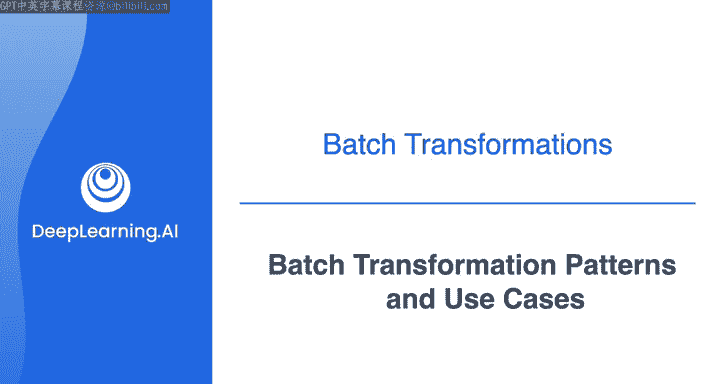
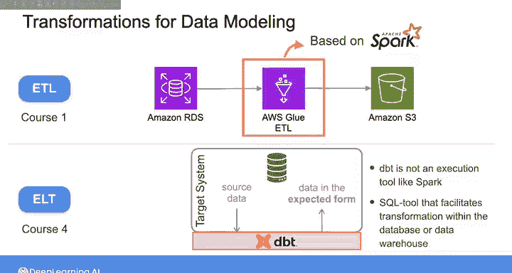
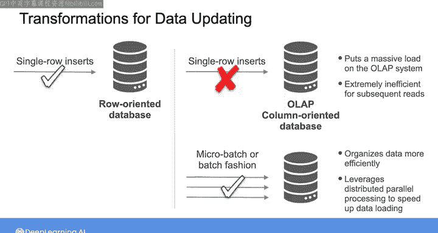

# 吴恩达《数据工程（数据建模、转换和服务）第4课，完结｜DeepLearning.AI Data Engineering》 - P24：23_批处理转换模式和用例.zh_en - GPT中英字幕课程资源 - BV13mtpe7ESt

InMy discussions with data teams from many big tech companies。

 I've noticed that a lot of a data engineers work is batch processing to serve data for analytics and in some cases for training machine learning models with batch transformations。

 you manipulate discrete chunks of data on a fixed schedule like daily hourly every 15 minutes or less to support ongoing reporting analytics and machine learning use cases let's go through some common batch transformation patterns suppose you created a model for your data it could be based on a Kimball star schema data vault or some other data modeling approach Now you're ingesting data into your system and you need to apply transformations to restructure the source data into the expected form you have a few options here you could follow a traditional ETL approach and rely on an external transformation tool to extract and transform the data based on the data model you created before loading the transform data into a target system such as the data warehouse or you can follow an ELT approach where you extract raw data from a。

System and import it directly into a data warehouse。

 then you clean and transform the data in the warehouse itself relying on the storage and computing capabilities of the warehouse or you can take a sort of hybrid approach called ELT where the little T refers to the simple transformations you apply to clean the data like duplicating the data before you load the clean data into the data warehouse then the big T refers to the transformations you apply inside the data warehouse to restructure the data based on the model that you defined In fact you already experimented with both the ETL and ELT approaches in previous labs back in course1。

 you implemented an ETL pipeline with AWS glue ETL as the external transformation tool to transform the data before loading it into S3 AWS gluelu ETL is based on a distributed processing framework called Spark and you can use it to perform more complex transformations on larger datas we'll cover Spark in more detail later this week。

Then in the first week of this course， you implemented an ELT pipeline using DBT to transform the data within a database itself Note that DBT is not an execution tool like Spark。

 meaning it doesn't come with compute resources but it is instead a SQL tool that you can use to facilitate the transformation task within a database or data warehouse by relying on the computing resources of the storage system in addition to transforming your data into a target schema you might need to apply transformations to clean and normal your data For example。

 the source data you extracted might have missing values duplicate entries。

 outliers or other inconsistencies This process of taking messy malform data and turning it into clean data is called data wrangling you could write your own code to perform data wrangling like you did last week to turn raw data into a useful form for training a machine learning algorithm but I highly recommend you use a data wrangling tool to avoid undifferentiated heavy lifting there are many third-part data wrangling tools available to you and many major。

Providers typically offer their own version of these tools。 For example。

 AWS offers AWS gluelu Datab as a visual data preparation service for cleaning。

 standardizing and transforming data after you store your transform data in the data pipeline you might need to periodically or continuously update the data to make sure that it's in sync with this data in the source system you can apply a simple approach known as trunnccate and reload where you delete all records from your table and then reload the data from the data source。

 rewriting any transformation is needed to get the data into your target system This approach works well when you have a small data and only need to update the data in your target system once in a while。

 however， if your data is large this approach can become very resource intensive in this case you might want to adopt a CDC or change data capture approach where you first identify the changes made in the source system and then update the tables in your target system based only on those changes For example。

 you can check the last updated column and a relational source database or。

You can check the database's transactional logs each row in the log can be labeled with an I if the row is inserted A U if the row is updated or a D。

 if the row is deleted when handling updated rows you can apply and insert only pattern or up merge pattern to update your target system with an insert only pattern。

 you insert new records without changing or deleteleting old records and you add additional information。

 the new record to distinguish it from the old one with an up merge pattern。

 you take a set of source records and look for matches against your target table by using a primary key or another logical condition when a match occurs。

 you update the target record by replacing it with a new record When no match exists you insert the new record when handling deleted rows。

 you can adopt a hard or soft delete pattern with a hard delete you permanently remove a record from your target system whereas with a soft delete。

 you mark the record as deleted you might use hard deletes to remove data for performance reasons。

 say a table is too big or if there's illegal legal or。

Ps reason to do so and you can use soft deletelets when you don't want to permanently delete a record but you also want to filter it out of query results you can also delete a record in an insert only manner when you insert a new record with a deleted flag without modifying the previous version of the record so single row inserts are commonly performed on roworiented databases however a problem I see a lot is that some data engineers try to perform single row inserts into an OAP columnoriented database this is an anti-pattern that could put massive load on the OAP system it also causes the data to be written in many separate files which is extremely inefficient for subsequent reads so instead I recommend loading data in a periodic micro batchch or batch fashion when you insert data in bulk the data can be organized more efficiently into row groups and better compressed and if the OAP system is distributed you can leverage the distributed parallel processing capability instead of loading records one by one So those are some of the common batch transformation patterns like I mentioned。

If you're only working with simple transformations and small data sets。

 you might be able to get away with performing the transformations on a single machine， however。

 as the transformations you need become more complex and the data sets become larger。

 you'll need to consider using distributed processing frameworks to meet the scalability and performance requirements while cloud data warehouses leverage distributed processing power。

 you might also need to apply transformations outside the data warehouse or inside a data lake。

 join me in the next video to begin our discussion on distributed processing frameworks。

