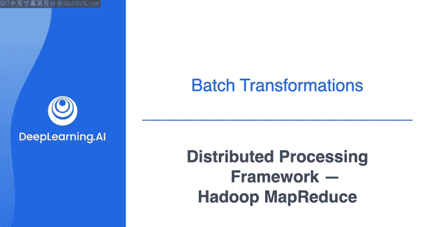
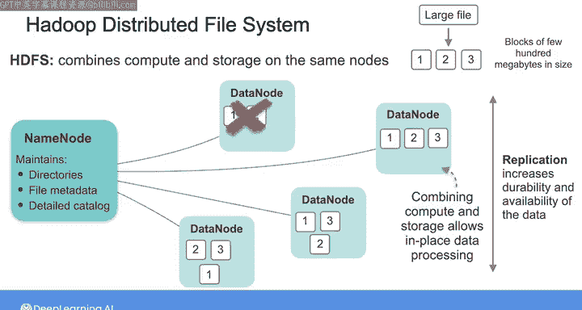
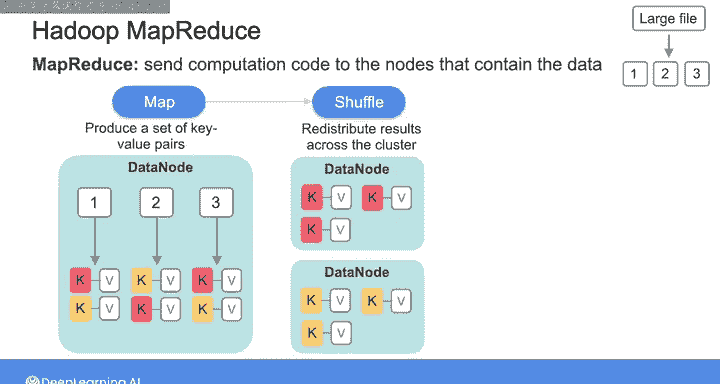
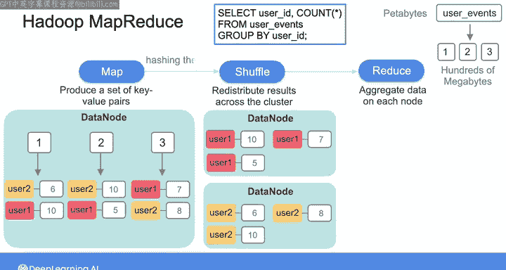
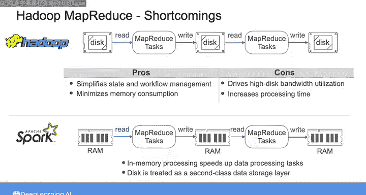

# 吴恩达《数据工程（数据建模、转换和服务）第4课，完结｜DeepLearning.AI Data Engineering》 - P25：24_分布式处理框架Hadoop.zh_en - GPT中英字幕课程资源 - BV13mtpe7ESt

Over the years， engineers have developed many big data tools to handle the growing amounts of data。

 let's take a moment to understand the evolution of key tools and frameworks that have led to today's data ecosystem。

In this video we'll be focusing on Apache Hadoop， one of the earliest frameworks for dealing with large datasets。

 and it's still surprisingly relevant today with the explosion of data in the early 2000s。

 traditional monolithic databases and data warehouses of the 1990s were not able to handle the massive amounts of data in a costeffect scalable available and reliable way at the same time commodity hardware such as servers RAM disks and flash drives also became cheap and ubiquitous During this time several innovations led to the largescale distributed computing and storage on massive computing clusters that you see today in 2003 Google published a paper on the Google file system or GFS which provided a fault tolerant and distributed file system across many clusters of commodity hardware servers shortly after that in 2004 Google published a paper on Mareduce a new parallel programming paradigm for large scale processing of data distributed over GFS Google's publications constituted a big bang。

For data technologies and the cultural roots of data engineering。

 the Google papers inspired engineers at Yahoo to develop the open source framework Apache Hadoop in 2006 Google's GfS paper provided a blueprint for the Hadoop distributed file system or HDfS and Mapreduce became part of the framework although Hadoop is not considered a bleeding edge technology today I still think it's important for you to understand the concepts behind Hadoop because Mapproduce still influences many distributed systems that data engineers use today and HDFS is still a key ingredient of many current big data engines such as Amazon EMr and Spk The Hadoop distributed file system is similar to object storage。

 but with a key difference Hadoop combines compute and storage on the same nodes whereas object storage typically has limited compute support for internal processing。

 Hadoop breaks large files into blocks Each block holding a chunk of data less than a few hundred mebytes in size。

 the file system is managed by what's called the name node which maintains。

iesFile matter data and a detailed catalog describing the location of the file blocks in the cluster in a typical configuration you would replicate each block of data to three nodes called data nodes This increases both the durability and availability of data If a disc or node fails and the replication factor for some file blocks fall below three the name node will instruct other data nodes to replicate these file blocks so that they again reach the correct replication factor by combining compute resources with storage nodes Hadoop allows in place data processing This was originally achieved using the mapre programming model and the mapre programming model you send computation code to the nodes that contain the data favoring locality rather than bring your data to your application the computation code consists of a collection of map tasks that read individual data blocks and produce a set of key value pairs these map tasks or followed by a shuffle that redistributes the results across the cluster that values with the same key or collected together in the same node and finally a reduced step。

Agregates data on each node for example， suppose that you wanted to run the SQL query that selects the user ID and count star。

 meaning the count of all records from the user events table and you'll group by the user ID So the result will be all the user IDs along with the number of records associated with that user ID with HDFS the data in the user events table is broken down into data blocks and spread across many nodes let's zoom in on one data node that contains these three data blocks。

 the mapre job generates one map task per block each map task essentially runs a query on the respective block and generates key value pairs where the key represents a user ID that appears in the block and the value is the corresponding count of records associated with that user ID within that block So for example in this first block there are six records associated with user2 and 10 records associated with user one and so on while the table might contain petabytes of data each block might only contain hundreds of megabytes。

So it's much faster to run the query on a single block than it is on the full table。

 You then redistribute the results by key， which is the user IDd in this example so that each key ends up on one and only one node So here all the user one key value pairs and up in one data node and the user two key value pairs and up in another data node This is the shuffle step which is often executed using a hashing algorithm on keys Once the map results have been shuffled you sum the results for each key the key along with its computed total count can be written to the local disk on the node where they're computed then finally you collect the results stored across nodes to view the full query results This model is extremely powerful but it has some shortcomings it utilizes numerous shortlive mapred tasks that read data from disk and write intermediate computations to disk in particular。

 no intermediate state is preserved in memory and all data is transferred between tasks by storing it on disk or pushing it over the network。

 this simplifies state and workflow management and minimizes memory consumption but it can also drive high disk bandwidth utilization。

And increase processing time so engineers develop other data processing frameworks that still include some elements of map shuffle and reduce。

 but relaxing constraints of mapre to allow for inmemory caching and since RAM is much faster than SSD and HDs in transfer speed and seek time persisting even a tiny amount of chosen data in memory can dramatically speed up specific data processing tasks for example。

 Spark which we'll discuss in the next video was designed around inmemory processing with Spark you treat data as a distributed set that resides in memory and treat disk as a secondclass data storage layer for processing which you'll only use if your data overflows for the available memory nowadays Hadoop is no longer a hot bleedinged technology and mapreduce is not widely used by data engineers and I think that advancements in leveraging memory for data transformations will continue to yield gains for the foreseeable future join me the next video to learn more about Apache Spk a distributed in-memory processing framework that you use in the upcoming lab。

