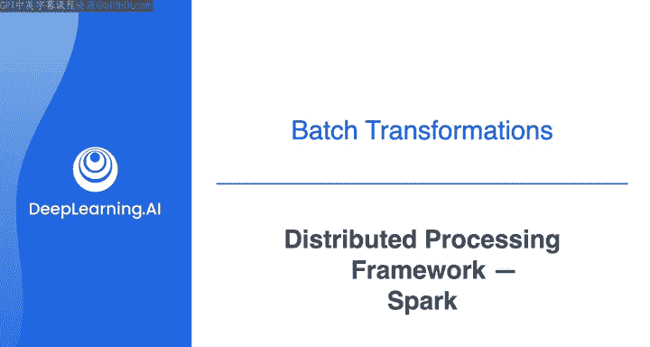
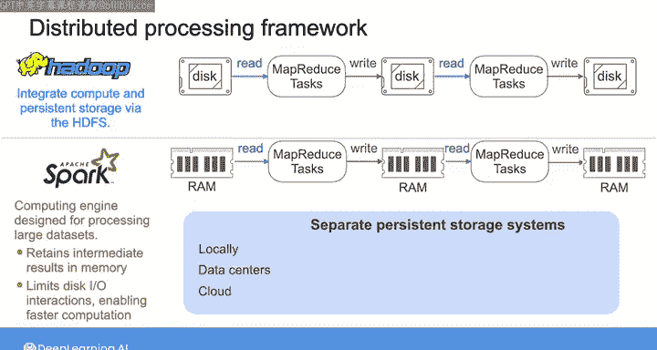
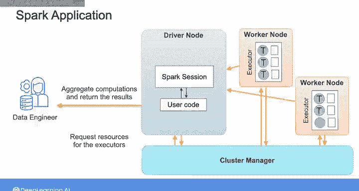

# 吴恩达《数据工程（数据建模、转换和服务）第4课，完结｜DeepLearning.AI Data Engineering》 - P26：25_分布式处理框架Spark.zh_en - GPT中英字幕课程资源 - BV13mtpe7ESt

To address the shortcomings of Hadoop Mareduce， researchers at UC Berkeley started the Spark project back in 2009。

 The goal was to come up with a distributed framework that borrows ideas from mapreduce。

 but is simpler and faster supporting in-meory storage for intermediate results and interactive processing of the data Spark has since evolved to support streaming processing as well as machine learning and graphing libraries and as new features are continuously being developed and added to this framework by the Apache Spark community。

 I think it's critical that you gain some experience with Spark unlike Hadoop which integrates compute and persistent storage via the Hadoop distributed file system Spark is just a computing engine designed for processing distributed large data sets with Spark you can perform parallel computations and retain intermediate results in memory which limits this out interactions enabling significantly faster computation than Hadoop Map Redd you can use Spk locally in data centers or in the cloud you can load data from and store the final results on separate persistent storage systems such as relational or。

keyvalue databases， object storage or even Hadoop file system Spark provides a unified platform that allows you to run different types of analytical workloads as self-contained Spar applications on one processing engine For example。

 you can use Sp to perform SQL queries to load data train and test machine learning algorithms and apply streaming transformations on your data over the same computation engine you can write your workloads in Python Java Sca and R using Spk core Apis Spark also offers built in libraries such as SparksQL for writing SQL queries。

 Mllib for machine learning applications， Spark structured streaming for interacting with real-time data and Gs for graph processing beyond these standard libraries you can also use external thirdpart libraries published and maintain by the open source communities these include connectors that allow you to connect to a variety of external data sources and storage systems monitor performance and much more Let's zoom in on the underlying components of a Sp application and see how they work together to。

As your code a Spark application consists of a cluster of nodes， it has a driver node。

 which is the central controller of a Spar application。

 a cluster manager node which communicates with the driver to allocate computational and memory resources across a cluster and manage these resources and a set of worker nodes where each node contains a Spark executeecutor that executes tasks assigned to them by the driver Spark applies a partitioning scheme to break up the data into partitions when loading it from disk and allocates to each Spark Executor。

 the partitions that are closest to it in the network so each executecutor's CPU core gets a partition of data to work on when you write a Spar application you start by instantiating a Sp session object that represents a single unified entry point to all Sps functionality through the entry you can define data frames read data from sources and perform SQL queries the driver node translates the instructions you wrote。

 which could be in Python， Sca or another language into Spk jobs which will be executed one by one based on the job。

priority to do this， the driver transforms each job into a sequence of stages and represents these stages as a dag。

 for example， this job here has three stages and is represented with this da so each dag is sort of like the execution plan for the corresponding job each stage is further broken down into tasks written in spark code that can run in parallel here St1 has four tasks that run in parallel and stages2 and3 each have three tasks that can also run in parallel you'll run stages that have shared dependencies serially and run those without dependencies in parallel for example in this dag stages2 and3 depend on the results of stage1 so they can't start until stage1 is done but stages2 and3 don't have any shared dependencies and can be run in parallel so to execute this job Spark will start with stage1 and run all four tasks in parallel Once these tasks are done St2 and3 will both start and the three tasks in each stage will run in parallel Re to our Spar application once the dag。

Exution plan is developed。 The driver communicates with a cluster manager to request computational and memory resources for the executors。

 Each task is assigned to a single core within an executor and each executor works on a single data partition the executor executes the task and communicates the computation results back to the driver node and finally the driver node aggregates these computations and returns the results back to you when interacting with Spark。

 you don't need to worry about all these underlying details so whether you write your application using your favorite programming language or using any of the standard libraries behind the scenes。

 your code will be decompposed and tasks and assigned across the Spark Executors there's a lot we can cover with Spark but I want to focus on Pypark which is the Python API for Apache Spk Pypark supports all Spk features including SpsQL Spark data frames。

 machine learning and structured streaming in the lab you'll work with structured data using Spark data frames and SparkSL So in the next video I'll show you how to create and work with Spark data。

In the video after that， we'll go over Sk' SQL。