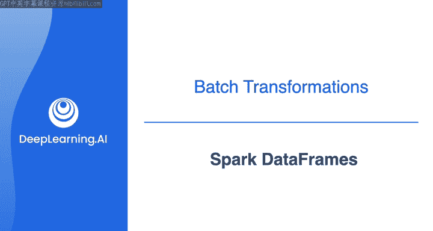
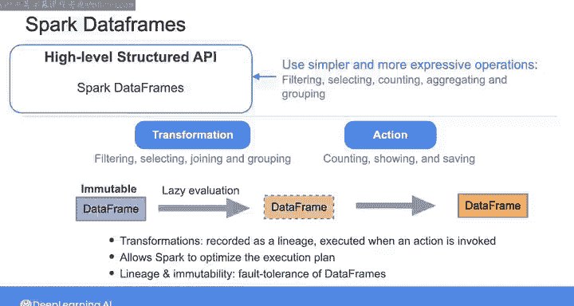

# 吴恩达《数据工程（数据建模、转换和服务）第4课，完结｜DeepLearning.AI Data Engineering》 - P27：26_Spark数据框.zh_en - GPT中英字幕课程资源 - BV13mtpe7ESt

Last week you perform simple transformations on a small tabular customer churn data using panda's data frames with Spark data frames。

 you can work with much larger tabular dataset sets that are distributed across Spark executeecutors behind the scenes。

 but Spark abstracts these details for you so you can view and interact through data as if it were a single table Spark data frames are actually built on top of the low-level data structure called resilient distributed data or RDD。

 which represents the actual partition collection of records that can be operated on in parallel to work directly with RDDs。

 you would need to manually define and optimize all the operations you want to perform on your data。

 but with Spark data frames you can interact with the data using simpler and more expressive high-level operations such as filtering selecting。

 counting， aggregating and grouping， and Spark will compile these operations down to the RDD level behind the scenes Spark data frames and the underlying RDD are both considered to be immutable data structures which is what makes them resilient in other words fault tolerant。

He can classify the operations on distributed data into two types transformations and actions transformations such as filtering。

 selecting， joining and grouping create new data frames from existing ones without modifying the original data This is why data frames and theyre underlying RDDs are considered immutable actions such as count。

 show and save， trigger the execution of these transformations In fact。

 allpark transformations are evaluated lazily， meaning that they are not executed immediately。

 instead they're recorded as a lineage and only executed when an action is invoked this lazy evaluation allows Spark to optimize the execution plan by rearranging transformation operations for efficiency。

 Moreover， the lineage and immutability properties ensure fault tolerance because these properties allow you to reproduce an original state in the event of failures In the next video I'll give you a quick demo of Pipar data frames and show you some of the common data frame operations you can perform。

When working with data in Apache Spark， I'll see you there。

