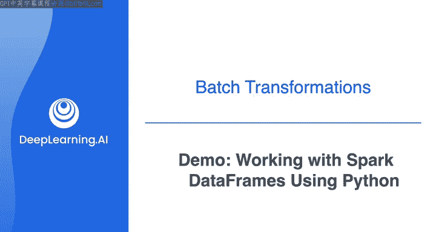
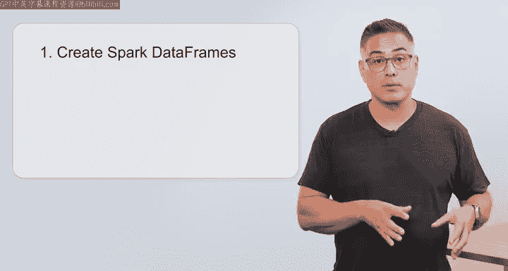
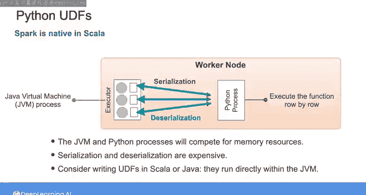

# 吴恩达《数据工程（数据建模、转换和服务）第4课，完结｜DeepLearning.AI Data Engineering》 - P28：27_演示：使用Python处理Spark数据框.zh_en - GPT中英字幕课程资源 - BV13mtpe7ESt

Let's take a look at some basic operations you can use to create sparkark data frames。

 manipulate existing data frames， clean data， aggregate data and define your own functions for working with data frames For this demo I'll use this Pip install command to install Piypark locally in the lab you' will be provided with a Spark cluster running inside a Docker container and I've included links in the additional resource section at the end of this week to show you how you can download the full version of Spark Next let's install another library called Find Spark which will automatically add Pipark to the systems path during runtime so that your system knows where to find Spark I'll import both the Pipark and Find Spark packages and then I'll initialized Find Spark。

Before you can create a Spark data frame， you need to create a Spark session which works as the entry point for working with Spark data frames。

 so from Piypark。sqL let's import the Spark session class。

 then I'll create a Spark session with the name example by calling this get or create method。

 this method will get an existing Spark session with the name example if it exists or it will create a new one。

Here are the details of the session。 you can see the version number of the Spark session and that its name is indeed example。

 Now let's create a data frame。 You can do this manually or you can import data from external data sources。

 let's say you want to manually create a data frame that holds a data from this order details table I'll create a data frame called orders Df by specifying the Spar session object that I created from before and then calling the create data frame method on it。

 This method expects two arguments。 The first argument is the data which I'll provide as a list of topples each consisting of the data from one row the second argument is the schema so I'll specify the name and the type of each column you can use the show method to view the rows of the data frame。

Let's say instead you want to create a data frame by reading data from a CSV file that contains transaction data of an online retail store。

 let's create another data frame called transactions Df that uses the same sparkk session object as before but this time it calls the read。

cv method specifying the name of the CSV file in indicating that the data contains a header you can view the first five rows of the data by calling the show method with n equals5 Now let's say you only care about some of the columns in the seta frame you can first use the columns command to view all the column names and then select only the columns you want by using the select method so here I'll select only the price quantity and country columns and then I'll use a show method to view the first five rows of these three columns if you want to quickly explore the contents of these columns you can use theDe method to compute basic summary statistics for each column including the value count mean standard deviation。

and maxs of each column like you see here Next let's take a look at how you can manipulate data frames。

 such as adding updating， renaming or removing a column from an existing data frame say you want to create a new column that represents the amount paid for each product you can call the with column method then specify the name of this new column which I'll call amount and the values for this new column which I'll get by multiplying the price and quantity columns from the existing data frame Spark checks if the amount column already exists in the data frame and if it does and then it will replace this column with the new values and if this column does not exist then it will create a new column with these values remember that sparkark data frames are immutable so this method actually returns a new data frame but I can assign this new data frame back to the same transactions Df variable you can verify that this new column was indeed added by calling the show method。

Next let's rename the invoice column to ID for that I'll call the with column renamed method and specify that the name of the existing column is invoice and that the new column name should be ID and finally let's remove the description column。

 I'll call the drop method and specify the name of the column that I want to remove。

In terms of cleaning your data in a data frame， you can easily remove the rows that contain null values by calling the dropN method you can also call the filter method to remove rows based on Boolean conditions For example。

 let's say that the quantity column contains some negative values and youll only want to consider the rows that contain positive values you can call the filter method and provide it with a condition where the quantity column must be greater than zero that way you'll only get the rows that don't contain null values and contain positive quantity values Next let's take a look at some aggregation operations on data frames For example。

 suppose you want to find the total amount spent on each order first I'll use the groupby method to group the rows by the order ID Next I'll sum up the amount column to get the total amount for each order ID I'll call the show method to view the results。

As another example， let's count the total number of rows for each country and order the count in descending order。

 again I'll call the group by method to group the rows by country and then I'll call the count method to sort the results。

 I'll call the order by method to order by the count and specify false for sendinging so that the results are sorted in descending order。

While Spark provides lots of built-in functionalities that you can find in the documentation。

 it also supports user defineded functions or UDFs。 For example。

 let's say you want to convert all the country names to uppercase you can define a function called to upper that takes in a string and returns a string in uppercase then you need to wrap this function in a UDF object to do so let's import the UDF class from Pipark SQL functions then I'll instantiate a UDF object called UDF to upper specifying the function that I just defined along with its return type now I'll select the ID column and the country column and apply the UDF to upper object to the country column。

You can see that all entries in the country column have now been transformed to uppercase strings alternatively。

 instead of wrapping the function you defined inside a UDF object。

 you can add this UDF decorator with the return type inside the brackets you can then directly apply the two upper function to the country column again remember that S data frames are immutable so with the UDF you actually created a new data frame that has a country column in uppercase let's replace the country column in the transaction data frame with a column containing the values in uppercase I'll call the with column method and specify that I want to replace the values in the country column with their uppercase values and here's the new transaction data frame。

Now that you've seen how Python UDFs work you should be careful when working with these functions。

 This is because Spark is native in Scala and each executor in the worker node is a Java virtual machine or JVM process that hosts a partition of data when you use Python UDFs Spark starts a separate Python process inside the worker node and requires data transfer from the JVM for the data to be processed by Python Spark serializes it to a format that Python can understand the Python process then executes the function row by row on that data and finally returns the result of the row operations to the JVM This process is not efficient since the JVM and Python process will compete for memory resources and is expensive to serialize and desseialize the data for better performance。

 you should consider rewriting Python UDFs in Sca or Java because these functions will run directly within the JVM and the good news is that after you register these UDFs in Spark you can still use them in Python So that was a quick overview of the basic operation。

You can do with Spark data frames。 join me in the next video to see how you can issue SQL queries with SparkSQL。

