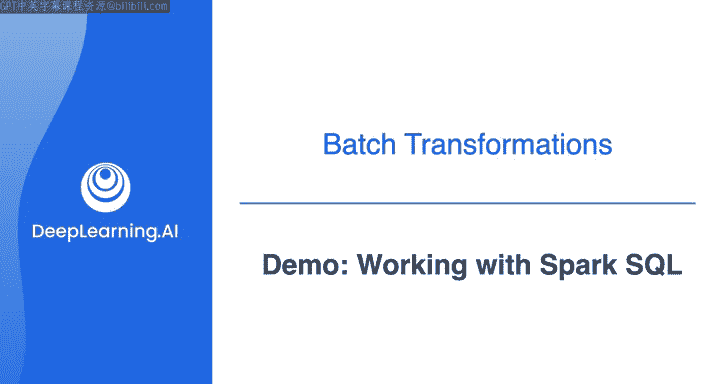
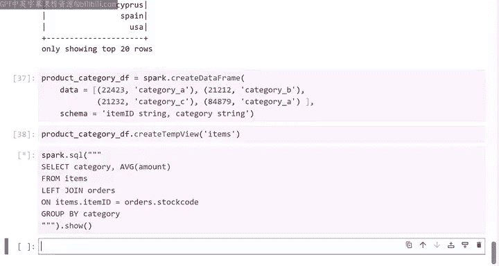

# 吴恩达《数据工程（数据建模、转换和服务）第4课，完结｜DeepLearning.AI Data Engineering》 - P29：28_演示：使用Spark SQL.zh_en - GPT中英字幕课程资源 - BV13mtpe7ESt

In the previous video， you saw how you can use Spark data frames to explore and process your data using Python code。

In this video you'll learn how you can also write SQL code to interact with the same data when working with Pypark。

 you can choose to manipulate your data using SQL code。

 Python code or a mix of both both types of code will run on the same computation engine and will compile to the same lowlel code here we have the same Jupyter notebook that you saw in the previous video and here's the transaction data frame we ended up with to issue SQL queries to interact with this data you need to create a temporary view from the data frame a temporary view is a virtual table that doesn't actually hold the data it persists as long as the Spar session is running and provides an interface for you to work with the table data using SQL code so here I'll call the create or replace tempemp View method on the transaction data frame to create a temporary view called orders。

Now you can initial SQLqueries on this temporary orders table using the Spar session object。

 you can call the SQL method and specify the SQL query as a string inside the brackets。

 this method will return a data frame representing the results of the query， for example。

 let's say you want to find the total amount spent on each order。

 I'll select the ID and the sum of the amount column which I'll rename as total。

From the orders table。And group by the ID。And then I'll order the results in descending order。

Here's the return data frame you can see the total amount spent in descending order you can also define your own function and use it inside the SQL query when working with data frames。

 you saw that you need to either wrap your function inside a UDF object or use the UDF decorator with SQLqueries you need to register your function as an example let's write a function called two lower that transforms a word into lowercase letters to register this function。

 or'll call the register method using the Spar session object then for the first argument I'll specify a name for the function which I'm calling UDF2 lower and then I'll pass in the function itself as a second argument Now using the name of this function you can use it inside the SQL query for example you can select the distinct countries from the orders table and apply this UDF to lower function on the country column。

You can also create more than one view， meaning more than one virtual table and join them in a SQL query。

 for example， let's first create another data frame called product category DF that contains the code and the category of three products。

 then using the data frame I create another temporary view called items。Then in the SQL query。

 I'll join the order table from before with this new items table to find the average amount for each category。

 so I'll select the category and the average amount。From the items table。

 left joined with the orders table based on the item ID from the items table and the stock code from the orders table。

 and then I'll group by the category so I can find the average order amount per category。

So that's a quick overview of how you can issue SQLqueries to interact with data using Piys Spk。

 but now it's your turn to practice in the next lab you'll use Piypark to transform your data into a star schema using the same data you saw off in the first week of this course。

 but before that in the next video Morgan will share more details on Amazon EMR。

 which you'll use to run Piy Spk in the lab after you finish the lab we'll dive into the technical considerations for transforming your data。

